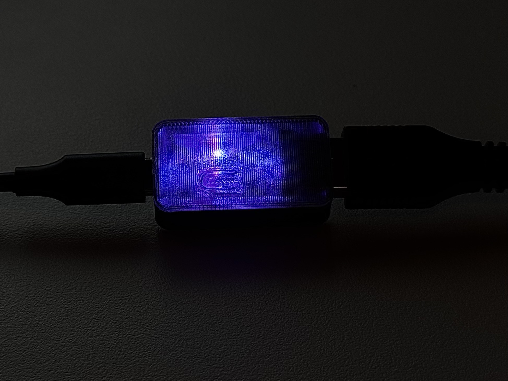
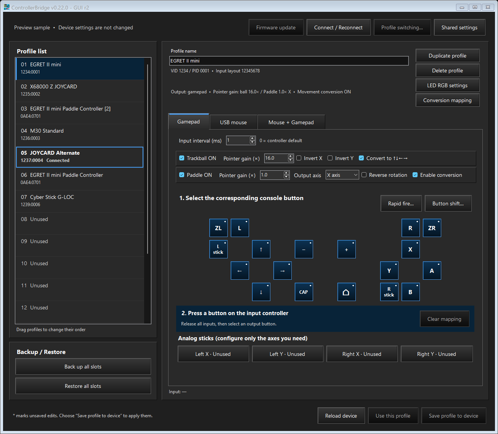

# ControllerBridge

[English](README.md) | [日本語](README.ja.md)

- パドル、トラックボール、フライトスティックなど、幅広いコントローラーに対応。
- 操作や設定を自由にカスタマイズ。
- マウスとゲームパッドの同時出力。
- シフトボタンで表／裏のボタン割り当てを切り替え。
- ボタンごとに、毎秒1回刻みで連射速度を設定。
- マウス、トラックボール、パドルの移動を任意のボタン入力に変換。
- 仮想ローリングスイッチモード。
- 1 ms以内の内部入力処理。
- 入力ポーリング間隔を設定可能（1～255 ms）。
- デバイスに最大16個のプロファイルを保存し、接続機器の自動判別とショートカットによる切り替えに対応。
- プロファイルごとにRGB LEDの色を自由に設定。
- 設定後はデバイスだけで動作し、プレイ中のPC接続は不要。
- プロファイルのバックアップと復元。

## 概要

ControllerBridgeは、USBコントローラーの入力をSwitch互換ゲームパッドとマウスの入力に変換します。改造不要の **Waveshare RP2350-USB-A** 基板で動作します。入力コントローラーをUSB-Aへ接続し、USB-Cを設定時はWindows PCへ、プレイ時はSwitch 2へ接続します。

[](docs/case.md)

標準基板用ケースには、光を拡散するフィンを備えた透明PETG製のふたを使用します。[ケースの紹介、作例写真、STLダウンロード](docs/case.md)を参照してください。このケースは、[barrenechea氏のWaveshare RP2350-USB-A Case](https://www.printables.com/model/1261378-waveshare-rp2350-usb-a-case)を改変したもので、[CC BY 4.0](https://creativecommons.org/licenses/by/4.0/)で提供しています。

## 現在のリリース

**現在の開発版：v0.22.0 - GUI r2（ファームウェア0.22.0）。** アプリは日本語のWindowsでは日本語、それ以外では英語で表示します。このREADMEには英語版と日本語版があります。詳細ドキュメントと参照用の画面画像は英語です。プロファイル名は入力した文字列のまま表示します。

**GUI r2：** Trackballのクリック変換モード名を **Virtual Cursor** に変更し、方向変換の割り当てと共通設定の案内を揃えました。Paddleは **Virtual Rolling** のままです。名称のみの変更で、動作や保存済み設定は変わりません。

**0.22.0の設定画面：** 共通設定をクリック変換、TrackballのHold、PaddleのVirtual Rollingにグループ化し、疑似慣性はHold内にまとめました。方向変換の割り当てでは冗長な説明を削除しました。「デバイスに保存」と「編集に反映」は未編集時にグレー表示となり、変更すると有効、開始時の値へ戻すと再び無効になります。 「方向変換の割り当て」は右側のプロファイル操作ボタン群に揃えました。削除確認には、未保存の変更をデバイスへ反映するまでリストをドラッグできない旨を表示します。基板を指す画面上の呼称は「デバイス」に統一しました。 プロファイルのメイン画面では、トラックボールとパドルを別々の立体枠で囲み、各入力のON／OFF・感度・反転・変換設定をまとめました。

**ファームウェア0.20.18：** USBマウスの移動処理を専用経路へ分離しました。ポインター感度、反転、パドル出力軸、クリック、連射を維持し、ゲームパッド変換用の状態処理を通りません。ゲームパッドと同時出力では従来の変換処理を使います。[検証結果とメモリ使用量](docs/verification.md)を参照してください。

**0.20.21：** Elite Series 2のGIP初期化がタイムアウトした場合、追加の自動復帰を一度だけ試みます。初期化成功後は最初の操作データを受信するまでシアン点滅になり、無操作で待っていることだけを理由に再接続しません。既存のプロファイルと設定は保持します。[MS-GIPUSBの起動とLED表示](docs/xbox-one-input.md)を参照してください。

**0.20.20：** MS-GIPUSB系統（有線Xbox One系コントローラー）の入力に対応しました。独立したXboxボタンとEliteの背面パドルも入力フィールドとして扱います。Elite Series 2では入力と、基板の再起動・ファームウェア更新後の復帰を確認しました。USB接続後、**Add controller** で割り当てを登録してください。マウスモードの変換フラグ保持も継続します。他機種および実機Switch・ゲーム上の動作は未検証です。[MS-GIPUSB入力](docs/xbox-one-input.md)を参照してください。

**0.20.19：** USBマウスへ切り替えても、トラックボールとパドルのキー変換フラグを保持し、ON／OFFをそのままグレー表示します。このモードでは変換を実行しません。ゲームパッドまたはマウス＋ゲームパッドへ戻すと、保持した設定で変換を再開します。保存・再読込でも保持するため、対応する0.22.0ファームウェアを使用してください。ポインター設定は引き続き変更できます。

**以前のGUI修正：** マウスUDLR設定でモードを切り替えた際に、文字が重なって表示される問題を修正しました。パドルのVirtual Rollingでは、項目名を「出力先アナログスティック」、説明文を「パドルの仮想角度をアナログ軸の傾きに変換します。」に変更しました。

**0.22.0：方向変換をプロファイル別にしました。** 各プロファイルの **方向変換の割り当て** で、Trackballの4方向、Paddleの負・正2方向、両方の変換モード、Virtual Rollingの出力先・反転・回転刻みを設定します。**編集に反映** の後に **プロファイルをデバイスに保存** すると適用されます。Paddleの負・正の割り当ては、ポインターのX/Y出力軸を変えても維持します。回転刻みは5°／10°／15°／20°／30°／40°／45°／60°／90°、初期値30°です。

上部の **共通設定** では、クリックのしきい値（初期値64 pt）、押下時間（30 ms）、待機時間（20 ms）、Holdのしきい値（1 pt）、**疑似慣性の発生値8 pt/20 ms・減衰率0.90・減衰間隔100 ms**、回転感度（1.0°/pt）を全プロファイル共通で調整します。有効／無効は各プロファイルの **方向変換の割り当て → Trackball → Hold → 疑似慣性を有効にする** で設定します。初期値・旧データ変換時は無効です。共通設定の保存は、編集中のプロファイルを保存しません。

各軸の直近20 msの移動量が発生値を超えると慣性を発生させます。小さな入力は慣性を追加せず、発生済みの量を周期ごとに0.90倍にし、8以下で終了します。最大持続時間はありません。開始量14～15では600 ms、16では700 ms、36では約1.5秒です。逆方向への有効入力はその軸の慣性を打ち切ります。Holdは押下／解放の二値出力のため、減衰するのは保持時間を決める内部量です。ゲーム上の移動速度はゲーム側のキーリピートにも依存します。

デバイスの旧v5/v6設定とJSON v2/v3を変換できます。旧版では共通だった割り当て・モード・回転刻みを各プロファイルへコピーし、Paddleは従来使用していたX軸の左右またはY軸の上下を負・正へ引き継ぎます。シフトキーは最大3個となり、旧設定の4個目だけを削除します。先頭3個とシフト後の割り当て・連射を保持します。旧JSONに共通設定は含まれないため、接続中のデバイスに残る移行用設定、または未接続時の標準値で補完し、取込み時に通知します。保存前に変換結果を確認してください。新形式はプロファイル／バンクv8、JSON v5です。旧ファームウェアへ戻す場合は更新前のバックアップが必要です。

ポインター感度はTrackball 1.0～256.0倍（初期値16.0）、Paddle 1.0～10.0倍（初期値1.0）を維持します。ポインターの感度・反転・Paddle出力軸も引き続きプロファイル別です。マウス＋ゲームパッドでは変換とポインター移動を併用し、USBマウス単独では変換設定を保持したまま変換を停止します。連射は毎秒1～60回（有効化時の初期値20）です。[操作ガイド](docs/configurator-guide.md#conversion-mapping-and-shared-settings)を参照してください。



## クイックスタート

1. 基板のUSB-CポートをWindows PCへ接続し、`ControllerBridge.exe` を起動します。Windows x64用ランタイムと対応するファームウェアを同梱しているため、.NETの別途インストールは不要です。
2. ファームウェアの自動案内が表示された場合はそれに従うか、**Firmware update** を選びます。初回インストールでは、ダイアログが直ちにBOOTを押した状態での再接続待ちに入り、**Cancel** だけを表示します。BOOTを押しながらUSB-Cをつなぎ直すと、検出後に最終の上書き確認が開きます。**Yes** を選ぶと、同梱ファームウェアを転送し、再起動後にバージョンを確認します。
3. 入力コントローラーをUSB-Aへ直接接続します。
4. 対応するプロファイルがないコントローラーでは、最初の空きスロットを自動選択します。**Add controller** を選び、機器を確認し、入力の割り当てと必要な軸の設定を行って保存します。
5. USB-CをSwitch 2へつなぎ替えます。PCなしで、接続機器に対応する保存済みプロファイルをデバイスが選びます。

設定アプリは同時に1つだけ起動できます。使用中は、ほかのブリッジ設定ツールを閉じてください。**Firmware update** は、動作中のバージョンと同梱バージョンが一致するかどうかだけを比較します。一致すれば書き込まずに終了し、異なれば確認が必要です。バージョン照会コマンドがないファームウェアでは、BOOT接続と上書き確認の手順に進みます。[ファームウェア更新ガイド](docs/firmware-update.md)を参照してください。

起動時とバックグラウンドでの機器検出時には、設定を読む前にファームウェアを確認します。Pico SDK USB（`2E8A:0009`）として認識される工場出荷状態のRP2350-USB-A、RP2350 BOOTモード（`2E8A:000F`）の基板、または検出できてもバージョンを読み取れないブリッジでは、**Device unsupported** と表示し、ファームウェアのインストール案内を自動で開きます。バージョンを読み取れ、同梱版と異なる場合は更新案内を開きます。認識対象の基板がない場合は **Device not connected** と表示し、案内は開きません。待機をキャンセルしたり、最後の確認で上書きを断ったりした場合は、未対応の状態表示を維持し、同じ接続中に案内を繰り返しません。切断を検出すると、次の接続時には再び案内を行います。バックグラウンドの再試行では編集中の内容を保持し、編集画面の無効化や再描画を繰り返しません。手動インストールや、上記以外のUSB識別情報を持つ機器には、引き続き **Firmware update** を使用できます。

新しい入力機器を検出しても、登録確認を開いたり、設定を書き込んだりすることはありません。スロットの自動選択は接続ごとに1回だけ行うため、その後の手動選択は維持されます。未保存の編集やモーダル操作がある場合は、選択の移動を保留します。全スロットが埋まっていて対応するプロファイルがない場合にだけ、操作を妨げない空きスロット不足のメッセージを表示します。未保存のプロファイルや削除待ちのスロットは保護します。0.19.0以降の新規登録では、転送開始時と確定時の両方で、元の入力機器の接続と保存先が空いていることを確認します。この保護を使うには、対応する同梱ファームウェアをインストールしてください。

このリリースでは、押している間だけ切り替わるボタンシフトを追加しています。0.16.0～0.19.0の既存設定は、メインの割り当て、軸、ID、ショートカット、出力設定、LED色を保持し、シフトを無効にして新形式へ移行します。旧ファームウェアは新形式を読めないため、戻す可能性がある場合は更新前に全スロットをバックアップしてください。0.16.0より前の記録には引き続き未対応で、16個の未使用スロットから開始します。[ボタンシフト](docs/button-shift.md)を参照してください。

## プロファイルと出力

デバイスには**16スロット**を保存でき、1台のコントローラーに複数の設定を用意できます。各プロファイルは、機器の照合情報、名前と固定ID、割り当て、ボタンシフト、連射、入力間隔、マウス設定、出力方式、同時出力時のボタン動作、LED色を保存します。

- **Duplicate profile** は、選択位置より下にある最も近い未使用スロットへ複製し、保存名の末尾に重複しない `[2]`、`[3]` などを付けます。複製先のスロットを保存するとデバイスに記録されます。
- **Delete profile** は、そのスロットを保存したときに選択中の内容を消去します。
- **LED RGB settings** はDelete profileの下にあり、初期値の暗い青（0, 0, 1）か、0～255の正確なR/G/B値を指定できます。スロットを保存すると反映します。黒（0, 0, 0）は待機中のLEDを消灯しますが、状態通知は引き続き優先します。数値入力欄の下にある6桁のRGBコード欄は、先頭の#の有無にかかわらずWebカラーを受け付け、各色の値と同期します。プレビューには表示専用の固定ガンマ4.0を使い、保存するRGB値は変更しません。
- プロファイルをドラッグするか、`Alt+Up`／`Alt+Down` で保存済みスロットを並べ替えられます。移動が完了すると直ちに保存し、ID、ショートカット、選択設定も一緒に移動します。
- **Back up all slots** と **Restore all slots** は、バンク全体を1つのJSONファイルで扱います。現在のバックアップは `ControllerBridge.Slots`、JSONバージョン4です。バージョン2／3のバックアップと個別エクスポートを変換します。バージョン2にはシフト設定がなく、バージョン1は引き続き未対応です。
- 割り当て編集画面の **Button shift…** で、1～3個の物理キーを登録できます。すべてを押している間はボタンだけの裏ページに切り替わり、変更していない出力は表の割り当てを引き継ぎます。**Apply to draft** を選んでから、スロットを保存してください。4本のアナログ軸は共通のままです。シフトキー入力の扱い、再割り当て、ショートカットの規則は[シフトガイド](docs/button-shift.md)を参照してください。
- **共通設定** ではしきい値・時間・感度・疑似慣性の調整値をデバイスへ保存します。変換先・モード・回転刻み・疑似慣性の有効／無効は各プロファイルの **方向変換の割り当て** で編集します。[設定方法](docs/configurator-guide.md#conversion-mapping-and-shared-settings)を参照してください。
- **Profile switching...** で、約1秒のBOOT長押し、またはコントローラーのショートカットを設定できます。選択したプロファイルは再接続後も保持します。

出力タブを選ぶと、プロファイルの設定を編集します。**Save profile to device** で保存してください。リストを選ぶだけではデバイスで使用中のプロファイルは変わらず、**Use this profile** で接続機器に対応する別の保存済みプロファイルを有効にします。

| 出力タブ | 動作 |
|---|---|
| Gamepad | ボタン、方向、スティック軸をSwitch互換ゲームパッドとして出力 |
| USB mouse | 相対移動とマウスボタンを出力 |
| Mouse + Gamepad | マウスとゲームパッドを別々のHIDインターフェースで出力 |

同時出力タブにだけ、**Button behavior: Mouse / Controller** を表示します。Mouseでは左右クリックとゲームパッドのMinus／Plus／HOMEを送ります。Controllerでは割り当てたゲームパッド操作をすべて送り、マウス側では移動を送ります。USBの構成が変わる場合は、USB-A側の入力ホストを動かしたままUSB-C側を再接続します。

EGRET II mini Paddle Controllerでは、トラックボールとパドルを個別に有効にできます。トラックボール感度は1.0～256.0倍、初期値16.0倍です。パドル感度は1.0～10.0倍、初期値1.0倍です。いずれも0.1刻みです。入力間隔 `0` はコントローラーの記述子にある標準値を使用し、`1`～`255` は要求間隔をミリ秒単位で指定します。たとえば `1` なら1ミリ秒ごとに入力を要求します。NAKが返る場合もあるため、要求頻度と新しいデータが届く頻度は同じではありません。

内部入力処理とは、デバイスが入力を受け取ってから出力を準備するまでの処理を指します。コントローラー内部のスキャン、USBポーリングの待ち時間、ゲーム側の処理、表示遅延は含みません。

## ドキュメントと対応範囲

まずは[ユーザーガイド](docs/configurator-guide.md)を参照してください。[ドキュメント一覧](docs/README.md)からは、現在の保存形式・プロトコルのリファレンス、GPIOの移植手順、LEDの動作、対応上の制限、検証結果も参照できます。

標準の入力経路は、直接接続した1台のFull Speed機器、4つのHIDインターフェース、8つのINエンドポイント、64バイトの入力パケット、256個の観測フィールドに対応します。USBハブ、Bluetooth、Low Speed／High Speed、HID Array型入力、任意のベンダー独自初期化は対応範囲外です。

EGRETコントローラー、X68000 Z JOYCARD、有線接続のM30のSwitch互換入力は確認済みです。Cyber Stickの入力は観測済みですが、個別ゲームでのアナログ操作は未検証です。Xbox 360形式の入力処理は実装済みですが、実機からの入力は未検証です。同時出力の動作は、ゲーム側のプレイヤー割り当てに左右される場合があります。**コンバットスクールでの移動速度の問題は未解決です。** [対応範囲と制限](docs/compatibility.md)を参照してください。

## ソース構成

| パス | 役割 |
|---|---|
| `lib/controller_usb` | PIO USBホスト、列挙、入力プロトコル、HIDデコード |
| `lib/controller_device` | RP2350内蔵USBデバイス、ゲームパッド／マウス出力、Feature転送 |
| `lib/controller_bridge` | 割り当て、キュー、プロファイル、保存、切り替え、測定 |
| `apps/egret_switch` | 通常のブリッジファームウェアと状態表示LED |
| `gui/ControllerBridge` | ControllerBridgeのWinFormsアプリ |
| `boards` | 基板定義。アプリケーション側のピン定数は[GPIOガイド](docs/gpio-assignment.md)を参照 |
| `hardware/case` | 印刷用ケースのSTLファイルとCC BY 4.0の帰属表示 |
| `tools` | 製品のビルドスクリプト |

コア1が入力を、コア0が割り当てと出力を処理します。通常のブリッジでは、入力に同梱のPico-PIO-USBを、出力にこのプロジェクト独自の内蔵USB実装を使います。TinyUSBは、別のCDC診断用ビルド対象でのみ使用します。

## ビルド

既存の固定済みPico SDK 2.1.1、Arm GCC 14.2.1、.NET 9 SDKを使用します。GUIの対象は `net9.0-windows` です。ビルドスクリプトは依存関係を確認し、システム全体の開発ツールのインストール、更新、変更は行いません。

```powershell
.\tools\build-firmware.ps1
.\tools\build-configurator.ps1 -Restore
```

設定アプリのビルドでは、通常のファームウェアもビルドし、そのUF2をSHA-256マニフェストとともに埋め込みます。出力は `build/ControllerBridge.uf2`、`dist/ControllerBridge.exe`、および手動復旧用の独立した `dist/ControllerBridge.uf2` です。GUIの依存関係をすでに復元済みなら、`-Restore` を省略できます。ファームウェアのツールは、既定で `%USERPROFILE%\.pico-sdk` を使います。別の既存インストール先を使う場合は、`-PicoSdkPath` と `-PicoToolsRoot` を指定してください。

## メモリ使用量

通常ファームウェアのバイナリとリンカーのセクション情報から算出した確保容量です。

| リソース | 使用量または予約量 | 残り |
|---|---:|---:|
| Flash：2,097,152バイト | コード・初期値119,788、永続保存領域49,152 | 1,928,212 |
| SRAM：532,480バイト | 静的データ156,296、スタック2本分8,192 | 367,992 |
| バンクのコピー1面：16,384バイト | データ13,908＋ヘッダー16 | 2,460 |
| 測定記録：4,096バイト | データ3,784＋ヘッダー16 | 296 |
| 共通設定：4,096バイト | 旧ヘッダー・データ56＋アラインメント8＋方向・モード記録164 | 3,868 |

静的SRAMの内訳は、ベクターテーブル272バイト、初期値ありデータ37,568バイト、BSS 118,456バイトです。最小ヒープ予約の2,048バイトは、SRAMの残容量に含まれます。これらは確保容量であり、スタックやヒープの実測ピーク値ではありません。プロファイルのサイズは848バイト、バンクのデータは13,908バイト、通常版UF2は239,616バイトです。

## リポジトリの内容とライセンス

`captures/` 内の診断出力、ビルド出力、リリースバイナリ、キャッシュはバージョン管理の対象外です。Pico-PIO-USBはGit履歴を除いて同梱し、記録済みのハッシュと照合します。

プロジェクトのコードは [BSD 2-Clause License](LICENSE) で提供しています。著作権表示は2026 HKey2です。サードパーティーのコードには、`third_party/` と `licenses/` にある各ライセンスが適用されます。改変したケースのSTLファイルには、別途 [CC BY 4.0](hardware/case/LICENSE.md) を適用し、原作者barrenechea氏への帰属を表示しています。
