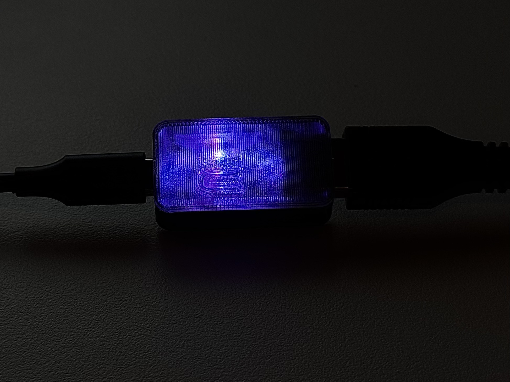
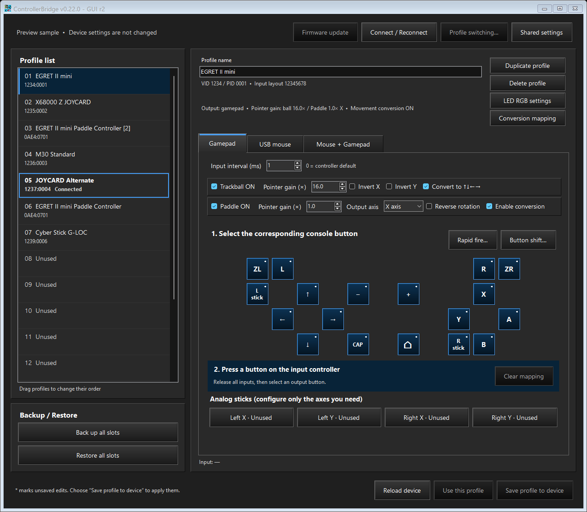

# ControllerBridge

[English](README.md) | [日本語](README.ja.md)

- Support for a wide range of controllers, including paddles, trackballs, and flight sticks.
- Fully customizable controls and settings.
- Combined mouse and gamepad output.
- Shift-button switching between primary and alternate button mappings.
- Per-button rapid fire, adjustable in one-press-per-second increments.
- Map mouse, trackball, and paddle movement to any button.
- Virtual rolling switch mode.
- Internal input processing within 1 ms.
- Configurable input polling interval (1–255 ms).
- Up to 16 onboard profiles, with automatic controller matching and shortcut switching.
- Customizable RGB LED colors for each profile.
- Standalone operation after setup—no PC required during play.
- Profile backup and restore.

## Overview

ControllerBridge turns USB controllers into Switch-compatible gamepad and mouse inputs using an unmodified **Waveshare RP2350-USB-A** board. Connect the input controller to USB-A and USB-C to a Windows PC for configuration, or to the Switch 2 for play.

[](docs/case.md)

The reference-board case uses a clear PETG lid with a light-diffusing fin. See the [case introduction, sample photos and STL downloads](docs/case.md). It is a remix of [barrenechea's Waveshare RP2350-USB-A Case](https://www.printables.com/model/1261378-waveshare-rp2350-usb-a-case), licensed under [CC BY 4.0](https://creativecommons.org/licenses/by/4.0/).

## Current release

**Current development release: v0.20.19 - GUI r6 (firmware 0.20.19).** The application uses Japanese on Japanese Windows and English otherwise. This README is available in English and Japanese. Detailed documentation and reference screenshots use English; profile names remain as entered.

**Firmware 0.20.18:** USB mouse uses a dedicated movement path, bypassing gamepad conversion state while preserving pointer gain, inversion, paddle axis, clicks and rapid fire. Gamepad and combined output retain their conversion behavior. See [implementation verification and memory](docs/verification.md).

**0.20.19 / GUI r6:** Selecting USB mouse retains both movement-to-gamepad conversion flags and shows their ON/OFF values in grey. Conversion is inactive in this mode. Returning to Gamepad or Mouse + Gamepad restores the retained settings. Saving and reloading also preserves them; install the matching 0.20.19 firmware. Pointer settings remain editable.

**Earlier GUI correction:** Fixed overlapping text when switching modes in Mouse UDLR settings. Clarified the Paddle Virtual Rolling label to **Output analog stick** and its description to **Converts the paddle's virtual angle into analog-axis tilt.**

Trackball pointer gain remains **1.0–256.0× (default 16.0)** and paddle pointer gain **1.0–10.0× (default 1.0)**, in 0.1 steps. Saved values are unchanged. The **Pointer gain (×)** fields remain editable while conversion is enabled. In **Mouse + Gamepad**, conversion adds gamepad output (clicks, held controls or paddle Virtual Rolling) while both pointer sources continue moving the mouse. No physical D-pad input or assignment is required. The original trackball click mode is now named **Virtual Rolling**; the new **Hold** mode is described below. Button-click conversion uses separate, hidden device-wide parameters, initially **6.0× for the trackball and 1.5× for the paddle**, stored independently of profile pointer gain. Enable **Convert to ↑↓←→** for the trackball, or **Enable conversion** for the paddle. In its default **Button clicks** mode, the paddle follows its X/Y output axis. Each signed source sum emits one press/release pair at the configured threshold (initially ±64), then clears and discards excess. **Mouse UDLR settings**, immediately right of **Profile switching...**, edits the device-wide **Movement threshold** (default **64 pt**, range **1–256**), **Hold time** (default **30 ms**, range **1–512**) and **Wait time** (default **20 ms**, range **1–512**). The **Trackball** and **Paddle** tabs each provide four drop-down lists in a D-pad arrangement, selecting independent Switch-side outputs for their movement directions. Their defaults are **↑ / ↓ / ← / →** respectively. Choices include all four directions and 14 Switch buttons, with no analog axes or Unassigned entry. Choosing A for the upper list makes upward movement send A. **Reset to defaults** restores only the four assignments on the displayed tab, retaining the other tab and all numeric values. Existing shared assignments are copied to both sources when upgrading from 0.20.12. Save writes the shared numeric settings, both source maps, both source modes and their parameters together and verifies them by reading back; all profiles share them. Hold time controls the pressed phase, and the independent wait time controls the released interval before the next click. Each phase starts at its corresponding successful USB completion. The dialog shows units beside the spinners without range labels. Cursor gains remain hidden. These defaults apply to newly initialized settings. Valid saved durations, including 16/16 ms, are retained. See [movement conversion](docs/configurator-guide.md#movement-to-d-pad).

**Trackball Hold** is available in **Mouse UDLR settings → Trackball → Mode**. Each valid movement report holds its assigned output while that axis's absolute movement is at least the dedicated **Movement threshold** (default **1 pt**, integer **1–127**). Zero or any subthreshold movement releases it; a sign reversal releases the old direction and holds the opposite one only if it meets the threshold. X/Y are independent, including diagonal holds. Existing four-direction assignments are retained in both modes. Hold uses raw per-report movement with profile X/Y inversion, without accumulation or gain scaling; the click threshold/hold/wait fields stay visible but disabled while this mode is displayed, retaining their values. Inactive parameters in either source tab are greyed out in place. Initial opening, tab/mode changes and save retries use the same enabled-state rules, so the tab and lower controls do not jump or clip. Upgrading preserves the old click behavior as Trackball Virtual Rolling. See [Hold setup and idle release](docs/configurator-guide.md#trackball-hold).

**Paddle Virtual Rolling** is available in **Mouse UDLR settings → Paddle → Mode**. It converts paddle movement into a full-strength left or right analog-stick direction in configurable **5°, 10°, 15°, 20°, 30°, 40°, 45°, 60° or 90° steps**. The default **30°** retains 12 positions; **5°** gives 72 positions and **90°** gives the four cardinal directions. All choices divide a full turn evenly. The initial internal direction is up; stopping centers the selected stick while retaining both angle and incomplete-step movement. Rotation sensitivity is **0.1–10.0° per input point** (default **1.0**), the default destination is **Right stick**, and rotation reversal is independent of pointer reversal. Changing the step aligns the retained angle to the nearest position of the new step and clears incomplete-step movement on the next nonzero paddle input. Ordinary stops retain both. Game restarts do not reset the angle; board startup does. Upgrading from 0.20.15 initializes only the new step to 30° and retains valid existing modes and parameters. Settings predating Virtual Rolling initialize Button clicks mode. See [Virtual Rolling setup and units](docs/configurator-guide.md#virtual-rolling).

Paddle rotation can be assigned per profile to **X (horizontal)** or **Y (vertical)** using the **Output axis** list in the mouse settings. Existing profiles remain X. Gain and rotation reversal apply to the selected axis; trackball movement retains its own X/Y settings. Install the matching 0.20.19 firmware, choose the axis, then **Save profile to device**. Profile and bank sizes are unchanged. See the [paddle settings](docs/configurator-guide.md#paddle-output-axis).

Rapid fire supports **1–60 press/release cycles per second**, with **20** as the starting value when enabling an output that was Off. Existing saved rates remain unchanged, and Off remains Off until enabled. The bundled firmware also supports this range. Profile and backup formats are unchanged.



## Quick start

1. Connect the board's USB-C port to Windows and run `ControllerBridge.exe`. It includes its Windows x64 runtime and matching firmware; no separate .NET installation is needed.
2. Follow the automatic firmware guide if it appears, or choose **Firmware update**. For first installation, the dialog immediately waits for reconnection with BOOT held and shows only **Cancel**. Reconnect USB-C while holding BOOT; detection opens the final overwrite confirmation. Choose **Yes** to transfer the bundled firmware and check its version after restart.
3. Connect the input controller directly to USB-A.
4. For a controller without a matching profile, the first available slot is selected automatically. Choose **Add controller**, confirm the device, map its inputs, configure any axes, and save.
5. Reconnect USB-C to the Switch 2. The board selects the matching saved profile without a PC.

Only one configurator instance can run. Close other bridge configuration tools while using it. **Firmware update** compares only whether the running version equals the bundled version. An equal version finishes without writing; a different version requires confirmation. Firmware without the version-query command follows the BOOT connection and overwrite-confirmation route. See the [firmware update guide](docs/firmware-update.md).

At startup and during background discovery, the tool checks firmware before reading settings. A factory-state RP2350-USB-A exposing Pico SDK USB (`2E8A:0009`), a board in RP2350 BOOT mode (`2E8A:000F`), or a detected bridge with no readable version shows **Device unsupported** and automatically opens the firmware installation guide. A readable different version opens the update guide. With no recognized board, the status is **Device not connected** and no guide opens. Cancelling the wait or declining the final confirmation keeps the unsupported status visible without repeating the guide during that connection; an observed disconnection rearms guidance for the next attachment. Background retries preserve drafts and do not repeatedly disable or repaint the editor. **Firmware update** remains available for manual installation or USB identities outside these recognized cases.

New input detection never opens a registration confirmation or writes settings. Selection happens once per attachment, so later manual browsing is preserved. Unsaved edits and modal operations defer the move. A full bank shows a nonmodal no-empty-slot message only when no matching profile exists. Slots with unsaved profiles or pending deletions are protected. Registration since 0.19.0 verifies the original input connection and empty destination at both transfer start and commit; install the matching bundled firmware to use this protection.

This release adds hold-to-shift button mappings. Existing 0.16.0–0.19.0 settings migrate to the new format with shift disabled, preserving the main mappings, axes, IDs, shortcuts, output settings and LED colors. Back up all slots before updating if you may need to return to older firmware: old firmware cannot read the new format. Pre-0.16.0 records remain unsupported and start with 16 unused slots. See [button shift](docs/button-shift.md).

## Profiles and output

The board stores **16 slots**, including multiple settings for one controller. Each profile stores matching information, a name and stable ID, mappings, button shift, rapid fire, input interval, mouse settings, output mode, combined-mode button behavior, and LED color.

- **Duplicate profile** copies into the closest unused slot below the selection and appends an available `[2]`, `[3]`, etc. to its stored name. Save the new slot to persist it.
- **Delete profile** clears the selected slot when you save it.
- **LED RGB settings**, below Delete profile, selects the default dim blue (0, 0, 1) or exact R/G/B values from 0 to 255. Save the slot to apply it. Black (0, 0, 0) turns the ready LED off; status notifications still take priority. A six-digit RGB code field below the spinners accepts web colors with or without a leading # and stays synchronized with the channels. The preview uses a fixed display-only gamma of 4.0; saved RGB values remain exact.
- Drag a profile, or use `Alt+Up` / `Alt+Down`, to reorder saved slots. Completed moves save immediately and carry IDs, shortcuts, and selections with them.
- **Back up all slots** and **Restore all slots** handle the whole bank in one JSON file. Current backups use `ControllerBridge.Slots`, JSON version 3. Version-2 backups and individual exports are imported with shift disabled; version 1 remains unsupported.
- **Button shift…**, in the mapping editor, learns one to four physical keys. Holding all keys activates a button-only shifted page; unchanged outputs inherit the main mapping. Choose **Apply to draft**, then save the slot. All four axes stay common. See the [shift guide](docs/button-shift.md) for consumption, remapping and shortcut rules.
- **Mouse UDLR settings** opens the shared movement-threshold/hold-time/wait-time and direction-assignment and conversion-mode dialog. Choose **Save to device** to apply and persist it independently of any unsaved profile edits. See [settings](docs/configurator-guide.md#mouse-udlr-settings).
- **Profile switching...** configures a roughly one-second BOOT hold or a controller shortcut. The selected profile is retained across reconnections.

Selecting an output tab edits the profile. Choose **Save profile to device** to persist it. Browsing the list does not change the active device profile; **Use this profile** activates another matching saved profile.

| Output tab | Behavior |
|---|---|
| Gamepad | Buttons, directions, and stick axes as a Switch-compatible gamepad |
| USB mouse | Relative movement and mouse buttons |
| Mouse + Gamepad | Separate mouse and gamepad HID interfaces |

Only the combined tab offers **Button behavior: Mouse / Controller**. Mouse behavior sends left/right clicks and gamepad Minus/Plus/HOME. Controller behavior sends all mapped gamepad controls while the mouse supplies movement. A USB layout change reconnects USB-C while the USB-A input host continues running.

For the EGRET II mini Paddle Controller, trackball and paddle can be enabled independently. Trackball gain is 1.0-256.0, default 16.0; paddle gain is 1.0-10.0, default 1.0, both in 0.1 steps. Input interval `0` uses the controller descriptor; `1`–`255` sets the requested interval in milliseconds. For example, `1` requests input every millisecond. NAK responses mean request rate is not the same as fresh data rate.

Internal input processing refers to the bridge's work between receiving input and preparing output. It excludes controller scanning, USB polling waits, game processing, and display latency.

## Documentation and compatibility

Start with the [user guide](docs/configurator-guide.md). The [documentation index](docs/README.md) also links the current storage/protocol reference, GPIO porting instructions, LED behavior, compatibility limits, and verification results.

The standard input path supports one directly connected Full Speed device, four HID interfaces, eight IN endpoints, 64-byte input packets, and 256 observed fields. Hubs, Bluetooth, Low Speed/High Speed, HID array inputs, Xbox One, and arbitrary vendor initialization are outside the supported scope.

EGRET controls, X68000 Z JOYCARD controls, and wired M30 Switch-compatible input have been tested. Cyber Stick input has been observed, but game-specific analog play remains unverified. The Xbox 360-format backend is implemented without physical-input verification. Combined output can depend on the game's player assignment. **Combat School movement speed remains unresolved.** See [compatibility and limits](docs/compatibility.md).

## Source layout

| Path | Responsibility |
|---|---|
| `lib/controller_usb` | PIO USB host, enumeration, input protocols, HID decoding |
| `lib/controller_device` | Native RP2350 USB device, gamepad/mouse output and Feature transport |
| `lib/controller_bridge` | Mapping, queues, profiles, storage, switching, measurements |
| `apps/egret_switch` | Normal bridge firmware and status LED |
| `gui/ControllerBridge` | ControllerBridge WinForms application |
| `boards` | Board definitions; see the [GPIO guide](docs/gpio-assignment.md) for application pin constants |
| `hardware/case` | Printable case STL files and their CC BY 4.0 attribution |
| `tools` | Product build scripts |

Core 1 handles input; core 0 handles mapping and output. The normal bridge uses vendored Pico-PIO-USB for input and this project's native USB implementation for output.

## Build

Use the existing pinned Pico SDK 2.1.1, Arm GCC 14.2.1, and .NET 9 SDK. The GUI targets `net9.0-windows`. Build scripts check dependencies and do not install, upgrade, or change system toolchains.

```powershell
.\tools\build-firmware.ps1
.\tools\build-configurator.ps1 -Restore
```

The configurator build also builds the normal firmware and embeds that exact UF2 with its SHA-256 manifest. Outputs are `build/ControllerBridge.uf2`, `dist/ControllerBridge.exe`, and a separate `dist/ControllerBridge.uf2` for manual recovery. Omit `-Restore` when GUI dependencies are already restored. Firmware tools default to `%USERPROFILE%\.pico-sdk`; use `-PicoSdkPath` and `-PicoToolsRoot` for another existing installation.

## Memory budget

Normal firmware allocation figures, calculated from its binary and linker sections:

| Resource | Used or reserved | Remaining |
|---|---:|---:|
| Flash, 2,097,152 bytes | Code/initial values 109,720; persistent storage 49,152 | 1,938,280 |
| SRAM, 532,480 bytes | Static data 154,040; two stacks 8,192 | 370,248 |
| One bank copy, 16,384 bytes | Payload 13,908 + header 16 | 2,460 |
| Saved measurement, 4,096 bytes | Payload 3,784 + header 16 | 296 |
| Common settings, 4,096 bytes | Legacy header/payload 56 + alignment 8 + direction/mode records 144 | 3,888 |

Static SRAM consists of vector table 272, initialized data 36,336, and BSS 117,432 bytes. The minimum heap reservation of 2,048 bytes is included in remaining SRAM. These are allocation figures, not measured peak stack/heap values. Profile size is 848 bytes, bank payload 13,908 bytes, and normal UF2 219,648 bytes.

## Repository contents and license

Diagnostic output under `captures/`, build outputs, release binaries, and caches are ignored. Pico-PIO-USB is vendored without its Git history and verified against recorded hashes.

Project code is provided under the [BSD 2-Clause License](LICENSE), copyright 2026 HKey2. Third-party code retains its own licenses under `third_party/` and `licenses/`. The remixed case STL files are separately licensed under [CC BY 4.0](hardware/case/LICENSE.md), with attribution to the original designer, barrenechea.
