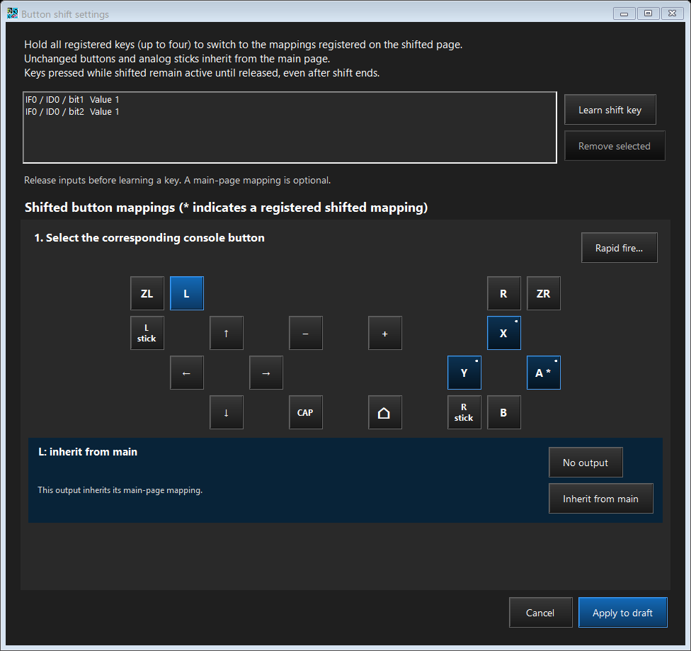

# Button shift

ControllerBridge 0.20.0 adds one shifted button page inside each profile. Hold all configured shift keys to use it; release any one to return. The active profile, USB output mode, four axes, mouse movement settings and LED color stay common. No page transition saves Flash or reconnects USB.

This follows the hold action and inherited-mapping concept described in the [reWASD Shift mode guide](https://www.help.rewasd.com/basic-functions/shift-mode.html). ControllerBridge implements one button-only page, up to four AND modifiers and the rules below; it does not reproduce reWASD's complete layer/shortcut system.

## Configure

1. Select the profile, or open the mapping step while adding a controller.
2. Choose **Button shift…** beside **Rapid fire…**.
3. Release all inputs, choose **Learn shift key**, then press one physical key. Repeat for up to four different keys. A key does not need a normal output mapping. All configured keys must be held together; there is no time limit between their presses.
4. Select a shifted output and perform the physical input to assign. Outputs you leave unchanged inherit the main page. **No output** explicitly mutes the selected output while shifted; **Inherit from main** removes that override. A `*` marks a changed output. **Rapid fire…** can give a shifted output its own Off/2–30 Hz setting.
5. Choose **Apply to draft**, then **Save slot to device**, or finish registration. Closing with Cancel discards the dialog's edits. Removing every shift key disables shift while retaining the stored shifted mappings for later use.

This image uses synthetic test mappings. The dialog has no independent axis settings: LX, LY, RX and RY always use the common profile settings. D-pad directions remain normal digital outputs; no new four-way or diagonal correction is applied.

## Inheritance and moving a physical input

Mappings are edited by output button. With no override for an output, its current main-page mapping is inherited. A muted override disables only that output. A changed binding replaces that output's main binding while shifted.

If an override uses the physical input of an inherited main output, the inherited output is suppressed while that overridden binding is pressed. For example, if physical button P normally sends Y, assigning P to shifted A produces:

| Input | Output |
|---|---|
| P | Y |
| Shift + P | A |
| Release Shift while P stays held | Y |
| Release P | Neither Y nor A |

Thus the moved input does not also produce inherited Y. Other physical inputs and unchanged outputs continue to work. Explicitly assigning the same source to several shifted outputs is still allowed. Overlap is based on the physical field and active range, not display names.

In USB mouse or combined mouse-button behavior, B/A remain the shared left/right click mappings. Shifting those mappings therefore changes the clicks. The selected output mode still determines which mapped outputs are sent; shift cannot change a mouse profile into a gamepad profile. Mouse movement stays common.

## Modifier and release behavior

- One to four modifiers form an AND condition. A single modifier activates shift immediately. There is no toggle, tap action, hold delay, or multi-key timing window.
- Once the full chord activates, modifier inputs cannot produce normal button outputs on either page. Their use by a common axis is also suppressed while consumed; other axis inputs continue normally.
- Releasing any modifier immediately restores the main page. Modifier output suppression remains until every modifier has been released, so a remaining held modifier does not suddenly fire its main mapping. Holding all modifiers again can reactivate shift without a Flash write.
- For a multi-key chord, an individual modifier can produce its main mapping **before the chord first completes**. Output already sent cannot be withdrawn. Dedicated physical keys with no ordinary mappings avoid this. A single immediate modifier cannot also perform a normal press action.
- Buttons already held at a page change are reevaluated from cached input, releasing the old output and applying the new mapping without requiring another physical press. Release/disconnection clears the appropriate state. Rapid phases restart on page changes.
- Permanent profile shortcuts cannot overlap modifier inputs. The GUI and firmware reject such configurations. Profile hotkeys use main-page physical mappings. Profile cycling, including BOOT-triggered cycling, is rejected while shift modifiers are consumed; release them all before switching profiles.

## Upgrade and backup

Install the 0.20.0 firmware bundled with the 0.20.0 configurator. Settings from 0.16.0–0.19.0 migrate automatically with shift disabled. Main mappings, axes, IDs, slot order, preferred selections, permanent shortcuts, RGB and output settings are preserved. Pre-0.16.0 storage remains unsupported.

New backups/exports use JSON version 3. Old version-2 files are accepted and converted; they have no shifted assignments. Keep a pre-upgrade version-2 backup if returning to old firmware may be necessary: 0.19.0 cannot read the expanded bank or new backup format, and downgrade conversion is not implemented. The existing [firmware update](firmware-update.md) confirmation still controls board programming.

The first save after migration writes and verifies a separate new bank before the legacy copies can be overwritten. Later saves alternate two 16 KiB areas. See [storage layout](configurator-design.md#profile-bank-and-flash), [memory budget](../README.md#memory-budget), and [verification limits](verification.md).
