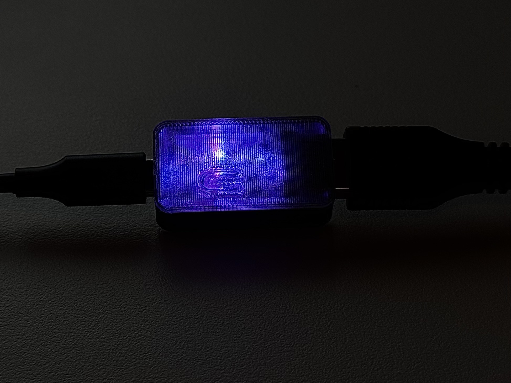
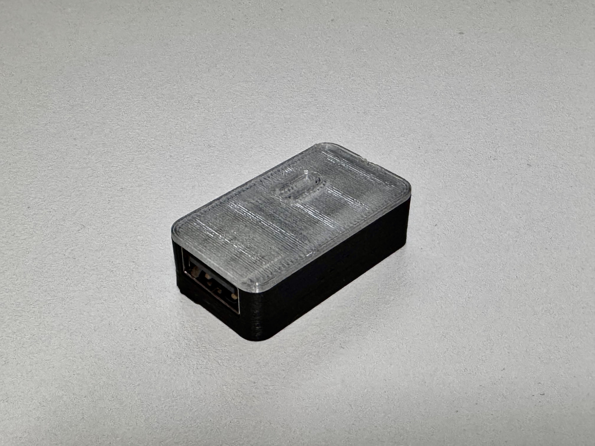
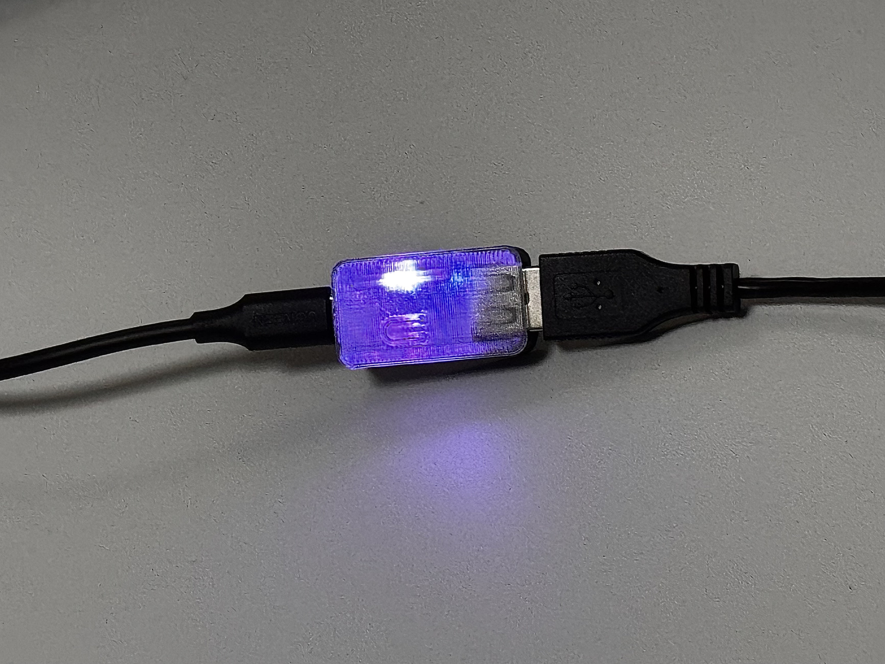
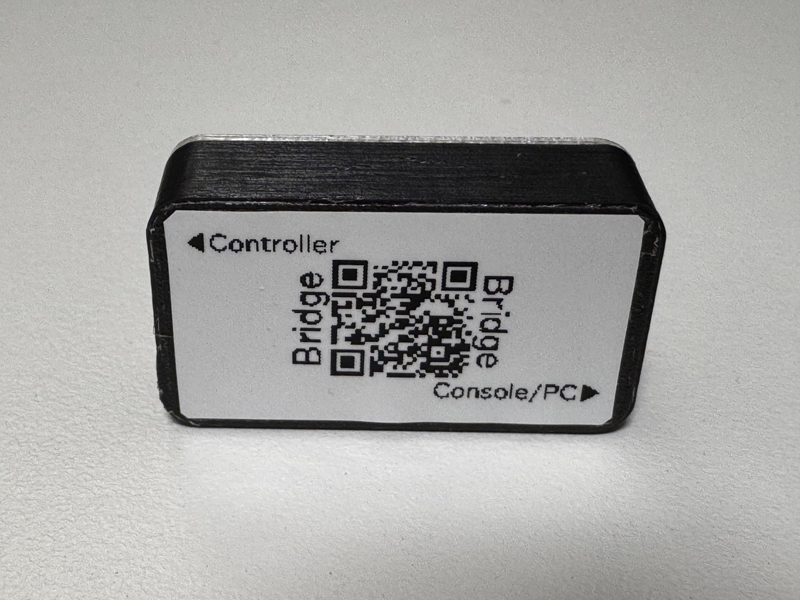

# Reference-board case

A 3D-printed enclosure for the **Waveshare RP2350-USB-A**, the reference board used by ControllerBridge. A clear PETG top lets the board's LED become part of the case's appearance: an added fin spreads the light through the lid, while the dark bottom frames the glow.

This is a remix of [**Waveshare RP2350-USB-A Case**](https://www.printables.com/model/1261378-waveshare-rp2350-usb-a-case) by [**barrenechea** (@barrenechea_1743112)](https://www.printables.com/@barrenechea_1743112), published under [**Creative Commons Attribution 4.0 International (CC BY 4.0)**](https://creativecommons.org/licenses/by/4.0/).

The assembled sample with the LED illuminated in a dark setting. The USB-C connection is on the left and the USB-A controller connection is on the right.

## What changed

| Part | Remix changes |
|---|---|
| **Top** | Printed in **clear PETG**. The original RESET-button feature is replaced with a **light-diffusing fin** to spread the LED's light through the transparent lid. |
| **Bottom** | The **USB-C opening is adjusted slightly** to improve the fit of the reference-board assembly. |

The change to the top replaces the case's RESET-button feature; it does not remove the RESET switch from the board. This page describes the enclosure, while [Status LED](status-led.md) explains ControllerBridge's LED indications and color settings.

## STL downloads

The model distribution currently contains **STL files only**. Download one top and one bottom:

| File | Part |
|---|---|
| [top.stl](../hardware/case/top.stl) | Clear PETG lid with the LED-diffusing fin |
| [bottom.stl](../hardware/case/bottom.stl) | Bottom with the adjusted USB-C opening |

Use millimetres when importing the files into a slicer. Clear PETG is the material used for the sample's top. Layer structure and print settings affect how the light appears; the photos show the actual printed sample rather than a rendered transparency effect. Blender project files, slicer projects and printer-specific G-code are not included in this distribution.

## Sample photos

### Assembled enclosure

The unlit enclosure shows the transparent lid and its fit over the dark bottom, viewed from the USB-A side.

### LED in ambient light

The connected sample under ambient lighting. The printed lid carries the LED's blue-violet glow beyond the light source itself.

### Bottom and connection label

The sample's underside has a separate label identifying the **Controller** and **Console/PC** ends. The label and QR code shown in the photo are not part of the STL geometry.

All four photos were supplied by HKey2 for this project. The HEIC originals were converted to JPEG for repository display, with orientation preserved, a maximum long edge of 2,048 pixels and capture metadata removed.

## Credits and license

Many thanks to **barrenechea** for designing and sharing the original compact enclosure under an open license. Their work provided the foundation for this ControllerBridge adaptation.

- **Original design:** [Waveshare RP2350-USB-A Case](https://www.printables.com/model/1261378-waveshare-rp2350-usb-a-case) by [barrenechea](https://www.printables.com/@barrenechea_1743112).
- **Remix:** HKey2 / ControllerBridge; the top and bottom changes are listed above.
- **Case STL license:** [CC BY 4.0](https://creativecommons.org/licenses/by/4.0/). The [case license notice](../hardware/case/LICENSE.md) accompanies both STL files.

When redistributing the models, retain the original-design credit, link to the license and identify the modifications. Attribution does not imply that the original designer endorses ControllerBridge. The case-model license is separate from the project's [BSD 2-Clause software license](../LICENSE).
