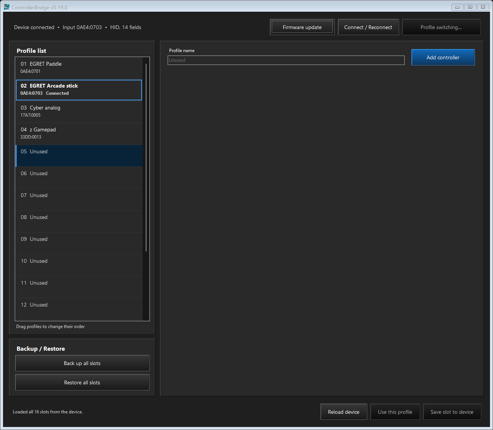
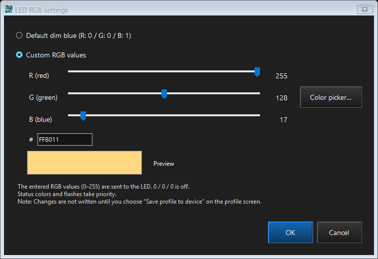
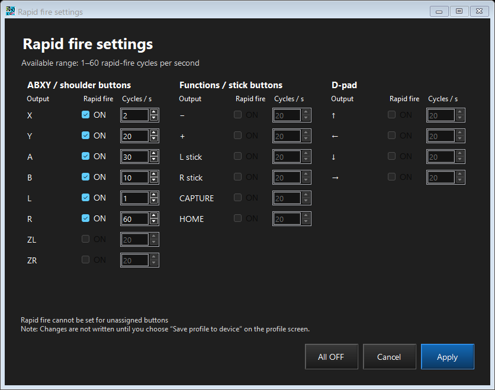
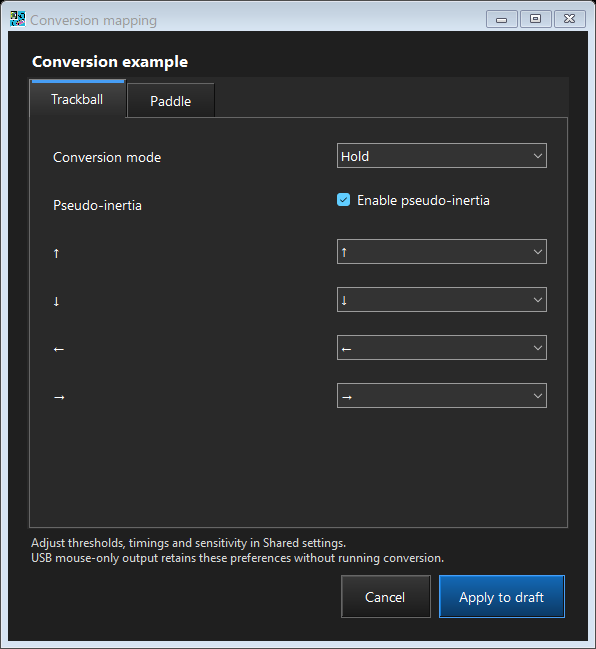
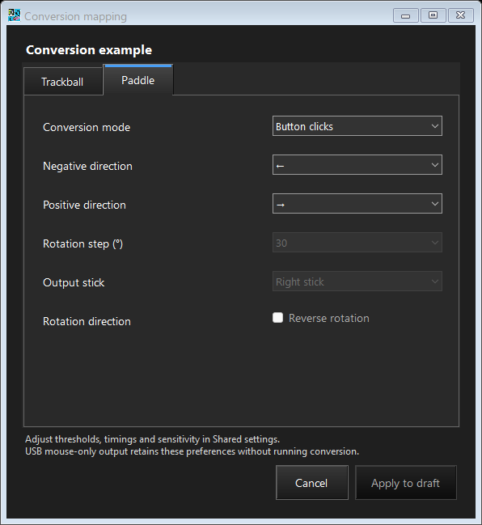
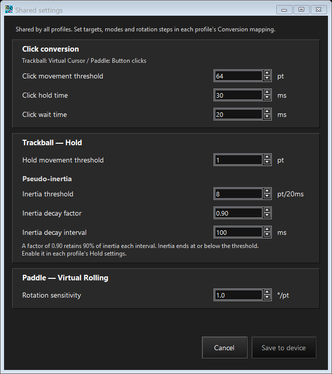

# ControllerBridge user guide

Windows x64 configurator 0.28.0 and RP2350-USB-A firmware 0.28.0. The application follows the Windows display language: Japanese on Japanese Windows, English otherwise. This guide and reference screenshots use English. Saved profile names are not translated.

The window and text follow each monitor's Windows display scaling, including movement between monitors with different scaling. If a settings dialog is taller or wider than the usable screen, use its scrollbars or Tab navigation to reach the remaining controls. The main window's mapping area can also scroll on shorter displays. Changing Windows scaling to 100% is not required.

## Connect and start

1. Connect the input controller directly to the board's USB-A port.
2. Connect USB-C to a Windows PC.
3. Run `ControllerBridge.exe`.
4. A factory-state RP2350-USB-A automatically opens the firmware installation guide, whether connected before startup or while the tool is running. The dialog immediately waits for reconnection with BOOT held and shows only **Cancel**. Follow its numbered steps; after BOOT is detected, the final **Yes/No** overwrite confirmation opens automatically. A detected bridge with a different or unreadable version also opens guidance; **Firmware update** is available manually. See [firmware update](firmware-update.md).
5. Check the connection status and the **Profile list**. Supported v5/v6/v8 settings migrate to v9 automatically with rumble off; v5 gains disabled shift, while v6 retains its first three shift keys. Installing this release over firmware older than 0.16.0 starts with all 16 slots unused; choose **Add controller** to register each controller again. New registrations persist across restarts.

The executable includes its runtime; no separate .NET installation is required. Only one instance can run. Close other bridge configuration tools while using the GUI. When the board is disconnected, the application retries about every two seconds. **Connect / Reconnect** starts an attempt immediately. An empty USB-A port shows a stable waiting message during enumeration retries.

When no recognized board is detected, the window shows **Device not connected** and waits quietly. A factory-state board exposing Pico SDK USB or a board in RP2350 BOOT mode shows **Device unsupported**, even though it has no ControllerBridge HID interface. This automatically opens the installation guide at startup or on background detection. Cancelling the wait or declining the final confirmation keeps that status visible without repeating the popup during the same connection. Once a disconnection is observed, connecting the board again opens guidance again. Background retries keep the editor enabled and preserve unsaved edits. A readable firmware mismatch is shown as an update requirement. For other USB identities, use **Firmware update** manually.

The initial and minimum main-window client size is 1290 × 1100 at 100% scaling (1306 × 1139 including the window frame in the checked environment). This fits the profile details in Japanese and English, including **Mouse + Gamepad → Controller** with all analog-axis buttons visible. The Clear mapping action sizes to its label so the English text stays on one line.

These general-interface screenshots show 0.19.0 and were refreshed on 2026-10-30 from the four profiles saved on the device: **EGRET Paddle**, **EGRET Arcade stick**, **Cyber analog**, and **z Gamepad**. The main window shows slot 02, **EGRET Arcade stick**, connected and active.

For MS-GIPUSB controllers (wired Xbox One family), see [MS-GIPUSB input setup and limits](xbox-one-input.md). After initialization, the connection type is **MS-GIPUSB**.

## Profiles and slots

The board stores 16 profiles in total, including multiple profiles for one controller. Each stores its name, device matching information, output mode, button behavior, mappings, button shift, rapid fire, input interval, mouse settings, and LED color. The profile currently active for the connected controller is bold and outlined in blue in the list, with a **Connected** label. This remains visible when another row is selected and clears when the controller or bridge disconnects. The bold styling applies only inside the list; the editor keeps its normal fonts.

Single-clicking a registered slot opens its settings without changing the active profile on the board. Double-click a different saved profile matching the connected controller to activate it and move the **Connected** marker. **Use this profile** performs the same action. A double-click does not activate another controller's profile, an unused slot, a profile with unsaved edits, or a profile that is already active. Unsaved edits have a `*`; choose **Save profile to device** to apply them. An unused slot shows **Unused** in a disabled gray profile-name field, hides the settings, and offers **Add controller**. Selecting a registered slot restores the normal editable name field.

When a supported controller finishes initialization and has no matching saved or draft profile, the GUI selects the first available slot from the top. This only changes the list selection: no confirmation opens, no wizard starts automatically, and nothing is written to the board. Later manual selection is preserved until another attachment. Unsaved edits, another modal window, and ongoing operations defer this selection. A pending deletion is not an available slot until it is saved.

If there is no matching profile and no usable empty slot, the connection header displays **A controller without a profile is connected, but no empty slot is available.** It does not open a popup or overwrite an existing profile. The message clears when the condition no longer applies. Matching uses the existing VID/PID and optional descriptor/revision rules, not individual physical unit serial numbers.

In this screenshot, unused slot 05 was selected manually to show its controls. The connected **EGRET Arcade stick** remains active in slot 02, with its bold label and blue outline. This image shows the unused-slot interface; it does not depict an unregistered controller arriving.

### Add, duplicate, and delete

**Add controller** opens a registration wizard. Confirm the detected device, assign inputs, configure any analog axes, and save to the board. Registration requires valid input from the connected controller and an empty slot in both the saved bank and the editor. The GUI retains the original bridge handle and input identity; firmware 0.19.0 and later checks the input connection generation and identity at transfer start and again at commit. Disconnecting, reconnecting even the same controller, changing the input identity, or occupying the destination cancels that registration transaction. Ordinary saved-profile edits keep their existing offline behavior.

**Duplicate profile** copies the selection into the nearest unused slot below it. It creates a new ID and appends an available `[2]`, `[3]`, and so on to the stored name. Copying a numbered copy does not nest suffixes. The original name stays unchanged. Reordering or deleting other profiles does not renumber names. Names are shortened at complete Unicode character boundaries when necessary to fit the 47-byte UTF-8 limit. Save the new slot to persist it. Duplication does not wrap to unused slots above the source.

**Delete profile** marks the selected slot unused after confirmation. Choose **Save profile to device** for that slot to apply the deletion. The Yes/No confirmation explains that dragging profiles to reorder the list is disabled until all unsaved changes have been saved to the device. Before saving, **Reload device** can discard the draft.

### Inspect raw inputs during registration

On **Add controller → 2 Map inputs**, choose **Input log…**. The separate window stays open while you select output buttons, press physical inputs, or calibrate an axis. It starts with a snapshot of all parsed fields and then records each received value change, including releases and inputs that are not assigned to any output.

Press and release one physical button at a time, then compare these columns:

| Column | Meaning |
|---|---|
| Index | ControllerBridge's internal input-field index, starting at zero; it is not a Switch output-button index |
| Input / Usage | Parsed input name and the hexadecimal usage page/ID; two distinct fields can report the same button number |
| IF / ID / bit / bits | Interface, report ID, bit offset, and field width identifying the source used by mappings |
| Raw / Hex | Value before mapping, calibration, inversion, or dead zone; hexadecimal is limited to the field's bit width |
| State / range | Pressed/released state or axis kind, followed by the descriptor's logical range |
| PC time / Device µs | PC receipt time and the device's 32-bit microsecond event timestamp; device time wraps at 2^32 |

Two rows named **Button 1** can still be distinguished by their Index and IF/ID/bit. If two physical buttons send exactly the same USB data, the software cannot identify which one was pressed. HID fields and normalized XInput/Switch fields use the same log; it is a parsed-field change log, not a capture of every raw USB packet. Unchanged reports are not repeated, and relative-input fields follow the firmware's existing change notifications.

**Pause recording** stops only logging; mapping and live input continue. Resuming marks the omitted interval and adds a new current-state snapshot. **Follow latest** controls scrolling. **Clear** starts a fresh history with current values. **Copy all** copies the retained log, and **Save log…** writes a UTF-8 tab-separated `.tsv` or `.txt` file.

Input reception continues while windows are opening or redrawing. The PC temporarily retains up to 8,192 input changes, while the log window keeps the latest 2,000 rows and reports how many older rows were discarded. If retained input history is exceeded, the tool silently continues with the received values. It does not cancel learning, clear analog detection, or add a missing-event warning; omitted values cannot be recovered in the log. A disconnection or change of controller still cancels registration. Closing, cancelling, or completing the wizard stops recording but leaves an already-open log available for copying or saving. Closing and reopening the log during registration starts a new history. Viewing and recording inputs never saves a profile.

### LED color

Select a profile, then choose **LED RGB settings** directly below **Delete profile**. **Default dim blue** retains the original ready color and brightness: R=0, G=0, B=1. Choose **Custom RGB values** to adjust R, G and B on three horizontal slider rows, each with a numeric readout from 0 to 255. The channel values are sent directly, without brightness scaling or RGB565 quantization. R=0, G=0, B=0 turns off the ready LED.

**OK** changes the selected draft; **Cancel** leaves it unchanged. Choose **Save profile to device** to persist it. The color is shown when that profile is active, input is received, and the output host is ready. Browsing another slot does not change the hardware color. Error, save, waiting, and profile-number indications retain their existing colors and priority. After an indication ends, the active profile color returns.

The screenshot uses a synthetic custom-color sample: R=255, G=128, B=17 (#FF8011). It does not read or change a physical device.

The square **eyedropper icon** on the right opens the Windows color chooser with the current RGB values. Confirming a color updates all three sliders, numeric readouts, the hexadecimal code and the preview. Cancelling the chooser preserves the previous values. Custom controls, including the picker, are enabled when **Custom RGB values** is selected. Hover over the icon to see **Color picker**; it also has a localized accessible name. The vector icon scales with the display.

The `#` field below the R/G/B sliders accepts six hexadecimal digits with or without a leading `#`; the prefix is removed automatically. For example, paste `000004` or `#000004` to set R=0, G=0, B=4. Uppercase and lowercase letters are accepted. Editing either the code or a slider updates the other controls and the preview. Incomplete, invalid or overlong codes cannot be confirmed; they are not silently shortened into another color. **Cancel** remains available while editing an incomplete code.

The single preview uses gamma 4.0 internally, following the user's comparison with the actual LED. There is no gamma control, explanatory curve text or uncorrected swatch. Earlier PC preview preferences are ignored. The entered code and channel bytes remain exact; this display correction does not alter the profile or firmware output. The preview itself does not require a firmware change. This release bundles 0.20.19, including independent Mouse UDLR hold and wait settings; install the matching firmware.

New profiles and existing 0.16.x/0.17.x profiles default to dim blue. Duplicating a profile copies its color; reordering, individual export/import, and whole-bank backup/restore retain it. Selecting **Default dim blue** removes the custom setting. The color is not assigned automatically or required to be unique; use a different color for each profile if desired.

### Reorder

Drag a registered profile to the blue insertion line. The upper half of a row inserts before it; the lower half inserts after it. The list scrolls near its edges. `Alt+Up` and `Alt+Down` also move the selection.

Save pending edits before reordering. A completed move is saved immediately and verified by reading back the bank. Profile data, ID, shortcut, and saved selection move together. BOOT and controller shortcuts cycle matching profiles in this order.

## Backup and restore

- **Back up all slots** saves all 16 persisted slots, their order, IDs, shortcuts, and selections to one JSON file.
- **Restore all slots** validates the file, asks for confirmation, replaces the bank, and reads it back for verification.

Per-profile output modes, button behavior, shift settings, and LED colors are included. Common diagnostic settings and saved measurements are separate. Save or discard drafts before either operation.

New backups use `ControllerBridge.Slots`, JSON version 6, with a SHA-256 checksum. JSON v2/v3/v5 backups are verified and converted. Binary v5 gains disabled shift; binary v6 retains its first three modifiers; v8 retains its assignments and migrates with rumble off. Missing shared conversion settings use the import defaults described under [compatibility](#import-and-upgrade-compatibility). JSON v1/v4 remain unsupported. Keep a pre-upgrade backup if returning to old firmware: it cannot read v9 banks or JSON v6. The board validates payload, generation, CRC and profiles before writing the inactive copy; an interrupted transfer before commit leaves the active bank intact.

### Included sample slots

The repository and release ZIP include [samples/ControllerBridge-Config-Sample_v0.22.0.json](../samples/ControllerBridge-Config-Sample_v0.22.0.json). Back up your current slots first, then choose **Restore all slots** to load it. This replaces the complete bank, including unused slots; it is not an individual-profile import. Review controller identities and mappings for your hardware. See the [sample instructions](../samples/README.md).

### Individual profile files

For occasional individual transfers, right-click a registered row and choose **Export**, or right-click an unused row and choose **Import**. The keyboard menu key and `Shift+F10` also open the selected row's menu. No additional buttons appear in the normal interface.

Export includes current edits. Import creates an unsaved draft; **Save profile to device** persists it. Occupied slots cannot be overwritten this way. Duplicate names receive a number; missing IDs or IDs conflicting with another slot receive a new ID. Unique names and IDs remain unchanged. Canceling or rejecting a file preserves existing drafts.

Individual files use `ControllerBridge.Profile`, JSON version 6. JSON v2/v3/v5 exports are accepted and converted with rumble off. Version-2/profile-v5 exports migrate with shift disabled; version-3/profile-v6 retains the first three modifiers. JSON v1/v4 remain unsupported. Individual files exclude slot order, shortcuts, and active selection, and cannot replace whole-slot backups.

## Map inputs and calibrate axes

Select an output control, release the physical input, and perform the action to assign. Already-held inputs must return to neutral before learning. A connection change or event overrun cancels learning.

Analog axes support measured minimum, center, maximum, a 0-50% dead zone, and inversion. Alternatively, use two digital inputs for negative and positive movement; pressing both produces center.

DS3 stick Y values are normalized at input decoding so upward movement increases the value, matching Switch Pro and Xbox input. Both sticks use the same convention in live input, calibration and assignments. Use the current EXE and its bundled firmware. Older saved DS3 assignments keep their physical output direction; the editor translates their ranges when opened with the updated firmware. Re-run the wizard to replace an intentionally or accidentally inverted old assignment. Other PlayStation models are not identified by this DS3-specific protocol rule.

### Analog stick setup wizard

Choose **Setup wizard** at the left of the four individual axis buttons in the **Analog sticks** group, either while editing a profile or adding a controller. The individual buttons remain available for manual settings.

The bands use red, green, yellow and magenta tones from [Paul Tol's bright colour scheme](https://sronpersonalpages.nl/~pault/#sec:qualitative), selected for easier distinction with common red–green colour-vision differences. On Switch 2 Pro's standard input layout these correspond to left X, left Y, right X and right Y. Colours continue to identify the source input when you remap an axis. Active bands are wider than confirmed reference lines, and the graph position stays fixed when the final review replaces the two-line instructions.

1. Release the controls to their resting positions before opening the wizard. It immediately starts **Left stick X** setup; there is no separate Start step. If an input has not arrived yet, its first valid value establishes its resting position.
2. Assign **Left stick X**, **Left stick Y**, **Right stick X**, then **Right stick Y**. Move the control you want to use for the selected output through its intended travel. Input names such as X, Y, Rz or Slider do not determine the destination; flight controls, pedals and swapped X/Y assignments work the same way.
3. Watch the colored detection band. Analog inputs, ordered by their internal input ID, use **red, green, yellow, magenta**; additional inputs repeat those four colors. The color follows the source input, including when X/Y assignments are swapped or a different output axis is selected. Each direction grows independently from the center. A short, faint band is still being detected. A solid band that stays fixed means that direction is ready; one-sided movement produces a half-axis, while movement in both directions can fill the diameter. **Invert direction** starts off for each axis and changes only when you operate the checkbox. Switching to another input preserves your inversion choice but starts a fresh detection band; returning to an earlier input also requires a new measurement.
4. Press a controller face button or **Confirm and next**. You can release the control first: completed directions remain visible at rest. After advancing, each confirmed axis remains in its input color as a thin line at about half brightness. The current axis keeps its wider detection band. All axes confirmed in this wizard remain visible together on the final review. A held confirmation button does not advance several steps.
5. Use **Back** or a visited axis button to revise a mapping, then move the intended input to measure it again. There is no separate restart button. **Keep this axis unchanged** preserves the existing mapping. Finish with **Apply settings**, then **Save profile to device**. Canceling or losing the connection discards the wizard's pending changes.

The movement history keeps the latest **180 valid analog value changes**. Sustained-hold timing is tracked separately. Duplicate values, invalid values and buttons do not advance it. Incomplete excursions fade as subsequent analog changes arrive, including changes on other axes. A single brief spike cannot complete a direction. You can also hold an axis well away from its center for about 0.4 seconds: the band continues growing even when the value stops changing. Small jitter does not interrupt this hold. Hold timing advances only while input communication is current; a pause in reception restarts incomplete hold timing. Completed directions stay visible at rest while the same source is selected. For 250 ms after a source becomes ready, another input cannot cancel it. After that, source switching uses a signed buffer average and a sustained outward gesture to suppress brief release rebounds; holding another input steadily away from center also selects it. A clear movement on another input switches the source and clears the previous measurement; the new band grows from the center without reusing that input's earlier completed range. Small jitter does not switch the source, and similarly strong simultaneous movement does not select an arbitrary new input. Each next output axis begins with an empty detection band, alongside the thin reference lines for previously confirmed axes. Returning through the step buttons restores the selected axis to the wider active display; new movement remeasures that axis without erasing the other confirmed lines.

Source switching uses a short signed average of up to **six changed values per input**, with unused positions treated as rest. Positive and negative motion cancel before its magnitude is evaluated. Values older than half a second are excluded. A moving replacement also needs substantial movement on the same side of center for at least **0.1 seconds**. Returning toward center or crossing it restarts this switching check, so a quick release rebound cannot replace an already detected source just by producing many reports. Continue moving the intended replacement through its travel, or hold it steadily away from center for about 0.4 seconds, to grow its fresh band. Initial detection does not have this switching delay. This filtering affects source selection in the wizard; raw limits, the current-position dot and gameplay output are not averaged.

The wizard starts detection without using any previous axis assignments, including when you reopen it for an existing profile. The circle describes the selected **output** axis, not a controller's internal naming or physical layout. Its band length indicates detection progress; raw recorded limits are saved separately. A white current-position dot appears for a stick only after you have confirmed both its X and Y axes in this wizard. It follows those confirmed assignments and their inversion settings; an unconfirmed candidate does not move it. A single axis or pedal has a detection band but no two-dimensional dot until its partner axis is also confirmed. **Keep this axis unchanged** preserves its saved mapping without treating it as a new measurement. Digital hats and button-only inputs are outside this wizard; use individual axis settings for a two-button axis.

In the circle, positive Y points upward and negative Y points downward. The detection band, confirmed reference line and white dot use the same orientation. This display convention does not change the saved axis inversion setting or the device's output mapping; use **Invert direction** when the assigned control itself needs reversing.

If input events are missed, measurement continues with the values received, preserving completed directions, confirmed axes and your inversion choices. The wizard stays open. Release a held confirmation button before continuing.

**One-sided pedals:** the released position becomes neutral (zero stick deflection), and travel produces only one side of the output axis. A pedal whose raw values decrease can be reversed with **Invert direction**. Move it through its intended full travel before confirming. Install firmware 0.25.0 or later before saving endpoint-neutral mappings; earlier firmware rejects a center equal to the minimum or maximum. Existing centered mappings retain their behavior. The profile and bank sizes are unchanged.

### DS3 gyro steering

The DUALSHOCK 3 gyro measures one rotation axis, perpendicular to the face of the controller. Use it like a steering wheel: turn the controller left or right and hold it at the desired steering position. This is relative steering, with a learned range; the display shows a percentage rather than a measured angle in degrees. Other rotation axes and Bluetooth motion input are not supported.

Install the bundled 0.28.0 firmware and connect the DS3 by USB. Update both the EXE and UF2 for drift protection; the configurator checks firmware support before saving gyro settings. Press PS if input is waiting. The bridge reads the attached unit's factory calibration on each connection and applies the gyro initialization appropriate to that unit. The Gyro button becomes available when this calibration is readable. A fixed calibration value from another controller is not used.

1. Open **Setup wizard**. Use **Gyro** at the lower left of the left-stick panel for **LX**, or at the lower right of the right-stick panel for **RX**. Each button opens that side's own setup. The Y axis and other stick keep their existing mappings.
2. The wheel responds to input as soon as the dialog receives it, including before calibration. **Input preview (not calibrated)** uses a temporary resting estimate to show movement. Hold the controller at the intended neutral orientation and choose **Calibrate neutral** below the graph. Keep it still for three seconds while its resting bias and noise are measured. The instruction, live stillness duration, restart count and progress bar are grouped below the graph. If the timer restarts, an amber message explains whether gyro variation, acceleration changes, missing input or a sensor limit prevented calibration. Rest the controller on a stable surface. If calibration keeps restarting even while untouched, reconnect it and use **Restart calibration**. The bar reports confirmed continuous stillness; an unstable reading is not accepted merely because three seconds have elapsed.
3. Turn **left first**, then right, to the positions that should produce full steering. The first movement defines left. Return to the center and stop, or choose **Check with this range**, to finish recording the range. Then turn again to check the direction and output. The arc-shaped steering graphic and percentage stay at the position you hold. **Invert direction** reverses the assignment; **Record range from neutral** records new limits.
4. Choose **Recenter button settings…** to select one DS3 button or several buttons to press together. This is one setting shared by both sticks, whichever side opened the dialog. When the combination becomes pressed, the current orientation becomes the reference position for both gyro assignments. A short press resets the reference immediately; confirmed recent still readings also refine the zero point when available. Holding the combination while keeping the controller still for about two seconds relearns both the resting zero and noise level, then resets the reference once more. Movement restarts the stillness timer. The long-hold correction happens once per press; release a button in the combination to rearm it. The selected buttons retain their ordinary output assignments. Both sticks share the physical sensor zero and noise calibration; their steering ranges and directions remain independent. Runtime zero adjustments are not repeatedly written to flash. To retain a new calibration in the profile, calibrate in the wizard and save the profile.
5. Choose **Apply settings**, then **Save profile to device** in the profile screen. Return the controller to the intended neutral orientation after setup. **Use this orientation as reference** changes the wizard's preview reference; the configured physical Recenter operation is available during play.

Steering holds while the controller is stationary; stillness alone does not return it to center. Strong drift protection follows small changes in the resting zero, using gyro and accelerometer stability together. It also rejects brief spikes, smooths sensor noise, and applies a minimum 5% output deadzone, including to older saved gyro profiles. Slow, small turns are intentionally suppressed. The output does not gradually return to center on its own. Large zero shifts require the stationary long Recenter press or another neutral calibration. Keep the controller still during that operation: a single gyro cannot reliably distinguish every slow constant rotation from zero drift. Readings near the sensor limits hold the last steering position; reconnect and calibrate if this persists. Neither software correction nor Recenter can recover rotation that was lost while the sensor was outside its usable range. Connecting the controller, saving or changing the active profile starts a new reference from the current orientation. If input history is interrupted during setup, calibrate neutral again before applying settings. Supported input polling intervals remain 1–255 ms; a slower interval reduces the responsiveness of steering and button actions.

**Accelerometers:** **Acceleration X**, **Acceleration Y** and **Acceleration Z** appear in the individual analog-axis settings. Select one manually and record its minimum, center and maximum, or use it as one side of a paired analog assignment. Their values are raw sensor readings and include gravity. They are separate from the gyro wizard and are not automatically selected by the stick wizard.

### Individual axis settings

Choose LX, LY, RX or RY to open its input assignments. There is no separate mode selector: the selected inputs determine how the axis operates. Press an assigned choice again to clear it. **With every choice cleared, Apply leaves the axis unused and centered.**

Each analog input is a split button with a live meter and input value:

- **Left 60%:** assign the input to the whole axis, with minimum, center, maximum, dead zone and inversion controls below.
- **Upper right:** assign only the positive direction (right/up).
- **Lower right:** assign only the negative direction (left/down).

For example, select the lower-right part of **L2 pressure** and the upper-right part of **R2 pressure**. Each selected side has its own **Released / neutral**, **Full input**, and **Dead zone %** settings. DS3 pressures default to 0, 255 and 0%. If a button reaches a smaller raw maximum, hold it at the desired full pressure and choose **Record full input**. Decreasing raw ranges are also accepted. Either side can be used on its own; clearing one side keeps the other assignment.

The calibrated positive and negative amounts are combined. Equal pressure, including both fully pressed, cancels to center; unequal pressure produces the difference. **Output** previews this amount. Selecting the left-hand whole-axis area replaces separate directional assignments. For a pressure input assigned to the whole axis, its released value initially remains the center, as before; adjust the center or inversion below if needed.

**Digital buttons:** the small **Digital −** and **Digital +** learning buttons are at the bottom right, next to Cancel and Apply. Hover over an assigned button to see its input name. Release the controls, choose a learning button, then press the physical button to assign it. Press an assigned learning button to clear that side. Press a waiting learning button again to cancel learning. One digital direction can be used alone; pressing both assigned buttons produces center.

Analog/pressure pairs and digital-button pairs are separate alternatives. Selecting an analog input clears digital assignments; completing digital learning replaces analog assignments. A pressure input cannot be mixed with a digital input on the opposite side.

**DUALSHOCK 3 pressure:** connect by USB and press PS if input is waiting. Named pressure inputs are available for D-pad Up/Right/Down/Left, L2/R2/L1/R1 and △/○/×/□. Pressure meters start at the left edge; stick meters use the midpoint. Meters show input after protocol direction normalization, before user inversion, calibration or dead zone. Unselected inputs update too. The compact list adjusts its columns to show all inputs without scrolling. Directional choices use **+ right / − left** for X and **+ up / − down** for Y in both S and X modes. This makes the split Y-axis positive input move in the same direction as an ordinary stick tilted up, including accelerator assignments; negative moves down, including brake assignments. The directional buttons, saved selection, calibration headings and preview use the same convention. Narrow buttons keep an arrow beside the sign. Existing saved profiles retain their actual output direction; reopening an older split Y mapping shows its corrected sign without rewriting the mapping. Hover over a button for the input name and direction. The stick wizard remains available for ordinary sticks; use this individual screen for pressure assignments.

**Whole-axis calibration:** select the input directly, or use **Move to detect an input axis**. Choose **Measure range**, move to both ends, release the control and choose **Record center**. **Restore input range** returns to the descriptor limits. The numeric fields can also be edited directly. Input loss cancels unfinished detection or recording; a controller disconnection closes the dialog. Saved inputs and calibration remain editable without a connected controller. A configured gyro can be retained or cleared here; use **Gyro** in the stick wizard to change its calibration or Recenter settings.

Choose **Apply**, then **Save profile to device** in the profile screen. Canceling the dialog discards its changes. Paired analog settings require the matching bundled firmware; the application requests an update before saving them to older firmware. The four output axes remain LX, LY, RX and RY, and the profile size is unchanged. Save profiles using the matching bundled firmware.

### Rapid fire

The **Rapid fire settings** dialog sets assigned buttons to Off or **1–60 press/release cycles per second**, in steps of one, while held. An output currently set to Off shows **20** as its new rate; turning it On uses that value unless you edit it. Existing saved rates, including 10 and 30, remain unchanged. Opening or applying the dialog without enabling an Off output leaves it Off. Apply the dialog, then save the slot. Rapid fire is unavailable for unassigned buttons or digital pairs used as analog axes. Install the matching 0.22.0 firmware for the expanded range; the storage format is unchanged. Rapid fire, LED RGB, button shift and axis settings share the reminder that changes are not written until you choose **Save profile to device** on the profile screen.

**Input interval (ms)** belongs to the profile. `0` uses the controller descriptor's interval; `1` requests a transfer every millisecond. Since 0.24.1, the same setting also controls X gamepad output, including Auto (X): `0` retains the reference-compatible 4 ms poll / 11 ms producer, while `1–255` requests that output period with no extra producer wait. Applying a changed active X interval reconnects USB after saved-data verification. S and mouse output retain their separate default 1 ms period. A controller can answer NAK when no data is ready, and the host may choose a different output polling cadence. Request rate does not establish internal scan rate or library/game sampling rate. See [latency and polling policy](latency-scheduling.md).

## Button shift

Choose **Button shift…** beside **Rapid fire…**, either in a saved profile or during registration. Learn one to three physical shift keys, then change only the button outputs that need a shifted assignment. All learned keys must be held together (AND); there is no press-time window. Unchanged outputs inherit the main page. **No output** explicitly disables an output while shifted; **Inherit from main** restores it. A `*` marks an override. The four axes remain common and have no shifted editors.

Choose **Apply to draft**, then **Save profile to device** (or complete registration). Pressing/releasing the shift keys changes runtime button mappings immediately without saving Flash, changing the active profile, or reconnecting USB. Any key release returns to the main page, but all modifier outputs remain consumed until every shift key has been released. Removing every shift key disables the feature while retaining the draft's shifted mappings.

See [Button shift](button-shift.md) for an example, the difference between overriding an output and moving a physical input, shared mouse buttons, rapid-fire settings, and conflicts with permanent profile shortcuts.

## S / Auto / X / Pro host mode

Open **Shared settings** and use the last group. **S** is the default and retains Switch-compatible output. **Auto** tries X first, then reconnects as S once if acceptance is not observed within five seconds; it never retries or cycles back. Use fixed S/X when a specific format is required. **X** selects wired Xbox 360 XInput for Gamepad and Mouse + Gamepad. The USB mouse-only editor continues to output a mouse and retains the selected host preference. **Pro** selects the original Switch Pro protocol for gamepad profiles and enables rumble forwarding when the profile also enables Rumble. Mouse layouts use S while Pro is selected. See [Pro output and rumble](#pro-output-and-rumble).

Choose **Save to device** to persist a change and reconnect USB. The configurator reconnects through its separate settings interface, preserving all profile drafts. When the active output is X, the face-button grid becomes Y at the top, X at the left, B at the right and A at the bottom. Existing mappings retain their physical positions. HOME becomes Guide; Capture has no Xbox 360 counterpart and is unavailable in X. See [wire mapping, Windows behavior and Switch 2 Pro setup](xinput-output.md).

## Output modes

| Tab | Output |
|---|---|
| Gamepad | Mapped buttons, directions, and stick axes using the active S, X or Pro protocol |
| USB mouse | Relative movement and buttons as a standard USB mouse |
| Mouse + Gamepad | Separate USB mouse and gamepad interfaces, with the gamepad using the active S or X protocol |

Selecting an available tab edits the profile. Save the slot to persist it. Unavailable tabs appear dimmed. Hover over a dimmed tab to see the reason and how to enable it in a tooltip. No permanent explanation occupies space inside another tab. Clicking an unavailable tab keeps the current tab and settings and does not create an unsaved edit. Keyboard tab navigation skips unavailable modes. If the bridge is disconnected or its firmware does not support profile output modes, the tooltip explains how to reconnect or update it. Only the combined tab shows **Button behavior**:

- **Mouse** sends left/right clicks while the gamepad supplies Minus, Plus, and HOME. Left/right click share the B/A mappings.
- **Controller** sends all mapped gamepad buttons, directions, and axes. The mouse supplies movement with its buttons released.

A USB layout change reconnects USB-C; the USB-A input host remains running. Changing only combined-mode button behavior needs no USB reconnection.

Trackball and Paddle controls are enclosed in separate raised panels in every output tab. Each panel groups its source ON/OFF switch with pointer gain, inversion and conversion settings; Paddle also contains its output-axis selector. The combined-mode Button behavior row remains outside both groups.

For the EGRET II mini Paddle Controller, trackball and paddle can be enabled independently. Trackball gain is 1.0-256.0, default 16.0; paddle gain is 1.0-10.0, default 1.0, both in 0.1 steps. The paddle can produce horizontal or vertical movement.

### Movement to D-pad

Enable **Trackball ON** and **Convert to ↑↓←→**, or **Paddle ON** and **Enable conversion**, in the profile editor. Choose **Gamepad** for gamepad output alone or **Mouse + Gamepad** for pointer movement together with conversion. USB mouse-only retains these preferences in disabled controls but does not execute conversion. Pointer gain and inversion remain independent per-profile settings. No physical D-pad binding is required.

Trackball **Virtual Cursor** is the original accumulated-click mode. It uses hidden shared gains (initially 6.0× for Trackball and 1.5× for Paddle) instead of pointer gain. Each axis emits one click when its signed sum reaches the click threshold, clears that sum and discards excess. Trackball X, Trackball Y and Paddle events retain their order. A separate queue holds four waiting clicks in addition to the current click; extra clicks are discarded and counted. Physical buttons/axes and pointer movement continue independently.

Each click holds for the configured pressed time after USB acknowledges the press, then waits for the configured released interval after release is acknowledged. The defaults 30/20 ms give an ideal upper bound of 20 clicks/s before polling overhead. A physical button using the same target, or any physical D-pad when the target is a direction, takes priority. Disconnects, profile changes and output resets clear generated work.

## Conversion mapping and shared settings

Use the selected profile's **Conversion mapping** button in the right-hand action column, below **LED RGB settings**, to edit these settings:

| Setting | Profile value |
|---|---|
| Trackball | Virtual Cursor (clicks) or Hold with optional pseudo-inertia; four targets in ↑/↓/←/→ order |
| Paddle | Button clicks or Virtual Rolling; negative and positive targets |
| Virtual Rolling | Rotation step, output stick and independent rotation reversal |

Targets can be any of the 18 digital gamepad outputs, including four directions and stick clicks. Analog axes and Unassigned are not offered. Negative/positive refer to Paddle movement after the profile's pointer reversal. Changing the pointer axis from X to Y retains those targets. The Paddle target controls are greyed out in Virtual Rolling; rolling options are greyed out in Button clicks. Their values are retained.

Choose **Apply to draft**, then **Save profile to device** to persist and apply the changes. **Cancel** discards the dialog edits. Selecting another profile uses that profile's own settings. Profile export, duplication, reorder and whole-bank backup retain them.

Open **Shared settings** at the top, immediately after **Profile switching...**, to tune response for all profiles. A matching 0.22.0 board is required. These values do not change when switching profiles:

| Parameter | Default | Editing range |
|---|---:|---:|
| Click movement threshold | 64 pt | 1–256 pt |
| Click hold time | 30 ms | 1–512 ms |
| Click wait time | 20 ms | 1–512 ms |
| Hold movement threshold | 1 pt | 1–127 pt |
| Inertia threshold | 8 pt/20 ms | 1–65,535 pt/20 ms |
| Inertia decay factor | 0.90 | 0.00–0.99, steps of 0.01 |
| Inertia decay interval | 100 ms | 1–1,000 ms |
| Rotation sensitivity | 1.0°/pt | 0.1–10.0°/pt, steps of 0.1 |

The dialog groups click conversion (Trackball Virtual Rolling / Paddle Button clicks), Trackball Hold, and Paddle Virtual Rolling in separate panels. Pseudo-inertia and its explanation sit inside the Hold panel.

**Save to device** is disabled until a displayed setting differs from its opening value; reverting all edits disables it again. The same rule applies to **Apply to draft** in Conversion mapping. Browsing the Trackball/Paddle tabs does not count as an edit.

All eight controls remain editable regardless of the currently selected profile's mode. **Save to device** persists these shared values and verifies a readback, without saving or discarding profile drafts. Cancel writes nothing; failures retain entered values for retry. Older values outside the editing range are shown clamped with a notice and change only on an explicit save. Hidden click-conversion gains remain unchanged.

### Trackball Hold

Select **Conversion mapping → Trackball → Hold**, optionally check **Enable pseudo-inertia**, apply to draft and save the profile. Enable is stored per profile and defaults to off; tuning stays in **Shared settings**. Hold compares raw X/Y with its movement threshold after profile inversion, without pointer gain. Axes act independently and can hold a diagonal.

Without inertia, zero/subthreshold reports release that axis immediately. If reporting stops, ordinary Hold expires after max(20 ms, two effective input polling intervals). With inertia enabled, each axis measures signed displacement over the preceding 20 ms and starts/refills inertia only above the common threshold and in the direction of a qualifying movement. The default is **8 pt/20 ms**. Small windows do not refill the existing amount or restart its clock. Qualifying reverse movement immediately cancels that axis; a sufficiently strong reverse movement can start new inertia in its own direction.

The default **0.90** decay factor retains 90% every **100 ms**, ending when the amount reaches or falls below **8**. There is no maximum duration. The following durations start at the last qualifying inertia refresh; they are not extra delays added to ordinary Hold. Internal fractional rounding is included in the implemented results.

| Starting amount (pt/20 ms) | Inertia duration with defaults |
|---:|---:|
| 8 or less | None |
| 12 | 400 ms |
| 14–15 | 600 ms |
| 16 | 700 ms |
| 20 | 900 ms |
| 36 | 1,500 ms |

Hold outputs pressed/released state, so this decays the internal duration-control quantity, not the strength of a digital direction. Actual cursor repeats depend on the host/game. Trackball/paddle pointer movement, click conversion and Virtual Rolling do not gain inertia.

Physical button holds remain intact; a physical D-pad owns the hat while pressed. Opposing generated directions cancel. Profile/settings changes, readiness loss and output resets clear old generated Hold and clicks. Click hold/wait fields do not impose a minimum duration on Hold.

### Virtual Rolling

Paddle **Virtual Rolling** produces a full-strength analog-stick direction. Choose it under **Conversion mapping → Paddle**, set the output stick, reversal and step, then apply and save the profile. The default stick is Right and reversal is Off. Rotation sensitivity is adjusted separately in **Shared settings**.

The nine steps are **5/10/15/20/30/40/45/60/90°**; default **30°** provides 12 positions, while 5° gives 72 and 90° gives four cardinal directions. All choices divide 360 evenly. Sensitivity converts input points to degrees: at 1.0°/pt, 30 points advance one 30° position. Incomplete movement is retained, and reversing first cancels that residual. Fast input can advance several steps in one report. These are virtual positions; physical detents and counts per revolution are device-dependent.

The angle starts up at board startup; output stays centered until movement arrives. Stopping centers the selected stick while retaining angle and residual. A changed step aligns the retained angle to the nearest new position on the next nonzero movement (clockwise on a tie) and clears the old residual. Sensitivity/stick/reversal changes do not discard angle/residual. Profile/output changes and reconnection stop motion without resetting the retained angle; a board restart resets it. No runtime angle is saved to Flash.

A zero Paddle report stops motion immediately. No-report fallback is max(20 ms, two effective Paddle polling intervals). Pseudo-inertia applies only to Trackball Hold. Virtual Rolling owns its selected stick, including centered idle output; the other stick and physical buttons retain their behavior. Its reversal is independent of pointer reversal, and its stick selection is independent of pointer X/Y axis.

## Paddle output axis

In USB mouse or Mouse + Gamepad, choose **X axis** or **Y axis** in the Paddle **Output axis** list and save the profile. Pointer gain (1.0–10.0×) and pointer reversal apply to this axis. Trackball inversion affects only Trackball. Direction-conversion negative/positive target assignments are independent of this axis in v8. During migration, the old X profile's left/right or old Y profile's up/down are selected once as those targets. Virtual Rolling selects its stick independently.

## Import and upgrade compatibility

Current device profiles and banks use version 9; exports use JSON version 6. Published v5, v6 and v8 device banks, and JSON v2/v3/v5 exports, are accepted. Migrated profiles retain rumble off. Main bindings, axes, IDs, selection, shortcuts, RGB and rapid-fire settings are retained. v5 has shift disabled; v6 keeps the first three modifiers and drops only a fourth. Shifted output mappings remain intact.

Device migration copies the saved shared maps, modes, stick/reversal and rotation step into every profile, then writes and verifies the inactive bank before adopting it. The old source remains available if that first write is interrupted. A v5 migration first uses Bank A so its two smaller legacy copies remain untouched. New tuning defaults only initialize missing records; existing valid timings and sensitivity survive.

Old JSON lacks the former common conversion settings. Imports use migration defaults retained in a connected device, or standard defaults if disconnected, and show a notice. Those values cannot recover a different device's missing shared settings; check targets/modes/step before saving. This operation does not copy common tuning into the profile. JSON v1 and binary v1–v4 remain unsupported. Old firmware cannot read v9; keep an old-format backup before upgrading for any downgrade.

## Switch profiles without a PC

Use **Profile switching...** to select a roughly one-second BOOT hold or a controller shortcut for all profiles matching that controller. A shortcut needs at least two nonconflicting buttons or directions pressed within 100 ms. Release them before repeating it. Shortcut inputs also reach the game. A permanent profile shortcut cannot share a physical input with a shift modifier; choose different inputs. Shift itself is a separate hold action, does not use the 100 ms shortcut window, and does not change the selected profile.

The shortcut method disables BOOT monitoring. Purple LED flashes indicate the matching profile's number. Selection is saved and survives reconnection. See [LED behavior](status-led.md) and [device compatibility](compatibility.md).

## Pro output and rumble

Version 0.27.0 adds a fixed **Pro** mode using the original Nintendo Switch Pro protocol. It accepts the console's HD rumble commands and sends them, in order, to a wired first-generation Switch Pro (`057E:2009`) or Switch 2 Pro (`057E:2069`) controller. Install the matching EXE and firmware together.

1. Connect ControllerBridge USB-C to the Windows PC and the Pro controller to its USB-A port using a data cable. Register the controller if it has no profile.
2. Open **Shared settings**, select **Pro** under host output, and save. This reconnects the bridge's USB output.
3. Select the Pro controller's **Gamepad** profile, enable **Rumble** (Japanese: **振動を有効にする**), and save the profile to the device.
4. Move the bridge's USB-C connection to the Switch or Switch 2 dock. Enable **Pro Controller Wired Communication** and controller vibration in the console settings. Press the Pro controller's **HOME** button if input is waiting, then use a game with vibration or **Controllers → Find Controllers**.

Rumble starts only when the console sends an enabled effect. Existing and newly created profiles default to rumble off. Pro forwards rumble to first-generation Pro, Switch 2 Pro and supported wired DUALSHOCK 3 controllers. DS3 also receives XInput rumble with X output (including Auto when it selects X). S output does not forward rumble. Motor output to Xbox controllers is not supported. Pro is an explicit selection and is not part of Auto detection.

For **DUALSHOCK 3**, use the same Pro setup with the DS3 gamepad profile, and press **PS** if input is waiting. To use a PC XInput game, choose **X** in Shared settings instead. Enable rumble both in the profile and in the game. DS3 motor output requires a supported, readable Sony factory-calibration revision; it is not enabled for unknown output layouts or arbitrary clones.

DS3 has a variable-strength large motor and an on/off small motor. Switch HD effects are converted to those motors; precise HD frequencies and the original controller's feel cannot be reproduced by DS3. Short effects are bounded to avoid delayed playback. A motor may continue running while a game holds a vibration state, until the game sends a stop or the connection/session ends.

In X output, gyro/rumble profiles send new input without the extra compatibility wait, including at input interval **0**. The default X USB polling interval remains 4 ms. Ordinary profiles retain their previous timing.

Gyro steering continues during rumble. Physical shaking can affect precision, so leave Rumble off for profiles where that matters. Automatic zero/noise learning pauses during motor activity and briefly after a confirmed stop. Input assignment/calibration dialogs temporarily stop DS3 rumble without changing its saved Rumble checkbox. Holding the gyro recenter combination also stops rumble while it is held; the existing stillness period must finish before recalibration. Closing the dialog or releasing the buttons allows only new game commands to start another effect. If a stop cannot be confirmed, input setup asks for reconnection before calibration.

Switch 2 Pro uses a separate vibration format. The bridge converts the two motors, frequency changes and intermediate samples, with a bounded amplitude. The feel can differ from a first-generation Pro because the actuators differ; native Switch 2 HD Rumble 2 commands are not exposed by the bridge's first-generation Pro output.

For a precision-control profile, leave **Rumble** off, set **Input interval (ms)** to **1**, and save. This requests Pro2 input every millisecond without running vibration conversion or periodic motor output. The input interval is independent of the Rumble checkbox and can also be 1 ms in a rumble-enabled profile. **0** uses Pro2's 4 ms descriptor default. Profiles retain their own interval and rumble choice across switching and reconnecting. Input report frequency does not specify the controller's internal button-scanning period or the console/game response time; the output host schedules its own USB polls.

Pro output uses the normal profile button and stick mappings. Mouse-only and combined mouse/gamepad profiles use S output and display **Pro (S)** while Pro remains selected. Their saved rumble preference is retained but inactive. Native gyro/accelerometer packets, NFC, controller audio and console wake-up are not provided by Pro output; existing DS3 gyro-to-stick mapping remains a separate feature.

Switching profiles, disconnecting, entering USB suspend or saving settings stops the effect. After a suspension or settings write, a fresh host command is required to resume. The bridge retains command order and applies backpressure when the output queue fills. If the controller stops accepting commands, it makes bounded stop attempts and disables feedback until a new session.

Profiles and banks use format v9 and JSON backups use v6. Published v5/v6/v8 banks migrate with rumble off, preserving previous assignments. Keep a pre-update backup if returning to older firmware. Ordinary profiles keep the existing input path; the gyro and rumble paths run only when those functions are in use.
