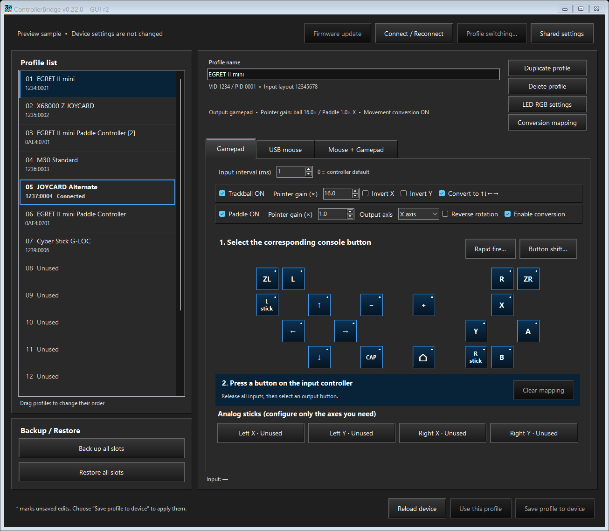
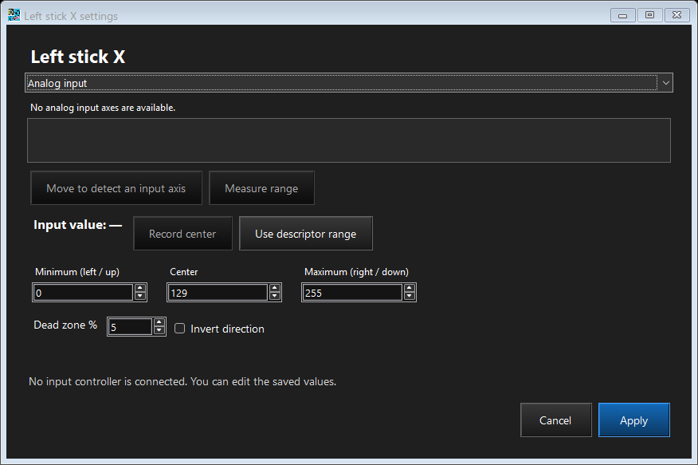
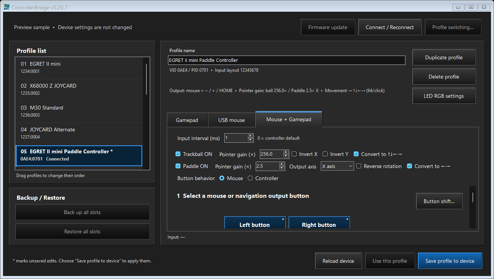
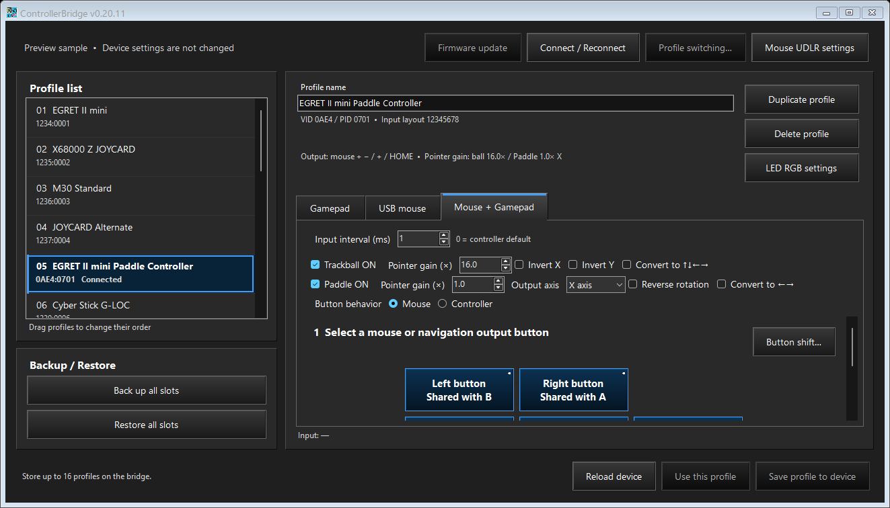
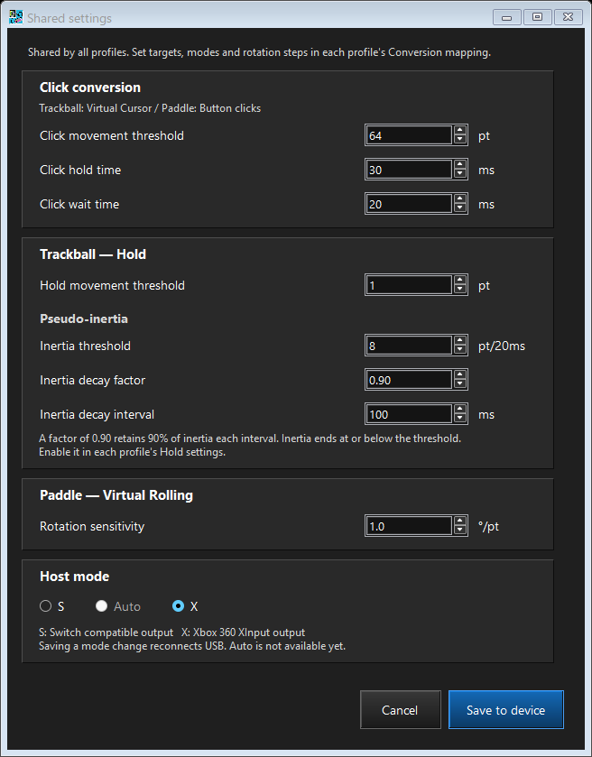
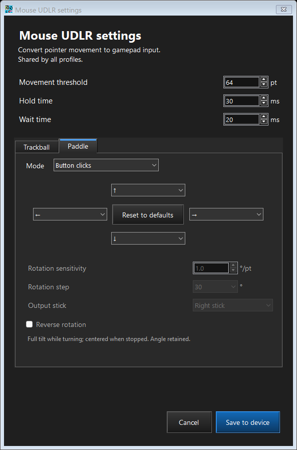
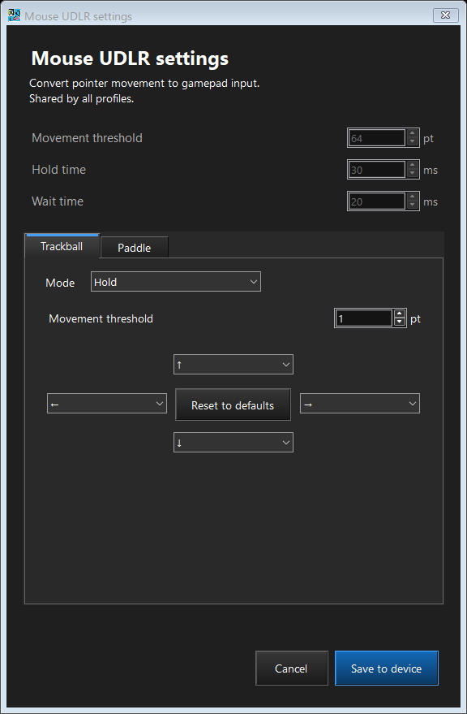
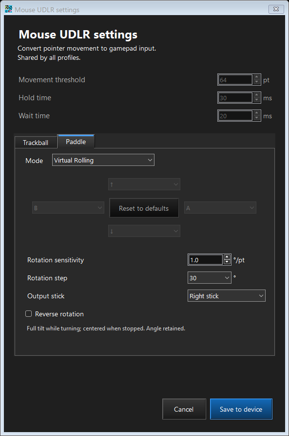
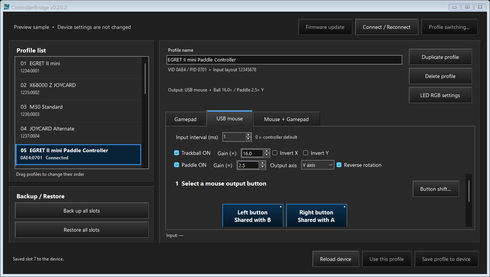

# ControllerBridge user guide

Windows x64 configurator 0.20.16 and RP2350-USB-A firmware 0.20.16. The application follows the Windows display language: Japanese on Japanese Windows, English otherwise. This guide and reference screenshots use English. Saved profile names are not translated.

The window and text follow each monitor's Windows display scaling, including movement between monitors with different scaling. If a settings dialog is taller or wider than the usable screen, use its scrollbars or Tab navigation to reach the remaining controls. The main window's mapping area can also scroll on shorter displays. Changing Windows scaling to 100% is not required.

## Connect and start

1. Connect the input controller directly to the board's USB-A port.
2. Connect USB-C to a Windows PC.
3. Run `ControllerBridge.exe`.
4. A factory-state RP2350-USB-A automatically opens the firmware installation guide, whether connected before startup or while the tool is running. The dialog immediately waits for reconnection with BOOT held and shows only **Cancel**. Follow its numbered steps; after BOOT is detected, the final **Yes/No** overwrite confirmation opens automatically. A detected bridge with a different or unreadable version also opens guidance; **Firmware update** is available manually. See [firmware update](firmware-update.md).
5. Check the connection status and the **Profile list**. Settings from 0.16.0–0.19.0 migrate automatically with button shift disabled. Installing this release over firmware older than 0.16.0 starts with all 16 slots unused; choose **Add controller** to register each controller again. New registrations persist across restarts.

The executable includes its runtime; no separate .NET installation is required. Only one instance can run. Close other bridge configuration tools while using the GUI. When the board is disconnected, the application retries about every two seconds. **Connect / Reconnect** starts an attempt immediately. An empty USB-A port shows a stable waiting message during enumeration retries.

When no recognized board is detected, the window shows **Device not connected** and waits quietly. A factory-state board exposing Pico SDK USB or a board in RP2350 BOOT mode shows **Device unsupported**, even though it has no ControllerBridge HID interface. This automatically opens the installation guide at startup or on background detection. Cancelling the wait or declining the final confirmation keeps that status visible without repeating the popup during the same connection. Once a disconnection is observed, connecting the board again opens guidance again. Background retries keep the editor enabled and preserve unsaved edits. A readable firmware mismatch is shown as an update requirement. For other USB identities, use **Firmware update** manually.

The initial and minimum main-window client size is 1290 × 1100 at 100% scaling (1306 × 1139 including the window frame in the checked environment). This fits the profile details in Japanese and English, including **Mouse + Gamepad → Controller** with all analog-axis buttons visible. The Clear mapping action sizes to its label so the English text stays on one line.



These general-interface screenshots show 0.19.0 and were refreshed on 2026-10-30 from the four profiles saved on the device: **EGRET Paddle**, **EGRET Arcade stick**, **Cyber analog**, and **z Gamepad**. The main window shows slot 02, **EGRET Arcade stick**, connected and active.

## Profiles and slots

The board stores 16 profiles in total, including multiple profiles for one controller. Each stores its name, device matching information, output mode, button behavior, mappings, button shift, rapid fire, input interval, mouse settings, and LED color. The profile currently active for the connected controller is bold and outlined in blue in the list, with a **Connected** label. This remains visible when another row is selected and clears when the controller or bridge disconnects. The bold styling applies only inside the list; the editor keeps its normal fonts.

Selecting a registered slot opens its settings without changing the active profile on the board. **Use this profile** activates a saved profile matching the connected controller. Unsaved edits have a `*`; choose **Save profile to device** to apply them. An unused slot shows **Unused** in a disabled gray profile-name field, hides the settings, and offers **Add controller**. Selecting a registered slot restores the normal editable name field.

When a supported controller finishes initialization and has no matching saved or draft profile, the GUI selects the first available slot from the top. This only changes the list selection: no confirmation opens, no wizard starts automatically, and nothing is written to the board. Later manual selection is preserved until another attachment. Unsaved edits, another modal window, and ongoing operations defer this selection. A pending deletion is not an available slot until it is saved.

If there is no matching profile and no usable empty slot, the connection header displays **A controller without a profile is connected, but no empty slot is available.** It does not open a popup or overwrite an existing profile. The message clears when the condition no longer applies. Matching uses the existing VID/PID and optional descriptor/revision rules, not individual physical unit serial numbers.


In this screenshot, unused slot 05 was selected manually to show its controls. The connected **EGRET Arcade stick** remains active in slot 02, with its bold label and blue outline. This image shows the unused-slot interface; it does not depict an unregistered controller arriving.

### Add, duplicate, and delete

**Add controller** opens a registration wizard. Confirm the detected device, assign inputs, configure any analog axes, and save to the board. Registration requires valid input from the connected controller and an empty slot in both the saved bank and the editor. The GUI retains the original bridge handle and input identity; firmware 0.19.0 and later checks the input connection generation and identity at transfer start and again at commit. Disconnecting, reconnecting even the same controller, changing the input identity, or occupying the destination cancels that registration transaction. Ordinary saved-profile edits keep their existing offline behavior.

**Duplicate profile** copies the selection into the nearest unused slot below it. It creates a new ID and appends an available `[2]`, `[3]`, and so on to the stored name. Copying a numbered copy does not nest suffixes. The original name stays unchanged. Reordering or deleting other profiles does not renumber names. Names are shortened at complete Unicode character boundaries when necessary to fit the 47-byte UTF-8 limit. Save the new slot to persist it. Duplication does not wrap to unused slots above the source.

**Delete profile** marks the selected slot unused after confirmation. Save that slot to apply the deletion. Before saving, **Reload device** can discard the draft.

### Inspect raw inputs during registration

On **Add controller → 2 Map inputs**, choose **Input log…**. The separate window stays open while you select output buttons, press physical inputs, or calibrate an axis. It starts with a snapshot of all parsed fields and then records each received value change, including releases and inputs that are not assigned to any output.

Press and release one physical button at a time, then compare these columns:

| Column | Meaning |
|---|---|
| Index | ControllerBridge's internal input-field index, starting at zero; it is not a Switch output-button index |
| Input / Usage | Parsed input name and the hexadecimal usage page/ID; two distinct fields can report the same button number |
| IF / ID / bit / bits | Interface, report ID, bit offset, and field width identifying the source used by mappings |
| Raw / Hex | Value before mapping, calibration, inversion, or dead zone; hexadecimal is limited to the field's bit width |
| State / range | Pressed/released state or axis kind, followed by the descriptor's logical range |
| PC time / Device µs | PC receipt time and the device's 32-bit microsecond event timestamp; device time wraps at 2^32 |

Two rows named **Button 1** can still be distinguished by their Index and IF/ID/bit. If two physical buttons send exactly the same USB data, the software cannot identify which one was pressed. HID fields and normalized XInput/Switch fields use the same log; it is a parsed-field change log, not a capture of every raw USB packet. Unchanged reports are not repeated, and relative-input fields follow the firmware's existing change notifications.

**Pause recording** stops only logging; mapping and live input continue. Resuming marks the omitted interval and adds a new current-state snapshot. **Follow latest** controls scrolling. **Clear** starts a fresh history with current values. **Copy all** copies the retained log, and **Save log…** writes a UTF-8 tab-separated `.tsv` or `.txt` file.

The window retains the latest 2,000 rows and reports how many older rows were discarded. A firmware event-ring overrun is explicitly marked and stops registration through the existing input-loss guard. Closing, cancelling, or completing the wizard stops recording but leaves an already-open log available for copying or saving. Closing and reopening the log during registration starts a new history. Viewing and recording inputs never saves a profile.

### LED color

Select a profile, then choose **LED RGB settings** directly below **Delete profile**. **Default dim blue** retains the original ready color and brightness: R=0, G=0, B=1. Choose **Custom RGB values** to adjust R, G and B on three horizontal slider rows, each with a numeric readout from 0 to 255. The channel values are sent directly, without brightness scaling or RGB565 quantization. R=0, G=0, B=0 turns off the ready LED.

**OK** changes the selected draft; **Cancel** leaves it unchanged. Choose **Save profile to device** to persist it. The color is shown when that profile is active, input is received, and the output host is ready. Browsing another slot does not change the hardware color. Error, save, waiting, and profile-number indications retain their existing colors and priority. After an indication ends, the active profile color returns.


The screenshot uses a synthetic custom-color sample: R=255, G=128, B=17 (#FF8011). It does not read or change a physical device.

The square **eyedropper icon** on the right opens the Windows color chooser with the current RGB values. Confirming a color updates all three sliders, numeric readouts, the hexadecimal code and the preview. Cancelling the chooser preserves the previous values. Custom controls, including the picker, are enabled when **Custom RGB values** is selected. Hover over the icon to see **Color picker**; it also has a localized accessible name. The vector icon scales with the display.

The `#` field below the R/G/B sliders accepts six hexadecimal digits with or without a leading `#`; the prefix is removed automatically. For example, paste `000004` or `#000004` to set R=0, G=0, B=4. Uppercase and lowercase letters are accepted. Editing either the code or a slider updates the other controls and the preview. Incomplete, invalid or overlong codes cannot be confirmed; they are not silently shortened into another color. **Cancel** remains available while editing an incomplete code.

The single preview uses gamma 4.0 internally, following the user's comparison with the actual LED. There is no gamma control, explanatory curve text or uncorrected swatch. Earlier PC preview preferences are ignored. The entered code and channel bytes remain exact; this display correction does not alter the profile or firmware output. The preview itself does not require a firmware change. This release bundles 0.20.16, including independent Mouse UDLR hold and wait settings; install the matching firmware.

New profiles and existing 0.16.x/0.17.x profiles default to dim blue. Duplicating a profile copies its color; reordering, individual export/import, and whole-bank backup/restore retain it. Selecting **Default dim blue** removes the custom setting. The color is not assigned automatically or required to be unique; use a different color for each profile if desired.

### Reorder

Drag a registered profile to the blue insertion line. The upper half of a row inserts before it; the lower half inserts after it. The list scrolls near its edges. `Alt+Up` and `Alt+Down` also move the selection.

Save pending edits before reordering. A completed move is saved immediately and verified by reading back the bank. Profile data, ID, shortcut, and saved selection move together. BOOT and controller shortcuts cycle matching profiles in this order.

## Backup and restore

- **Back up all slots** saves all 16 persisted slots, their order, IDs, shortcuts, and selections to one JSON file.
- **Restore all slots** validates the file, asks for confirmation, replaces the bank, and reads it back for verification.

Per-profile output modes, button behavior, shift settings, and LED colors are included. Common diagnostic settings and saved measurements are separate. Save or discard drafts before either operation.

New backups use `ControllerBridge.Slots`, JSON version 3, with a SHA-256 checksum. Version-2 backups with version-5 bank data are verified and migrated with shift disabled, preserving all 16 slots and metadata. JSON version 1 remains unsupported. Keep a version-2 backup made before upgrading if you may return to older firmware; 0.19.0 cannot read version-6 banks or version-3 backups. The board validates the full payload, generation, CRC, and profile structure before writing the inactive Flash copy. An interrupted transfer before commit does not replace the active bank.

### Individual profile files

For occasional individual transfers, right-click a registered row and choose **Export**, or right-click an unused row and choose **Import**. The keyboard menu key and `Shift+F10` also open the selected row's menu. No additional buttons appear in the normal interface.

Export includes current edits. Import creates an unsaved draft; **Save profile to device** persists it. Occupied slots cannot be overwritten this way. Duplicate names receive a number; missing IDs or IDs conflicting with another slot receive a new ID. Unique names and IDs remain unchanged. Canceling or rejecting a file preserves existing drafts.

Individual files use `ControllerBridge.Profile`, JSON version 3. Version-2/profile-v5 exports migrate with shift disabled; earlier exports are rejected. They exclude slot order, shortcuts, and active selection, and cannot replace whole-slot backups.

## Map inputs and calibrate axes

Select an output control, release the physical input, and perform the action to assign. Already-held inputs must return to neutral before learning. A connection change or event overrun cancels learning.

Analog axes support measured minimum, center, maximum, a 0-50% dead zone, and inversion. Alternatively, use two digital inputs for negative and positive movement; pressing both produces center.

The live **Input value** readout reserves enough width for a signed 32-bit value. **Record center** and **Use descriptor range** keep their positions when the value changes sign or number of digits.

The analog dialog displays all candidate axes with live centered meters and raw values. Move the physical control to identify its axis, then select the matching row. Unselected axes update too. Large sets use multiple columns when needed.



The screenshot shows the saved **Cyber analog** profile's **Left stick X** settings: minimum 0, center 129, maximum 255, dead zone 5%, and no inversion. That controller was not connected during capture, so the input list and live value are empty and learning controls are disabled. Connect the matching controller to identify and measure its live axes.

The meter uses the descriptor range before calibration, inversion, or dead zone. A range crossing zero uses zero as its reference; other ranges use their midpoint. Missing input shows a waiting state; out-of-range values appear gray. Select the source, measure its travel, record the released center, and apply the result.

The **Rapid fire settings** dialog sets assigned buttons to Off or **1–60 press/release cycles per second**, in steps of one, while held. An output currently set to Off shows **20** as its new rate; turning it On uses that value unless you edit it. Existing saved rates, including 10 and 30, remain unchanged. Opening or applying the dialog without enabling an Off output leaves it Off. Apply the dialog, then save the slot. Rapid fire is unavailable for unassigned buttons or digital pairs used as analog axes. Install the matching 0.20.16 firmware for the expanded range; the storage format is unchanged. Rapid fire, LED RGB, button shift and axis settings share the reminder that changes are not written until you choose **Save profile to device** on the profile screen.


**Input interval (ms)** belongs to the profile. `0` uses the controller descriptor's interval; `1` requests a transfer every millisecond. The controller can answer NAK when no data is ready. Request rate does not establish its internal scan rate or the game's sampling rate.

## Button shift

Choose **Button shift…** beside **Rapid fire…**, either in a saved profile or during registration. Learn one to four physical shift keys, then change only the button outputs that need a shifted assignment. All learned keys must be held together (AND); there is no press-time window. Unchanged outputs inherit the main page. **No output** explicitly disables an output while shifted; **Inherit from main** restores it. A `*` marks an override. The four axes remain common and have no shifted editors.

Choose **Apply to draft**, then **Save profile to device** (or complete registration). Pressing/releasing the shift keys changes runtime button mappings immediately without saving Flash, changing the active profile, or reconnecting USB. Any key release returns to the main page, but all modifier outputs remain consumed until every shift key has been released. Removing every shift key disables the feature while retaining the draft's shifted mappings.

See [Button shift](button-shift.md) for an example, the difference between overriding an output and moving a physical input, shared mouse buttons, rapid-fire settings, and conflicts with permanent profile shortcuts.

## Output modes

| Tab | Output |
|---|---|
| Gamepad | Mapped buttons, directions, and stick axes as a Switch-compatible gamepad |
| USB mouse | Relative movement and buttons as a standard USB mouse |
| Mouse + Gamepad | Separate mouse and gamepad HID interfaces on one USB device |

Selecting a tab edits the profile. Save the slot to persist it. Only the combined tab shows **Button behavior**:

- **Mouse** sends left/right clicks while the gamepad supplies Minus, Plus, and HOME. Left/right click share the B/A mappings.
- **Controller** sends all mapped gamepad buttons, directions, and axes. The mouse supplies movement with its buttons released.

A USB layout change reconnects USB-C; the USB-A input host remains running. Changing only combined-mode button behavior needs no USB reconnection.

For the EGRET II mini Paddle Controller, trackball and paddle can be enabled independently. Trackball gain is 1.0-256.0, default 16.0; paddle gain is 1.0-10.0, default 1.0, both in 0.1 steps. The paddle can produce horizontal or vertical movement.

### Movement to D-pad

The pointing controls are available in **Gamepad**, **USB mouse**, and **Mouse + Gamepad** tabs. Enable **Convert to ↑↓←→** for the trackball, **Enable conversion** for the paddle, or both, then choose **Save profile to device**. Enabling either conversion from USB mouse selects Mouse + Gamepad, because gamepad directions require a gamepad interface. Trying to select USB mouse while conversion is enabled retains the settings and selects Mouse + Gamepad. Disabled input sources retain their conversion preferences.

The following click accumulation and timing apply to Trackball **Virtual Rolling** (the original click mode) and Paddle **Button clicks**. Trackball [Hold](#trackball-hold) has its own per-report threshold. For paddle-to-stick operation, see [Virtual Rolling](#virtual-rolling). Pointer movement and direction conversion have separate gains. **Pointer gain (×)** keeps each profile’s existing values and defaults (trackball 16.0, paddle 1.0), and stays editable when that source is ON, including while conversion is enabled. These controls and the profile summary describe pointer movement only. Cursor gains are hidden device-wide parameters, initially **6.0× for the trackball** and **1.5× for the paddle**, saved separately from profiles. They have no numeric display or editing control in the profile/test screens. Direction inversion remains effective. Ball X, ball Y and paddle have independent signed sums. At the configured positive or negative threshold (initially +64 or -64), that source produces **one click**, clears its sum and discards excess. Opposite movement cancels and fractional tenths are retained. With the initial threshold and cursor gains, 10 raw ball counts give 60 and the next count produces one click; 42 raw paddle counts give 63 and the next count produces one click. Simultaneous thresholds produce clicks in ball-X, ball-Y, paddle order.

The paddle follows **Output axis** for pointer movement and Button clicks: X produces left/right (←→), Y produces up/down (↑↓). The axis selector remains enabled during conversion. The checkbox is labeled **Enable conversion**; Virtual Rolling uses its own stick selection and reversal. **Reverse rotation** reverses either pair. With normal firmware **0.20.6 or later**, conversion is an additional output: in **Mouse + Gamepad**, both enabled sources continue mouse movement using their saved pointer gain (ball 1.0–256.0, paddle 1.0–10.0), while hidden cursor gains drive independent D-pad clicks. No physical D-pad or direction assignment is needed. From 0.20.12, Mouse UDLR settings can replace each generated direction with any gamepad output. Version 0.20.13 gives Trackball and Paddle separate assignment tabs. The previous shared mapping is copied to both sources on upgrade. These assignments always target the gamepad report, including when combined-mode physical buttons are routed as mouse clicks. The **Gamepad** tab still selects a gamepad-only USB layout; choose **Mouse + Gamepad** for both outputs. Firmware 0.20.3–0.20.5 suppressed mouse movement for converted sources. Existing conversion preferences are retained.

The movement threshold, minimum pressed duration and minimum released interval are separate persistent device-wide settings, shared by all profiles and normal/test firmware. Their defaults are **64 pt**, **30 ms hold** and **20 ms wait**. Each click holds its press for at least the hold duration after the press is acknowledged, then remains released for at least the wait duration after release is acknowledged before starting another click. Changing one duration does not change the other. Normal buttons/axes and pointer movement continue independently. The ideal upper bound is 1000 / (hold ms + wait ms) clicks per second before host polling overhead: **20 clicks per second** with both defaults. The separate direction queue holds four waiting clicks in addition to the current click; extra clicks are counted and discarded. With the defaults, four queued clicks represent about 200 ms of additional work plus polling. Ordinary input has priority when it holds the same output button, or any D-pad direction when the generated target is a direction; conflicting generated work is cancelled without releasing the ordinary input. A generated A/B/etc. button can coexist with a physical D-pad direction. USB loss, profile changes and output resets clear pending movement. The defaults are application choices, not documented Nintendo minimums. Existing saved timings are retained; the default change does not overwrite a saved 16/16 ms pair.

Separately stored hidden cursor gains and the always-editable pointer fields require **0.20.5 or later**. Firmware 0.20.4 uses the same initial conversion gains as constants; 0.20.3 uses profile gain and paddle left/right only. The profile format remains compatible with those versions. Before returning to a version older than 0.20.3, turn both conversion options off in every profile and reduce trackball gain to at most 64, then save with the current firmware. Individual JSON exports, slot backups, duplication and reorder retain pointer values without changing profile or bank size.

```powershell
python tools/controllerctl.py profile-mouse --trackball-gain 256 --trackball-to-dpad --paddle-to-dpad
```



## Mouse UDLR settings

Choose **Mouse UDLR settings**, immediately to the right of **Profile switching...** at the top of the main window. This opens the settings shared by **all profiles**. It requires a connected board with matching firmware 0.20.16 supporting configurable rotation steps; the button is disabled when disconnected or unsupported.

The following three fields control button clicks. They remain visible but disabled for **Trackball → Hold** and **Paddle → Virtual Rolling**; they are enabled for Trackball Virtual Rolling and Paddle Button clicks. Their saved/draft values are retained. Hold has a separate threshold.

| Parameter | Default | Allowed integer range | Effect |
|---|---:|---:|---|
| Movement threshold | 64 pt | 1–256 pt | Signed accumulated movement required for one direction click |
| Hold time | 30 ms | 1–512 ms | Minimum pressed duration after the press is acknowledged |
| Wait time | 20 ms | 1–512 ms | Minimum released interval after release is acknowledged, before the next click |

Choose the **Trackball** or **Paddle** tab to edit that source. Trackball offers **Virtual Rolling** (the original click mode and upgrade default) or **Hold**. Its four assignments are shared by both modes. For Paddle, choose **Button clicks** (the default) to display the existing assignments, or **Virtual Rolling** for stick rotation. Trackball in either mode, and Paddle in Button clicks mode, have four independent drop-down lists in a D-pad arrangement: upper = upward movement, lower = downward, left = leftward, and right = rightward. Their initial selections are **↑ / ↓ / ← / →**. Each list contains the four directions plus every Switch-side button shown on the profile screen: **Y, B, A, X, L, R, ZL, ZR, −, +, L stick click, R stick click, HOME and CAPTURE**. Analog axes and Unassigned are not offered. These are output choices and require no learning from physical controller buttons. For example, choosing **A** in the upper Trackball list makes upward trackball movement send A, without changing the paddle. Paddle **X axis** uses its left/right choices and **Y axis** uses its up/down choices; **Reverse rotation** applies before choosing the direction.

**Reset to defaults** restores the four selections on the displayed tab to ↑/↓/←/→. It leaves the other tab, both mode selections and all numeric settings unchanged, and does not write to the device until **Save to device** is chosen. Existing custom assignments are loaded as selected values. Earlier zero/default mappings display the corresponding direction; their saved representation changes only on an explicit save.

All parameters remain at fixed positions within their source tab. Unused parameters are **greyed out**, rather than removed:

| Selected tab and mode | Common click threshold / hold / wait | Hold threshold | Direction assignments | Paddle rolling options |
|---|---|---|---|---|
| Trackball — Virtual Rolling | Enabled | Disabled | Enabled | In Paddle tab |
| Trackball — Hold | Disabled | Enabled | Enabled | In Paddle tab |
| Paddle — Button clicks | Enabled | In Trackball tab | Enabled | Disabled |
| Paddle — Virtual Rolling | Disabled | In Trackball tab | Disabled | Enabled |

The same rules apply on the first opening with saved settings, after tab/mode changes and after a failed save. Mode changes preserve values and keep the tab and lower assignment/reset controls in place. During saving, all editable controls are disabled; a failure restores only those used by the selected mode. The dialog reserves space for both modes and uses the existing scrolling behavior if the monitor cannot display its full height.

The fields load the current device values. Choose **Save to device** to apply and persist the three shared numeric settings, all eight Trackball/Paddle assignments, both source modes and their parameters in one operation, then verify them by reading back. Switching tabs retains both drafts. The values survive restart and profile switching. Upgrading from 0.20.12 copies the saved shared assignment to both tabs, so existing behavior is retained until one is edited. **Cancel** discards dialog edits. A save failure leaves the dialog and entered values available for retry. Unsaved profile edits remain intact; this operation does not save those drafts. Cursor gains and per-profile pointer sensitivity retain their values.

The dialog explains that pointer movement is converted to gamepad input and that the settings are common to all profiles. Units sit directly beside the spinners; the ranges above remain enforced but are not printed in the dialog. On upgrade from a shared-duration version, an absent wait setting inherits a valid saved hold duration to preserve the earlier behavior. If no valid hold value has been saved, initialization uses 30 ms hold and 20 ms wait. A valid saved wait value is retained.

If an older stored value is outside the new editing range, the dialog shows a notice and a value inside the range. The device is changed only when **Save to device** is chosen. Opening the dialog or cancelling does not rewrite old settings.







### Trackball Hold

1. On the profile screen, enable **Trackball ON** and **Convert to ↑↓←→**, then **Save profile to device**. Choose **Mouse + Gamepad** for pointer movement together with held gamepad controls, or **Gamepad** for gamepad output alone.
2. Open **Mouse UDLR settings → Trackball → Mode** and select **Hold**.
3. Set **Movement threshold** and any of the four output assignments, then **Save to device**. These are common settings shared by all profiles.

The dedicated threshold defaults to **1 pt** and accepts integers **1–127**. The screen shows the label, value and `pt` unit, with no printed range. This is raw relative movement per valid trackball report, after the profile's X/Y inversion. Neither pointer gain nor the hidden click-conversion gain multiplies it, and movement does not accumulate between reports.

Each axis is evaluated independently:

| New movement on an axis | Output |
|---|---|
| Magnitude at least the Hold threshold | Hold the output assigned to that sign/direction |
| Zero, or nonzero magnitude below the threshold | Release that axis's generated output |
| Opposite sign | Release the previous direction; hold the opposite output only when its magnitude meets the threshold |

For example, with a threshold of 3 pt and default mappings, X=+4 holds right, X=+1 releases it, and X=-3 holds left. X/Y can hold together for diagonal movement. Custom buttons use the same four assignments as Trackball Virtual Rolling, and returning to either mode retains them. Generated buttons coexist with ordinary held buttons; a physical D-pad owns the hat while pressed. Opposing generated hat directions cancel. Hold does not change analog axes.

A genuine zero/subthreshold trackball report releases immediately in the output queue. Reports belonging only to the paddle or another interface/report ID do not synthesize a trackball release. For devices that stop reporting when idle, a fallback releases Hold after **20 ms or two input polling intervals without a valid trackball report, whichever is longer**. Input/output resets, readiness loss and saved setting changes also clear held output. USB polling determines when the host receives a transition; Hold adds no click-style minimum pressed duration or released gap.

The shared 64 pt / 30 ms / 20 ms click parameters remain visible and disabled while Trackball Hold is displayed, retaining their values. They do not affect Hold's per-report threshold or idle timeout. Updating old settings keeps the original trackball click behavior under **Virtual Rolling**, with the unused Hold threshold initialized to 1 pt. Paddle mode, its gain/stick/reversal and all existing assignments remain intact.



This capture opens saved Hold directly, before any tab navigation. The direction assignments are ↑/↓/←/→.

### Virtual Rolling

This subsection describes **Paddle Virtual Rolling**, which produces analog-stick rotation. **Trackball Virtual Rolling** is the name of the existing accumulated-click mode described under [Movement to D-pad](#movement-to-d-pad).

1. On the profile screen, enable **Paddle ON** and **Enable conversion**, then **Save profile to device**. Use **Mouse + Gamepad** for pointer movement plus stick output, or **Gamepad** for stick output alone.
2. Open **Mouse UDLR settings → Paddle** and select **Virtual Rolling** in **Mode**.
3. Set the following options and choose **Save to device**. These options are shared by all profiles; this save does not save unrelated profile drafts.

| Option | Default | Range or choices |
|---|---|---|
| Rotation sensitivity | 1.0°/pt | 0.1–10.0°/pt, in steps of 0.1 |
| Rotation step | 30° | 5°, 10°, 15°, 20°, 30°, 40°, 45°, 60° or 90° |
| Output stick | Right stick | Right stick / Left stick |
| Reverse rotation | Off | Reverses this virtual rotation independently of pointer settings |

The default virtual lever has **12 positions, 30° apart**. This default follows the 12-contact endless rotary mechanism in the [user-supplied loop-lever article](https://ykuns-mechanical-club.com/loop.lever); [Alps Alpine's SRRM series specification](https://tech.alpsalpine.com/j/products/category/switches/sub/04/series/srrm/) independently documents 12-position endless switches with a nominal 30° switching angle. The latter is a reference for the mechanism, not identification of the article's SRN part or the connected paddle.

**Rotation step** selects only the nine values in the table, using a drop-down list with an adjacent ° unit. Every choice divides 360° evenly: 5° gives 72 positions, 10° gives 36, 15° gives 24, 20° gives 18, 30° gives 12, 40° gives 9, 45° gives 8, 60° gives 6 and 90° gives four cardinal directions. Smaller steps make the available directions finer; this remains discrete stick output. Values such as 1°, 25° and 35° are not offered. Choose a step to suit the game's expected directions; these are virtual positions, not a claim about the physical paddle's detents.

Sensitivity converts raw relative paddle input points to virtual degrees, independently of the selected step. At the default 1.0°/pt and 30° step, 30 points in one direction advance one position and 360 points complete a virtual turn. With the same sensitivity, 5° needs 5 points per step and 90° needs 90 points. In general, step degrees divided by sensitivity gives the raw input amount required from zero residual. Movement below one step is retained, including across stops; reversing cancels that residual movement before completing a step in the other direction. Fast movement may advance multiple positions in one report. There is no added speed cap or inertia. These sources do not establish the connected paddle's counts per physical revolution or maximum speed, so one physical revolution is not assumed to equal one virtual revolution.

The internal angle starts at **up** when the board starts, but the output remains centered until movement is received. While turning, the chosen stick points at the current position at full radial strength. When turning stops, it returns to center while retaining the angle and fractional movement. The next movement resumes from that state. If the step was changed, the next nonzero paddle input first aligns the held angle to the nearest new step measured from up (an exact tie chooses the clockwise position), clears the old fractional movement, then applies the new input. This keeps 90° on up/right/down/left even when changing from another step. Changing sensitivity, destination or reversal alone does not discard the held angle/residual. Game starts/restarts do not reset it. Profile/output changes and input reconnection stop the output without resetting the angle; a board restart resets it. The angle is held in RAM and is never saved to Flash during operation.

A valid paddle report with zero movement stops the output immediately. For devices that stop reporting when idle, the fallback is no paddle report for **20 ms or two input polling intervals, whichever is longer**. This is an idle-detection rule, not a mechanical speed specification. Unrelated trackball/button reports do not count as a zero paddle report.

Virtual Rolling controls the selected stick, including its centered idle state; the other stick, buttons and trackball conversion retain their own behavior. The mode replaces paddle-generated button clicks. Pointer motion continues in combined output. The profile's paddle **Output axis**, pointer gain and pointer **Reverse rotation** continue to affect the pointer and Button clicks; Virtual Rolling instead uses its own sensitivity and reversal. The shared **Movement threshold**, **Hold time** and **Wait time** apply to button clicks, not the virtual angle or stop timeout. The direction lists and their reset button remain visible but disabled during Paddle Virtual Rolling. Switching back to Button clicks enables the retained assignments and disables the still-visible rolling options. Upgrading from versions before Virtual Rolling initializes Button clicks mode. Upgrading from 0.20.15 retains valid paddle/trackball modes, sensitivity, stick, reversal and assignments, and initializes only the new rotation step to 30°. The step is shared by all profiles and is saved and read back with the other Mouse UDLR settings. Install matching 0.20.16 firmware to use it.



## Paddle output axis

In **USB mouse** or **Mouse + gamepad**, choose **X axis** or **Y axis** from **Output axis** on the paddle row, then choose **Save profile to device**. X is horizontal and Y is vertical. Existing profiles and new profiles default to X. The selection belongs to each profile and survives duplication, export/import, whole-bank backup/restore, and reordering. Turning **Paddle ON** off disables its controls while retaining the axis choice.



For mouse movement, paddle gain (1.0–10.0) and **Reverse rotation** act on the selected axis. Direction conversion uses its separate hidden paddle gain (initially 1.5×) and retains reversal. Trackball **Invert X** and **Invert Y** affect only the trackball. With both inputs enabled, the paddle is added to the selected trackball axis; the other axis remains the trackball's value. Changing only the paddle axis does not require a USB layout change.

Y-axis profiles require GUI and firmware **0.20.2 or later**. The GUI rejects saving Y to older firmware before beginning a profile or bank upload. Older firmware does not recognize saved Y profiles; set every paddle profile back to X and save with the current firmware before using an older firmware version.

The CLI exposes the same setting: `python tools/controllerctl.py profile-mouse --slot 5 --paddle-axis y` (slots are 1–16). Use `--paddle-axis x` to restore horizontal output. This selects the axis for pointer movement and optional Button clicks. Virtual Rolling selects its gamepad stick separately in Mouse UDLR settings.

## Switch profiles without a PC

Use **Profile switching...** to select a roughly one-second BOOT hold or a controller shortcut for all profiles matching that controller. A shortcut needs at least two nonconflicting buttons or directions pressed within 100 ms. Release them before repeating it. Shortcut inputs also reach the game. A permanent profile shortcut cannot share a physical input with a shift modifier; choose different inputs. Shift itself is a separate hold action, does not use the 100 ms shortcut window, and does not change the selected profile.

The shortcut method disables BOOT monitoring. Purple LED flashes indicate the matching profile's number. Selection is saved and survives reconnection. See [LED behavior](status-led.md) and [device compatibility](compatibility.md).
