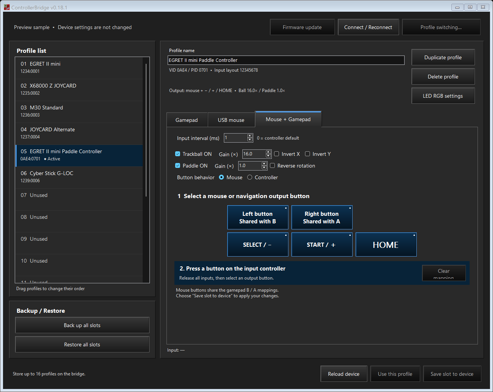
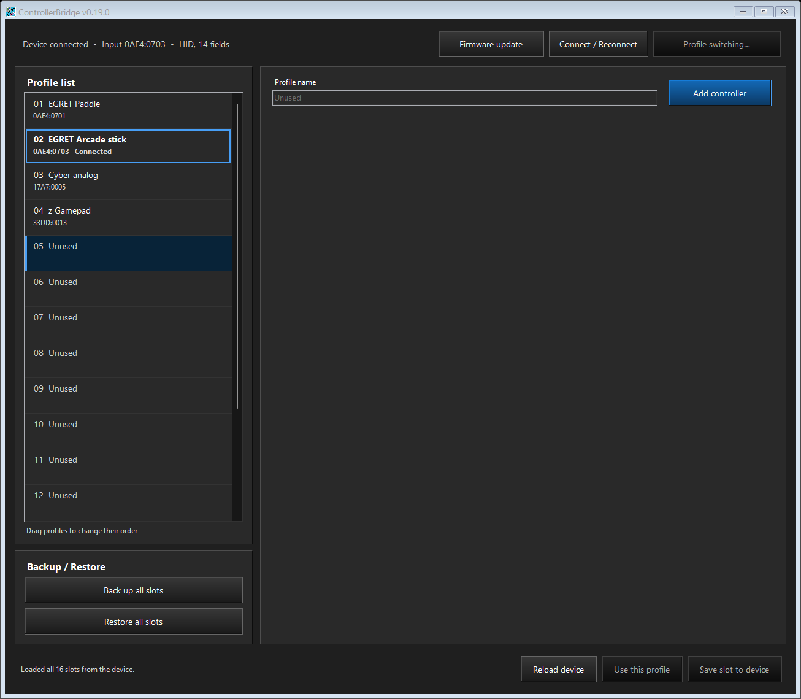
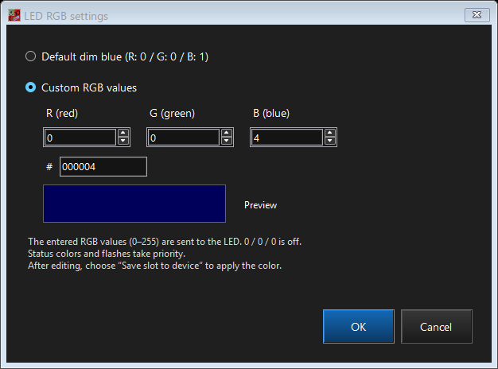
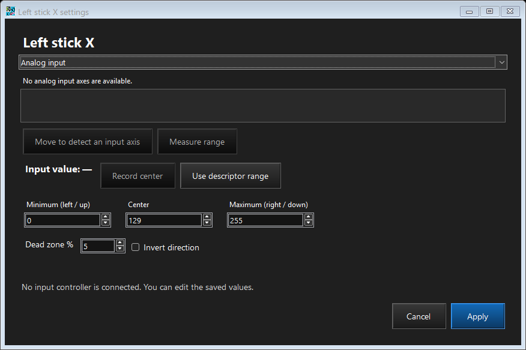

# ControllerBridge user guide

Windows x64 configurator 0.19.0 and RP2350-USB-A firmware 0.19.0. The application follows the Windows display language: Japanese on Japanese Windows, English otherwise. This guide and all repository screenshots use English. Saved profile names are not translated.

## Connect and start

1. Connect the input controller directly to the board's USB-A port.
2. Connect USB-C to a Windows PC.
3. Run `ControllerBridge.exe`.
4. A factory-state RP2350-USB-A automatically opens the firmware installation guide, whether connected before startup or while the tool is running. The dialog immediately waits for reconnection with BOOT held and shows only **Cancel**. Follow its numbered steps; after BOOT is detected, the final **Yes/No** overwrite confirmation opens automatically. A detected bridge with a different or unreadable version also opens guidance; **Firmware update** is available manually. See [firmware update](firmware-update.md).
5. Check the connection status and the **Profile list**. Installing this release over firmware older than 0.16.0 starts with all 16 slots unused; choose **Add controller** to register each controller again. New registrations persist across restarts.

The executable includes its runtime; no separate .NET installation is required. Only one instance can run. Close other bridge configuration tools while using the GUI. When the board is disconnected, the application retries about every two seconds. **Connect / Reconnect** starts an attempt immediately. An empty USB-A port shows a stable waiting message during enumeration retries.

When no recognized board is detected, the window shows **Device not connected** and waits quietly. A factory-state board exposing Pico SDK USB or a board in RP2350 BOOT mode shows **Device unsupported**, even though it has no ControllerBridge HID interface. This automatically opens the installation guide at startup or on background detection. Cancelling the wait or declining the final confirmation keeps that status visible without repeating the popup during the same connection. Once a disconnection is observed, connecting the board again opens guidance again. Background retries keep the editor enabled and preserve unsaved edits. A readable firmware mismatch is shown as an update requirement. For other USB identities, use **Firmware update** manually.

The initial and minimum main-window client size is 1290 × 1100 at 100% scaling (1306 × 1139 including the window frame in the checked environment). This fits the profile details in Japanese and English, including **Mouse + Gamepad → Controller** with all analog-axis buttons visible. The Clear mapping action sizes to its label so the English text stays on one line.

These screenshots were refreshed on 2026-10-30 from the four profiles saved on the device: **EGRET Paddle**, **EGRET Arcade stick**, **Cyber analog**, and **z Gamepad**. The main window shows slot 02, **EGRET Arcade stick**, connected and active.

## Profiles and slots

The board stores 16 profiles in total, including multiple profiles for one controller. Each stores its name, device matching information, output mode, button behavior, mappings, rapid fire, input interval, mouse settings, and LED color. The profile currently active for the connected controller is bold and outlined in blue in the list, with a **Connected** label. This remains visible when another row is selected and clears when the controller or bridge disconnects. The bold styling applies only inside the list; the editor keeps its normal fonts.

Selecting a registered slot opens its settings without changing the active profile on the board. **Use this profile** activates a saved profile matching the connected controller. Unsaved edits have a `*`; choose **Save slot to device** to apply them. An unused slot shows **Unused** in a disabled gray profile-name field, hides the settings, and offers **Add controller**. Selecting a registered slot restores the normal editable name field.

When a supported controller finishes initialization and has no matching saved or draft profile, the GUI selects the first available slot from the top. This only changes the list selection: no confirmation opens, no wizard starts automatically, and nothing is written to the board. Later manual selection is preserved until another attachment. Unsaved edits, another modal window, and ongoing operations defer this selection. A pending deletion is not an available slot until it is saved.

If there is no matching profile and no usable empty slot, the connection header displays **A controller without a profile is connected, but no empty slot is available.** It does not open a popup or overwrite an existing profile. The message clears when the condition no longer applies. Matching uses the existing VID/PID and optional descriptor/revision rules, not individual physical unit serial numbers.

In this screenshot, unused slot 05 was selected manually to show its controls. The connected **EGRET Arcade stick** remains active in slot 02, with its bold label and blue outline. This image shows the unused-slot interface; it does not depict an unregistered controller arriving.

### Add, duplicate, and delete

**Add controller** opens a registration wizard. Confirm the detected device, assign inputs, configure any analog axes, and save to the board. Registration requires valid input from the connected controller and an empty slot in both the saved bank and the editor. The GUI retains the original bridge handle and input identity; firmware 0.19.0 checks the input connection generation and identity at transfer start and again at commit. Disconnecting, reconnecting even the same controller, changing the input identity, or occupying the destination cancels that registration transaction. Ordinary saved-profile edits keep their existing offline behavior.

**Duplicate profile** copies the selection into the nearest unused slot below it. It creates a new ID and appends an available `[2]`, `[3]`, and so on to the stored name. Copying a numbered copy does not nest suffixes. The original name stays unchanged. Reordering or deleting other profiles does not renumber names. Names are shortened at complete Unicode character boundaries when necessary to fit the 47-byte UTF-8 limit. Save the new slot to persist it. Duplication does not wrap to unused slots above the source.

**Delete profile** marks the selected slot unused after confirmation. Save that slot to apply the deletion. Before saving, **Reload device** can discard the draft.

### Inspect raw inputs during registration

On **Add controller → 2 Map inputs**, choose **Input log…**. The separate window stays open while you select output buttons, press physical inputs, or calibrate an axis. It starts with a snapshot of all parsed fields and then records each received value change, including releases and inputs that are not assigned to any output.

Press and release one physical button at a time, then compare these columns:

| Column | Meaning |
|---|---|
| Index | ControllerBridge's internal input-field index, starting at zero; it is not a Switch output-button index |
| Input / Usage | Parsed input name and the hexadecimal usage page/ID; two distinct fields can report the same button number |
| IF / ID / bit / bits | Interface, report ID, bit offset, and field width identifying the source used by mappings |
| Raw / Hex | Value before mapping, calibration, inversion, or dead zone; hexadecimal is limited to the field's bit width |
| State / range | Pressed/released state or axis kind, followed by the descriptor's logical range |
| PC time / Device µs | PC receipt time and the device's 32-bit microsecond event timestamp; device time wraps at 2^32 |

Two rows named **Button 1** can still be distinguished by their Index and IF/ID/bit. If two physical buttons send exactly the same USB data, the software cannot identify which one was pressed. HID fields and normalized XInput/Switch fields use the same log; it is a parsed-field change log, not a capture of every raw USB packet. Unchanged reports are not repeated, and relative-input fields follow the firmware's existing change notifications.

**Pause recording** stops only logging; mapping and live input continue. Resuming marks the omitted interval and adds a new current-state snapshot. **Follow latest** controls scrolling. **Clear** starts a fresh history with current values. **Copy all** copies the retained log, and **Save log…** writes a UTF-8 tab-separated `.tsv` or `.txt` file.

The window retains the latest 2,000 rows and reports how many older rows were discarded. A firmware event-ring overrun is explicitly marked and stops registration through the existing input-loss guard. Closing, cancelling, or completing the wizard stops recording but leaves an already-open log available for copying or saving. Closing and reopening the log during registration starts a new history. Viewing and recording inputs never saves a profile.

### LED color

Select a profile, then choose **LED RGB settings** directly below **Delete profile**. **Default dim blue** retains the original ready color and brightness: R=0, G=0, B=1. Choose **Custom RGB values** to enter each channel from 0 to 255. The channel values are sent directly, without brightness scaling or RGB565 quantization. R=0, G=0, B=0 turns off the ready LED.

**OK** changes the selected draft; **Cancel** leaves it unchanged. Choose **Save slot to device** to persist it. The color is shown when that profile is active, input is received, and the output host is ready. Browsing another slot does not change the hardware color. Error, save, waiting, and profile-number indications retain their existing colors and priority. After an indication ends, the active profile color returns.

The screenshot shows the saved **EGRET Arcade stick** setting: **Default dim blue**, R=0, G=0, B=1 (#000001).

The `#` field below the R/G/B spinners accepts six hexadecimal digits with or without a leading `#`; the prefix is removed automatically. For example, paste `000004` or `#000004` to set R=0, G=0, B=4. Uppercase and lowercase letters are accepted. Editing either the code or a spinner updates the other controls and the preview. Incomplete, invalid or overlong codes cannot be confirmed; they are not silently shortened into another color. **Cancel** remains available while editing an incomplete code.

The single preview uses gamma 4.0 internally, following the user's comparison with the actual LED. There is no gamma control, explanatory curve text or uncorrected swatch. Earlier PC preview preferences are ignored. The entered code and channel bytes remain exact; this display correction does not alter the profile or firmware output. The preview itself does not require a firmware change. This release bundles 0.19.0 for the separate guarded-registration feature, so install its matching firmware.

New profiles and existing 0.16.x/0.17.x profiles default to dim blue. Duplicating a profile copies its color; reordering, individual export/import, and whole-bank backup/restore retain it. Selecting **Default dim blue** removes the custom setting. The color is not assigned automatically or required to be unique; use a different color for each profile if desired.

### Reorder

Drag a registered profile to the blue insertion line. The upper half of a row inserts before it; the lower half inserts after it. The list scrolls near its edges. `Alt+Up` and `Alt+Down` also move the selection.

Save pending edits before reordering. A completed move is saved immediately and verified by reading back the bank. Profile data, ID, shortcut, and saved selection move together. BOOT and controller shortcuts cycle matching profiles in this order.

## Backup and restore

- **Back up all slots** saves all 16 persisted slots, their order, IDs, shortcuts, and selections to one JSON file.
- **Restore all slots** validates the file, asks for confirmation, replaces the bank, and reads it back for verification.

Per-profile output modes, button behavior, and LED colors are included. Common diagnostic settings and saved measurements are separate. Save or discard drafts before either operation.

New backups use `ControllerBridge.Slots`, JSON version 2, with a SHA-256 checksum. Older backup files, including JSON version 1, are rejected. There is no migration from earlier saved settings. The board validates the full payload, generation, CRC, and profile structure before writing the inactive Flash copy. An interrupted transfer before commit does not replace the active bank.

### Individual profile files

For occasional individual transfers, right-click a registered row and choose **Export**, or right-click an unused row and choose **Import**. The keyboard menu key and `Shift+F10` also open the selected row's menu. No additional buttons appear in the normal interface.

Export includes current edits. Import creates an unsaved draft; **Save slot to device** persists it. Occupied slots cannot be overwritten this way. Duplicate names receive a number; missing IDs or IDs conflicting with another slot receive a new ID. Unique names and IDs remain unchanged. Canceling or rejecting a file preserves existing drafts.

Individual files use `ControllerBridge.Profile`, JSON version 2. Earlier exports are rejected. They exclude slot order, shortcuts, and active selection, and cannot replace whole-slot backups.

## Map inputs and calibrate axes

Select an output control, release the physical input, and perform the action to assign. Already-held inputs must return to neutral before learning. A connection change or event overrun cancels learning.

Analog axes support measured minimum, center, maximum, a 0-50% dead zone, and inversion. Alternatively, use two digital inputs for negative and positive movement; pressing both produces center.

The live **Input value** readout reserves enough width for a signed 32-bit value. **Record center** and **Use descriptor range** keep their positions when the value changes sign or number of digits.

The analog dialog displays all candidate axes with live centered meters and raw values. Move the physical control to identify its axis, then select the matching row. Unselected axes update too. Large sets use multiple columns when needed.

The screenshot shows the saved **Cyber analog** profile's **Left stick X** settings: minimum 0, center 129, maximum 255, dead zone 5%, and no inversion. That controller was not connected during capture, so the input list and live value are empty and learning controls are disabled. Connect the matching controller to identify and measure its live axes.

The meter uses the descriptor range before calibration, inversion, or dead zone. A range crossing zero uses zero as its reference; other ranges use their midpoint. Missing input shows a waiting state; out-of-range values appear gray. Select the source, measure its travel, record the released center, and apply the result.

**Rapid fire...** sets assigned buttons to Off or 2-30 press/release cycles per second while held. Apply the dialog, then save the slot. Rapid fire is unavailable for unassigned buttons or digital pairs used as analog axes.

**Input interval (ms)** belongs to the profile. `0` uses the controller descriptor's interval; `1` requests a transfer every millisecond. The controller can answer NAK when no data is ready. Request rate does not establish its internal scan rate or the game's sampling rate.

## Output modes

| Tab | Output |
|---|---|
| Gamepad | Mapped buttons, directions, and stick axes as a Switch-compatible gamepad |
| USB mouse | Relative movement and buttons as a standard USB mouse |
| Mouse + Gamepad | Separate mouse and gamepad HID interfaces on one USB device |

Selecting a tab edits the profile. Save the slot to persist it. Only the combined tab shows **Button behavior**:

- **Mouse** sends left/right clicks while the gamepad supplies Minus, Plus, and HOME. Left/right click share the B/A mappings.
- **Controller** sends all mapped gamepad buttons, directions, and axes. The mouse supplies movement with its buttons released.

A USB layout change reconnects USB-C; the USB-A input host remains running. Changing only combined-mode button behavior needs no USB reconnection.

For the EGRET II mini Paddle Controller, trackball and paddle can be enabled independently. Trackball gain is 1.0-64.0, default 16.0; paddle gain is 1.0-10.0, default 1.0, both in 0.1 steps. The paddle produces horizontal movement. With both enabled, horizontal trackball and paddle movement are added.

## Switch profiles without a PC

Use **Profile switching...** to select a roughly one-second BOOT hold or a controller shortcut for all profiles matching that controller. A shortcut needs at least two nonconflicting buttons or directions pressed within 100 ms. Release them before repeating it. Shortcut inputs also reach the game.

The shortcut method disables BOOT monitoring. Purple LED flashes indicate the matching profile's number. Selection is saved and survives reconnection. See [LED behavior](status-led.md) and [device compatibility](compatibility.md).
