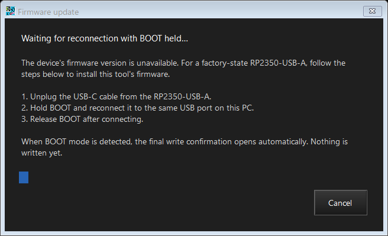
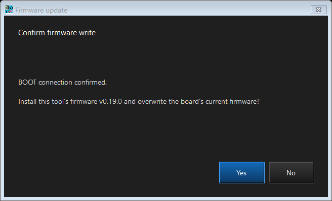

# Firmware update

ControllerBridge 0.19.0 embeds its matching `ControllerBridge.uf2` in the Windows executable. Use **Firmware update** at the top of the main window, including when the normal profile connection is unavailable. The updater always compares for exact version equality; it does not classify versions as upgrades or downgrades.

## Automatic startup and connection guidance

The main window checks the firmware identity before reading capabilities or profile data. Only an exact match with the bundled version proceeds to normal settings reads. Detection runs at startup and about every two seconds while waiting for a usable connection.

- A readable different version automatically opens the updater with the device and bundled versions. The existing **Install v0.19.0?** confirmation follows. Lower and higher versions are treated alike.
- A factory-state RP2350-USB-A exposing Pico SDK CDC/reset USB (`2E8A:0009`), a board in RP2350 BOOT mode (`2E8A:000F`), or a detected bridge without readable firmware information shows **Device unsupported** and automatically opens the BOOT connection guide. It immediately monitors for BOOT connection and shows only **Cancel**. A valid BOOT connection advances to the final overwrite confirmation automatically. This works both when the board is already connected at startup and when it is detected while the tool is running.
- With no recognized board, the tool shows **Device not connected** and waits without opening an update guide or recording a startup error. Unrelated USB peripherals do not trigger installation. Other firmware with unrecognized USB identities can still use **Firmware update** manually.

Opening a guide never starts programming by itself. **Cancel**, Escape, or closing the BOOT wait exits without writing; **No**, Escape, or closing the final confirmation also cancels. The main window retains its explanatory status and continues discovery without disabling/re-enabling the editor. Unsaved drafts remain editable. The same device/version condition is prompted once while the board stays connected; cancelling does not cause a recurring popup. An observed disconnection rearms guidance for the next attachment. **Firmware update** remains available to reopen it. Disconnection by itself never opens a guide.

Background discovery pauses while another modal editor is open. Manual firmware update waits for any pending discovery to finish. Closing the updater reconnects without immediately reopening the same automatic guide.

The factory-state screenshot was captured on 2026-10-31 with the supplied RP2350-USB-A connected. The BOOT wait was cancelled, preserving its factory firmware.

## Confirmation flow

1. Choose **Firmware update**. The dialog shows **Checking firmware version...**.
2. If the device already has the bundled version, it reports that version and finishes without rebooting or writing.
3. If a supported device reports a different version, the dialog asks **Install v0.19.0?**. **No** exits; **Yes** starts automatic programming.
4. If no supported version response is available, the dialog immediately shows **Waiting for reconnection with BOOT held...** and only a **Cancel** button. Unplug the RP2350-USB-A's USB-C cable, hold **BOOT**, reconnect to the same PC USB port, then release BOOT. This wait has no timeout. **Cancel**, Escape, or the window close button exits without writing.
5. Once the target's RP2350 BOOT USB identity and disk information are validated, the dialog automatically shows **Confirm firmware write** with **Yes/No** buttons. It states that BOOT connection was confirmed and names the bundled version. Only **Yes** starts the transfer; **No** exits without writing. If the board was already in validated BOOT mode, this final confirmation appears directly after detection.

During programming, keep the USB cable attached. The dialog shows mode switching, file transfer progress, restart/reconnection, and installed-version verification. Completion is shown only when the application on the programmed USB port reports the bundled version. A successful file copy or disappearance of the USB drive alone is not treated as completion.

The **Yes/No** prompts default to **No** for Enter and Escape. Closing a confirmation dialog also cancels. While programming or checking the restart, the update dialog and main window cannot be closed through their normal close controls.

## First installation and recovery

A factory-state RP2350-USB-A starts with its existing USB software, not ControllerBridge. Its detected Pico SDK USB identity opens the first-installation guide automatically. Hold BOOT while reconnecting USB-C to the same PC port, then accept the separate overwrite confirmation to install the bundled image. A board already in RP2350 BOOT mode is also detected automatically. Neither route requires Explorer or a file selection dialog. A detected ControllerBridge device with no version response follows the same BOOT guide.

Only one target board should be connected. The updater checks the RP2350 BOOT USB identity and its `INFO_UF2.TXT`; it rejects multiple candidates. When a factory or application USB target was identified, BOOT must appear on that same USB port. After either route, the running application must return on the programming target's USB port.

Pico SDK USB identity is shared across boards, and BOOTSEL identifies the RP2350 chip rather than carrier-board wiring. These identities initiate guidance; they do not by themselves authorize programming. The confirmation requires the user to connect the supported Waveshare RP2350-USB-A. Custom OTP USB identities and other carrier boards are outside the supported configuration.

Manual BOOT reconnection waits until detection or cancellation. The automatic BOOT transition after confirming a readable version mismatch still has a 30-second timeout; restart verification has a 45-second timeout. If either times out, the dialog reports failure and gives recovery instructions. The updater does not retry a write automatically. Reconnect while holding BOOT and run **Firmware update** again. The embedded image is reused; no separate firmware download is needed.

Unsaved profile edits remain in the main window, and the updater does not save or restore them. Current storage formats remain unchanged from 0.16.0. Updating from a pre-0.16.0 firmware starts with unused slots because those older records are intentionally ignored. This updater does not restore an old backup.

## Image and device checks

- The executable embeds a manifest and the exact UF2 produced by its build. It verifies the SHA-256 checksum before opening the update dialog.
- The UF2 must contain consecutive, complete RP2350 Arm secure Flash blocks starting at `0x10000000`. Its addresses must remain below `0x101F8000`, preserving the last 32 KiB reserved for settings.
- Disk selection combines the Windows storage-device mapping, USB parent identity `2E8A:000F`, and RP2350 `INFO_UF2.TXT`. A volume label alone is insufficient.
- USB location paths associate the normal HID application, BOOT disk, and returning application. This does not rely on a drive letter staying the same.
- Cancelling the BOOT wait prevents the final confirmation and any write, including cancellation at the detection boundary. After the final confirmation, the selected disk and USB identity are checked again before opening the output file.
- A disconnect during the final write/flush is accepted only provisionally; a matching version after restart is still required. An earlier write interruption fails immediately.

Version verification establishes that the expected application started. It is not a byte-for-byte readback of all Flash contents. No additional PICOBOOT driver or external updater executable is bundled.

## Build and diagnostics

`firmware-version.txt` is the version source shared by CMake and the Windows project. Use `tools/build-configurator.ps1`: it builds the normal firmware, creates the checksum manifest in `build/`, embeds both resources, and publishes `dist/ControllerBridge.exe` plus a separate `dist/ControllerBridge.uf2` for manual recovery. Run this script after changing firmware sources; direct GUI builds only reuse the existing embedded build inputs.

Feature command **47** returns a 56-byte payload: `CBV1` at offset 0, schema 1 at offset 4, board code 1 (RP2350-USB-A) at offset 5, a NUL-terminated ASCII version in bytes 8-31, and `ControllerBridge` in bytes 32-55. Diagnostic trace, fixed-motion, and nonstandard packet-size builds do not advertise this normal-release identity. Command **9** requests BOOTSEL with a 250 ms delay.

    .\tools\build-configurator.ps1 -Restore
    .\dist\ControllerBridge.exe --check-firmware-update captures/firmware-check --language en
    .\dist\ControllerBridge.exe --check-connection-ui captures/connection-check --language en
    .\dist\ControllerBridge.exe --check-startup-readonly captures/startup-check --language en
    .\dist\ControllerBridge.exe --inspect-firmware captures/firmware-readonly.json

The firmware and connection UI checks use simulated devices and render dialogs. The startup read-only check also handles an attached factory-state board: it verifies unsupported status, automatically cancels the real BOOT wait, and observes stable retries. It then simulates only the prior absent state and lets the normal timer rediscover the attached real USB device, exercising the connection-time path without physically disconnecting or modifying the board. The inspection command reads version/USB identity and detects BOOT disks. No serial reset, reboot, or programming is performed by these checks. See [verification](verification.md) for results and remaining hardware validation.

The device-selection design follows the [Raspberry Pi USB PID allocation](https://github.com/raspberrypi/usb-pid), [RP2350 boot ROM disk implementation](https://github.com/raspberrypi/pico-bootrom-rp2350/blob/master/src/nsboot/usb_virtual_disk.c), and Microsoft's [USB device interface class](https://learn.microsoft.com/en-us/windows-hardware/drivers/install/guid-devinterface-usb-device), [USB location property](https://learn.microsoft.com/en-us/windows-hardware/drivers/install/devpkey-device-locationpaths), and [storage device-number query](https://learn.microsoft.com/en-us/windows/win32/api/winioctl/ni-winioctl-ioctl_storage_get_device_number).
