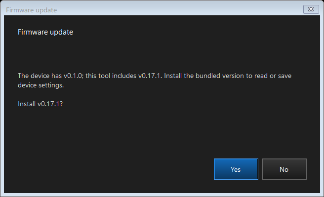
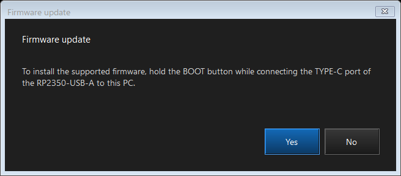

# Firmware update

ControllerBridge 0.19.0 embeds its matching `ControllerBridge.uf2` in the Windows executable. Use **Firmware update** at the top of the main window, including when the normal profile connection is unavailable. The updater always compares for exact version equality; it does not classify versions as upgrades or downgrades.

## Automatic startup guidance

The main window checks the firmware identity before reading capabilities or profile data. Only an exact match with the bundled version proceeds to normal settings reads. The window distinguishes a detected bridge with different firmware, a detected bridge without readable version information, and no supported interface detected.

- A readable different version automatically opens the updater with the device and bundled versions. The existing **Install v0.19.0?** confirmation follows. Lower and higher versions are treated alike.
- A detected bridge without version-query support automatically opens the BOOT connection guide, followed by the separate overwrite confirmation if accepted.
- If no supported interface is detected, the tool shows **Device not connected** and waits without opening an update guide or recording a startup error. This applies at startup, during background retries, and after manual reconnect. Factory firmware, BOOT mode, or other software may expose no recognizable bridge interface; use **Firmware update** manually for those states.

Opening a guide never starts programming by itself. **No**, Escape, or closing a confirmation exits without writing. The main window retains its explanatory status and continues discovery about every two seconds without disabling/re-enabling the editor. Unsaved drafts remain editable. The same device/version condition is prompted once per application session; declining does not cause a recurring popup. **Firmware update** remains available to reopen it. A newly detected different firmware condition can prompt once, while an ordinary disconnection after a working connection does not open an installation guide.

Background discovery pauses while another modal editor is open. Manual firmware update waits for any pending discovery to finish. Closing the updater reconnects without immediately reopening the same automatic guide.

## Confirmation flow

1. Choose **Firmware update**. The dialog shows **Checking firmware version...**.
2. If the device already has the bundled version, it reports that version and finishes without rebooting or writing.
3. If a supported device reports a different version, the dialog asks **Install v0.19.0?**. **No** exits; **Yes** starts automatic programming.
4. If no supported version response is available, the dialog asks you to hold **BOOT** while connecting the **TYPE-C** port of the **RP2350-USB-A** to the PC. After you choose **Yes**, it separately asks whether to overwrite the board with this tool's firmware. Both confirmations are required. **No** at either prompt exits without writing.

During programming, keep the USB cable attached. The dialog shows mode switching, file transfer progress, restart/reconnection, and installed-version verification. Completion is shown only when the application on the programmed USB port reports the bundled version. A successful file copy or disappearance of the USB drive alone is not treated as completion.

The **Yes/No** prompts default to **No** for Enter and Escape. Closing a confirmation dialog also cancels. While programming or checking the restart, the update dialog and main window cannot be closed through their normal close controls.

## First installation and recovery

Firmware predating the version-query command, including 0.16.0, follows the BOOT connection route once. Later normal releases support the automatic route. A board already in BOOT mode can also use the manual route without Explorer or a file selection dialog.

Only one target board should be connected. The updater checks the RP2350 BOOT USB identity and its `INFO_UF2.TXT`; it rejects multiple candidates. With automatic mode switching, BOOT must appear on the same USB port as the confirmed application. After either route, the running application must return on the programming target's USB port.

BOOTSEL identifies the RP2350 chip, not the particular carrier-board wiring. The manual confirmation therefore requires the user to connect the supported Waveshare RP2350-USB-A. Custom OTP USB identities and other carrier boards are not accepted or supported by this updater.

If BOOT detection or restart verification times out, the dialog reports failure and gives recovery instructions. The updater does not retry a write automatically. Reconnect while holding BOOT and run **Firmware update** again. The embedded image is reused; no separate firmware download is needed.

Unsaved profile edits remain in the main window, and the updater does not save or restore them. Current storage formats remain unchanged from 0.16.0. Updating from a pre-0.16.0 firmware starts with unused slots because those older records are intentionally ignored. This updater does not restore an old backup.

## Image and device checks

- The executable embeds a manifest and the exact UF2 produced by its build. It verifies the SHA-256 checksum before opening the update dialog.
- The UF2 must contain consecutive, complete RP2350 Arm secure Flash blocks starting at `0x10000000`. Its addresses must remain below `0x101F8000`, preserving the last 32 KiB reserved for settings.
- Disk selection combines the Windows storage-device mapping, USB parent identity `2E8A:000F`, and RP2350 `INFO_UF2.TXT`. A volume label alone is insufficient.
- USB location paths associate the normal HID application, BOOT disk, and returning application. This does not rely on a drive letter staying the same.
- A disconnect during the final write/flush is accepted only provisionally; a matching version after restart is still required. An earlier write interruption fails immediately.

Version verification establishes that the expected application started. It is not a byte-for-byte readback of all Flash contents. No additional PICOBOOT driver or external updater executable is bundled.

## Build and diagnostics

`firmware-version.txt` is the version source shared by CMake and the Windows project. Use `tools/build-configurator.ps1`: it builds the normal firmware, creates the checksum manifest in `build/`, embeds both resources, and publishes `dist/ControllerBridge.exe` plus a separate `dist/ControllerBridge.uf2` for manual recovery. Run this script after changing firmware sources; direct GUI builds only reuse the existing embedded build inputs.

Feature command **47** returns a 56-byte payload: `CBV1` at offset 0, schema 1 at offset 4, board code 1 (RP2350-USB-A) at offset 5, a NUL-terminated ASCII version in bytes 8-31, and `ControllerBridge` in bytes 32-55. Diagnostic trace, fixed-motion, and nonstandard packet-size builds do not advertise this normal-release identity. Command **9** requests BOOTSEL with a 250 ms delay.

    .\tools\build-configurator.ps1 -Restore
    .\dist\ControllerBridge.exe --check-firmware-update captures/firmware-check --language en
    .\dist\ControllerBridge.exe --check-connection-ui captures/connection-check --language en
    .\dist\ControllerBridge.exe --check-startup-readonly captures/startup-check --language en
    .\dist\ControllerBridge.exe --inspect-firmware captures/firmware-readonly.json

The firmware and connection UI checks use simulated devices and render dialogs. The startup read-only check accepts either no detected bridge or an attached older/different bridge. It verifies that absence produces no guide; for an older/different bridge it automatically declines the guide. Both cases observe background retries without rebooting or programming a device. The inspection command only reads version/USB identity and detects BOOT disks. See [verification](verification.md) for the actual checks performed and remaining hardware validation.

The device-selection design follows the [Raspberry Pi USB PID allocation](https://github.com/raspberrypi/usb-pid), [RP2350 boot ROM disk implementation](https://github.com/raspberrypi/pico-bootrom-rp2350/blob/master/src/nsboot/usb_virtual_disk.c), and Microsoft's [USB location property](https://learn.microsoft.com/en-us/windows-hardware/drivers/install/devpkey-device-locationpaths) and [storage device-number query](https://learn.microsoft.com/en-us/windows/win32/api/winioctl/ni-winioctl-ioctl_storage_get_device_number).
