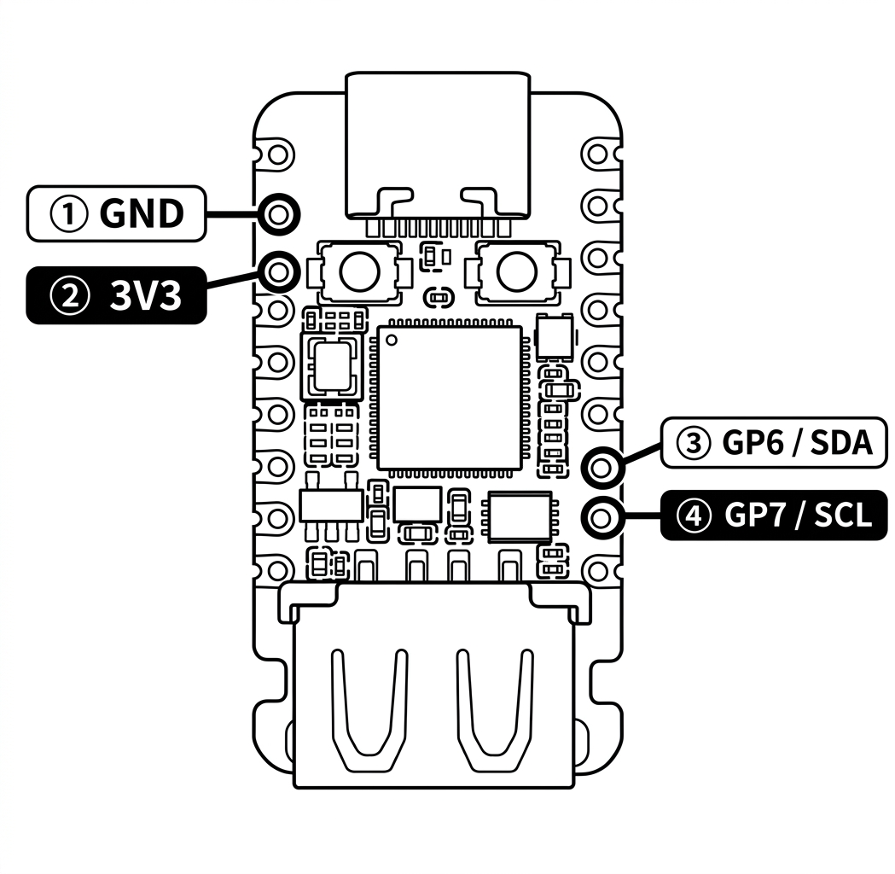

# OLED status display

Firmware 0.35.0 supports a 64×32 OLED on the Waveshare RP2350-USB-A with SDA on GP6 and SCL on GP7. Connect the display to 3.3 V and GND. The display uses I²C1 at address 0x3C or 0x3D. The supported panel uses SSD1306-compatible commands, column offset 32, 32 display rows, and A1/C8 orientation; panels with different geometry need different firmware settings.

The firmware checks the two display addresses only at startup. If neither responds, no display updates are attempted until the next restart. Connecting a display after startup therefore requires restarting the board.

## Connection reference



Reference wiring: ① GND, ② 3V3, ③ GP6 / SDA, ④ GP7 / SCL.

## Display type

Open **Shared settings → Display**, immediately below **Host mode**. Select a type and choose **Save to device**. The choice applies to every profile and is retained after restart. OFF is used when no valid display setting has been saved, including an upgrade from firmware without display settings. An existing saved display type is preserved during updates. Use the matching 0.35.0 configurator and its bundled firmware; an earlier build with the same number may require an update.

| Type | Display |
|---|---|
| OFF | Default. Turns off the OLED and stops display updates and interval sampling. The startup OLED presence check still runs. |
| Profile name + polling interval + index | The top three rows show the name; the final row shows a measured output polling interval, actual S/X/G mode, and slot 01–16. |
| Maximum profile name + output mode | Wraps the name across 30 cells: 8 + 8 + 8 + 6. The final two cells always contain a space and S, X or G. Long words wrap to the next row. |
| Profile name + transmitted input | The profile name, up to two pressed output button names in brackets, and active output stick X/Y in hexadecimal. |
| Detail A | From top to bottom: the connected controller's 4-digit VID followed by its 4-digit PID, IN interval, OUT interval, and input payload bytes per second. |
| Detail B | Controller VID/PID, 32 input button bits, native input X/Y and Rx/Ry; all four rows use hexadecimal. |
| Detail C | Signed X/Y mouse output counts per second; R: theoretical input capacity at the current polling interval; S: actual received input reports per second. |

The display has four rows of eight 8×8 character cells. Profile names use printable ASCII; other characters are omitted without changing the saved name. The transmitted-input view also has small dedicated glyphs for the four PlayStation button symbols. With the interval/index type, whitespace separates the name into rows, each word is cut at eight characters, and words after the third row are omitted. With maximum-name display, whitespace becomes a single space, and all text wraps across the available cells.

S means Switch output, including Pro. X means XInput output. G means GameCube adapter output. These indicate the actual output format, including Auto's X/S change, rather than identifying the connected console. With no active profile, the name area stays blank and the interval/index type shows `S--`, `X--` or `G--`.

For `EGRET Paddle` in slot 1, with an observed 1 ms output interval:

```text
EGRET
Paddle

 1ms S01
```

Maximum-name display for `ABCDEFGHIJKLMNOPQRSTUVWXYZ123456789`:

```text
ABCDEFGH
IJKLMNOP
QRSTUVWX
YZ1234 S
```

Detail A example (values are illustrative):

```text
0413502B
 IN: 1ms
OUT: 1ms
16384B
```

IN is the observed request interval on the controller's primary input endpoint; OUT is the observed request interval on the main output endpoint toward the console or PC. Both include requests with no new data. Separate endpoints are not added together to shorten the interval. The fourth row shows the approximate successful input payload bytes per second, across input endpoints. It is a traffic indicator rather than total USB bus traffic: headers, control transfers and duplicate packets are excluded. Rates update about once per second; IN can take two to three seconds to settle after enabling Detail A or reconnecting.

The first row has no separator: `0413502B` means VID `0413` and PID `502B`. These belong to the controller connected to USB-A, not the converter. An adapter reports its own VID/PID; the IDs do not identify controllers behind it or individual units with a serial number. No controller is shown as `--------`. Detail A uses the entire first row for these IDs; output mode and profile index remain available in the configurator and the other display types.

The interval is the average time between the connected host's USB input requests, including requests that find no new report. It is sampled about once per second; it does not measure the controller's internal scan rate or total input latency. `--ms` means waiting for a usable sample or no requests. Values below 100 ms use integer milliseconds; longer intervals use tenths of a second. After startup, settings saves, or USB reconnection, allow about one to two seconds for a fresh value.

Names and mode update when the active profile, its saved name, the selected display type, or the actual output format changes. The interval/index type also updates when its displayed average changes. Only rows with changed text are sent to the OLED; unchanged text causes no redraw. Input traffic counting is enabled only while Detail A or C is active on a detected, working OLED. OFF and maximum-name display do not sample polling intervals. A missing OLED causes no runtime display work; a failed transfer stops OLED communication until restart.

## Profile name + transmitted input

Select **Profile name + transmitted input** immediately above Detail A (**プロフィール名 + 送信情報** in Japanese). This is an ordinary display type, intended for checking what the converter is sending after assignments, shift, turbo/toggle and direction/stick conversion.

| Row | Display |
|---|---|
| 1 | The first eight visible characters of the active profile name; whitespace is compacted. |
| 2 | The first pressed output button, using the profile's selected button labels. |
| 3 | A second pressed output button, if present. |
| 4 | The active output stick's X (4 hexadecimal digits) followed by Y (4). |

Button names include brackets: `[A]`, `[Option]`, `[LStick]`. The name inside is at most six cells. `OPTIONS` is abbreviated to `Option`, `CAPTURE` to `Capt.`, and the stick-click labels to `LStick` / `RStick`. PlayStation square, cross, circle and triangle use dedicated symbols. An output without a name in the selected system uses its fixed ID, such as `[Btn14]`. Names follow the saved button-label choice; output mode does not select or swap them. This is not automatic recognition of the physical controller's printed names.

Buttons are listed in the same fixed ID order as the assignment interface: the four face buttons, L/R, ZL/ZR, minus/plus, stick clicks, Home/Capture, then Up/Down/Left/Right. At most two are shown; a third simultaneous button does not replace them or start scrolling. Released button rows are blank. The view follows the actual outgoing buttons, including shift/toggle and turbo; a physical input that is suppressed or has no corresponding output bit is not shown as a transmitted button. Guide is available in XInput; Capture can be shown in S/Pro but has no XInput output bit.

X/Y use the same common 16-bit units in S, X, Pro and GC output. `0000` is center, `7FFF` is +32767, `8000` is -32768, and `FFFF` is -1; positive X is right and positive Y is up. The left stick is shown when it is non-neutral. The right stick is shown when only it is non-neutral. When both move, the left stick has priority. At rest the row is `00000000`. This common view does not change the actual USB format or increase the input's resolution.

Example with PS4 labels, Circle and OPTIONS pressed, and the left output stick fully right/down:

```text
DS3 Raci
[○]
[Option]
7FFF8000
```

The display samples the current report prepared for USB transmission up to 20 times per second. Short presses and rapid turbo edges can occur between samples. This view does not confirm that a game accepted the report and does not include a game's own dead zone or sensitivity. Mouse-only output has no gamepad stick state here; use Detail C for mouse output movement. When gamepad output is unavailable, including USB suspension, rows 2–4 show `--------`.

## Detail B: raw controller inputs

Starting with 0.35.0, Detail B shows inputs **before profile assignments and conversion**. It retains saved display ID 4, so an existing Detail B selection automatically uses this new format after updating. Select **Profile name + transmitted input** to inspect the converted output.

| Row | Eight hexadecimal digits |
|---|---|
| 1 | VID (4) + PID (4) for the controller on USB-A. |
| 2 | Input buttons 1–32 as a 32-bit mask: button 1 is bit 0, button 32 is bit 31. |
| 3 | Native input X (4) + Y (4). |
| 4 | Native input Rx (4) + Ry (4); devices that report their second stick as Z/Rz use that pair instead. |

Button numbers are the input's HID Button usages, or the equivalent usages in the supported controller protocol. This is not the XInput output button mask and is independent of saved mappings, button labels, shift, turbo and toggle. Duplicate digital/pressure fields for the same input button share one bit. Hat switches and separate direction fields do not gain invented button bits; a controller that reports its D-pad as numbered buttons can include those bits. Analog trigger amounts are not shown in this four-row layout.

Axes retain their original encoded bit values and directions. No center normalization, dead zone, profile inversion, curve or sensitivity is applied. An 8-bit center of 128 appears as `0080`; a 12-bit center of 2048 as `0800`; a signed 16-bit center as `0000`. Negative values retain the field's own two's-complement bits, so -1 in an 8-bit field is `00FF` and -1 in a 16-bit field is `FFFF`. Y therefore follows the input device's convention. Four displayed digits do not imply that an 8-bit input has 16-bit resolution.

The first X/Y input group determines the interface and report used for the axes; fields from another interface or report are not combined into a fictitious stick. If Rx/Ry are absent, Z/Rz from that same group are shown. Relative X/Y inputs show the latest received delta, not accumulated travel or counts per second. If such a device stops reporting while idle, the last received delta remains visible.

Example: DS3 input buttons 1 and 17, centered left stick, and right X/Y at their native endpoints:

```text
054C0268
00010001
00800080
00FF0000
```

An absent or not-yet-received axis shows `----`; a field wider than 16 bits shows `****` instead of silently discarding bits. The button row is `--------` until a supported numbered button field has been received. No controller shows four rows of hyphens. Input values remain available even when no matching profile is active or the game-facing USB connection is unavailable.

Both input views read existing values up to 20 times per second and redraw only changed rows. They add no input history or event queue. OLED transfers remain asynchronous; USB input handling does not wait for a screen refresh. Selecting another display type stops the unselected view's work. OFF and a missing or failed OLED stop these reads and rendering.

## Detail C: pointing-device movement and input report capacity

Detail C updates about once per second and uses its four rows for X, Y, R and S. It does not show VID/PID. X/Y show signed decimal mouse output counts per second, after the configured sensitivity and inversion, using successfully delivered mouse reports. X is positive right and Y positive down. Values are net movement, so opposite motion cancels within the interval. They are not screen pixels or the game's internal cursor coordinates. The actual elapsed interval is used for the per-second calculation.

```text
X+001234
Y-000056
R 1000/s
S  125/s
```

**R is the theoretical input report capacity at the current polling interval:** 1000 divided by the interval in milliseconds, rounded to the nearest whole report per second. The current input-interval override is used when set; otherwise the primary endpoint's bInterval is used. Examples: 1 ms = 1000/s, 2 ms = 500/s, 8 ms = 125/s. It is not calculated from observed polls or successful reports, and is not a claim about the controller's sensor scan rate or maximum capability under a different setting.

**S is the number of reports the controller actually returned per second.** It counts nonempty successful reports received on the same primary USB-A input endpoint, even when their contents are unchanged. Requests that receive no data, errors and duplicate retries are excluded. Multiple input endpoints are not added together. S is independent of how many reports the converter sends to the console or PC. The example means that the current 1 ms input interval permits 1000 reports/s while the controller returned about 125 reports/s.

R and S describe the input side; X/Y describe the converted mouse output. On a device with separate input interfaces, the R/S pair describes the same primary endpoint as Detail A's IN interval, not every interface. Some devices stop reporting while idle; compare during sustained movement under the same input-interval setting. A zero S reading while idle is valid and does not establish the device's maximum reporting capability. Per-second rounding and the sample boundary can cause small fluctuations; S is not clamped to R to hide them.

X/Y are available for USB mouse and mouse-plus-gamepad profiles with a supported pointing input. Gamepad-only profiles, unavailable mouse output and the first interval show `X-------` / `Y-------`. R/S can still be shown independently. `R ----/s` means the configured input interval is unavailable; `S ----/s` means waiting for a usable measurement interval. No controller shows four rows of hyphens. Magnitudes above 999999 show a sign and six asterisks instead of wrapping; rates above 9999 show `R>9999/s` or `S>9999/s`.

Switching profiles, changing USB state or saving settings discards affected averaging intervals. Existing output totals are read once per update; no additional input history, motion queue or per-output-packet display operation is added. Counting and display work stop when OFF or a different non-metric display type is selected.

## Installation order

**We recommend removing R13 before installing the OLED.** Once the OLED is mounted, physically accessing and removing R13 becomes more difficult.
