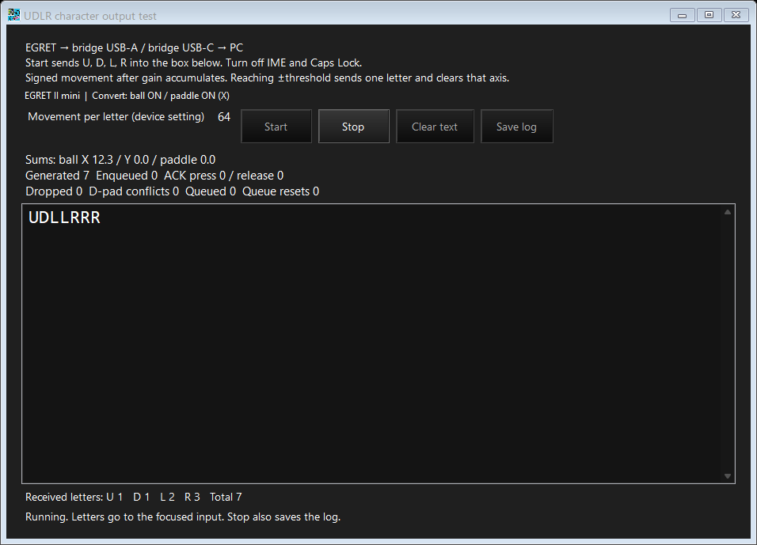

# UDLR keyboard test — 0.20.16-udlr

This optional build emits U/D/L/R letters through the board's USB-C keyboard interface. Connect the EGRET controller to USB-A and the board to the PC by USB-C. Movement conversion runs on the board and shares the normal firmware's conversion code. This dedicated diagnostic still exposes a keyboard-only output. Use normal 0.20.16 in Mouse + Gamepad mode to test simultaneous pointer movement and D-pad clicks; the UDLR test does not expose a mouse interface.

## Build and launch

```powershell
.\tools\build-udlr-test.ps1
```

The script enables CMake `BRIDGE_UDLR_TEST` and MSBuild `UdlrTest`, uses separate intermediates, and writes `test/udlr/dist/ControllerBridgeUdlrTest.exe` and `ControllerBridgeUdlrTest.uf2`. It uses the existing pinned Pico tools and .NET 9 SDK. The EXE embeds that exact test firmware. Firmware alone can be built with `tools/build-diagnostic.ps1 -UdlrTest -BuildDirectory test/udlr/build`. Normal builds explicitly use the default OFF flag and do not contain this test's dialog, button, keyboard descriptor, gate or command 50. Test source is retained at `apps/egret_switch/udlr_test.h` and `gui/ControllerBridge/UdlrTestDialog.cs`.

Run the dedicated EXE, whose title contains **UDLR TEST**. Enable conversion on the active profile and save it. Open **UDLR test…** at the top right. The read-only **Movement per letter (device setting)** shows the current saved threshold (default 64). To edit it, close the test dialog and open **Mouse UDLR settings** on the main window. Press **Start**, turn IME and Caps Lock off, and operate the controller with the text box focused. **Stop** releases output and writes a JSON trial log beside the EXE under `logs/`. Closing the dialog stops output; loss of dialog communication stops it after approximately two seconds.

**Paddle Virtual Rolling uses an analog-stick output, which this keyboard-only diagnostic does not expose.** Select **Mouse UDLR settings → Paddle → Mode → Button clicks** and save before testing paddle letters. Paddle Virtual Rolling suppresses paddle-generated letters. Trackball Virtual Rolling retains the original click letters; Trackball Hold sends held U/D/L/R letters, including two letters for diagonal input. Use normal 0.20.16 to verify stick rotation. The rolling options are shared with normal firmware.

The settings dialog keeps inactive parameters visible and greyed out in every mode. Saved-Hold first opening, source-tab changes and save retries use the same enabled-state rules and fixed positions. This release adds a rotation-step setting and requires matching 0.20.16 firmware. Paddle Virtual Rolling offers 5°, 10°, 15°, 20°, 30°, 40°, 45°, 60° or 90°, default 30°. The saved setting is shared by both variants, but its analog-stick directions can only be observed with normal firmware.

## Trackball Hold

Select **Mouse UDLR settings → Trackball → Mode → Hold**, set its dedicated **Movement threshold** (default 1 pt; integer 1–127), and save. The active profile also needs Trackball ON and Convert to ↑↓←→. Start the diagnostic as usual. Each valid raw X/Y report holds the corresponding source-direction letters when its magnitude meets the threshold, and releases on zero/subthreshold input or sign reversal. Profile X/Y inversion applies; pointer/hidden gains and the shared click threshold/timings do not. No-report idle release uses max(20 ms, twice the input polling interval). Custom gamepad assignments are retained but this keyboard diagnostic continues to show original source directions.

The read-only **Movement per letter** field and commands 49/51 still show the click settings/statistics. They do not report Hold's separate threshold or measure its duration. Existing trial logs do not include complete Hold mode metadata or transitions. Windows keyboard autorepeat may add repeated letters during one hold; character count is not a count of Hold presses or generated clicks. Use normal firmware to check the actual assigned gamepad output.

## Click conversion

The following applies to **Trackball Virtual Rolling** (legacy clicks) and **Paddle Button clicks**.

- Trackball and paddle click conversion use hidden device-wide gains, initially **6.0×** and **1.5×**. These are stored separately from pointer sensitivity and are not displayed or editable in the GUI. Saved profile mouse sensitivity is retained but does not affect the test or normal D-pad conversion. Inversion remains effective.
- Trackball X is L/R, Y is U/D. Paddle **X axis** is L/R and **Y axis** is U/D; **Reverse rotation** reverses the selected pair. The profile UI uses Convert to ↑↓←→ for trackball and Enable conversion for paddle.
- Three independent signed sums retain tenths. Reaching the saved threshold (initially ±64) sends one press/release, clears that sum, and discards excess. Simultaneous crossings are sent ball X, ball Y, paddle. With the initial threshold and cursor gains, a raw +11 ball count or a paddle magnitude of 43 crosses from zero; each produces only one letter even if movement is much larger.
- The shared threshold is stored in the device's common configuration sector and survives reboot/profile switching. **Mouse UDLR settings** edits it from 1–256 pt, independently of the test's Start/Stop controls. Starting or stopping a trial does not write Flash. The test sends no physical-button letters.

Pressed **Hold time** and released **Wait time** are separate persistent device-wide parameters, initialized to 30 ms and 20 ms respectively and each editable from 1–512 ms in **Mouse UDLR settings**. Each phase is timed from its corresponding successful USB completion, with four waiting clicks. Missing wait settings inherit a valid previously saved shared hold duration on upgrade. Without a valid saved hold, wait initializes to 20 ms. Valid independent saved values, including 16/16 ms, are preserved. Held keyboard reports retain the same letter until release; overflow is counted and discarded. Command 51 / `controllerctl.py direction-timing` reports actual ACK-to-ACK timing separately from the GUI letter log. The text count is PC reception, while generated/enqueued/ACK press/release counts describe firmware output. Keyboard letters go to whichever PC field has focus. Logs include the common threshold, actual hidden conversion gains read from the device, paddle axis, retained profile settings, letters and sampled counters. Stored profile gain therefore can differ from `conversionGains` intentionally. The preview below is the unchanged 0.20.7 UI with synthetic input, not measured controller motion.



## Test-only protocol and returning to normal

Command 50 requires `UDL2`, enable byte at offset 4, and zero at offset 8 (no threshold parameter). It returns `UTS2`, schema 2, enable status and threshold. Old `UDL1` requests and nonzero threshold requests are rejected. Command 49 keeps `DKY1` with byte 6=2 for this variant and byte 7=running; normal firmware leaves both zero. Successful status polling renews the two-second lease. No converted letters are sent until Start.

Use the normal `dist/ControllerBridge.exe` updater to return to normal 0.20.16. Normal firmware emits clicks, trackball-held controls or the paddle Virtual Rolling stick direction and has no keyboard-test entry point. Profiles, hidden cursor gains, common threshold, hold/wait durations and independent trackball/paddle target maps and both source modes/parameters are shared between the two variants. The keyboard diagnostic intentionally continues to emit source-direction U/D/L/R letters even when a gamepad target is assigned; use the normal build to verify those gamepad outputs. The historical `test/udlr/source/` copy is 0.20.3 evidence; current builds use the repository source tree and the script above.

## Validation and memory

The 0.20.16 test build passes **16,442** Japanese/English GUI checks across ten suites and shares **50,830 deterministic C checks** with normal firmware. They cover nine rotation steps, retained drafts, saved-Hold first opening, fixed mode/tab positions, visible disabled controls, save/readback and retry, and 100–200% layouts. Both firmware and GUI variants were rebuilt. No physical board was opened or written. The keyboard diagnostic still emits source-direction U/D/L/R for Trackball Virtual Rolling/Hold and Paddle Button clicks regardless of gamepad assignment; it has no analog-stick output.

| Resource | Used or reserved | Remaining |
|---|---:|---:|
| Flash, 2,097,152 bytes | Code/initial values 108,504 + storage 49,152 | 1,939,496 |
| SRAM, 532,480 bytes | Static 153,540 + stacks 8,192 | 370,748 |
| Common settings sector, 4,096 bytes | Prefix 56 + alignment 8 + direction/mode records 144 | 3,888 |
| One bank copy, 16,384 bytes | Payload 13,908 + header 16 | 2,460 |

Static SRAM is vectors 272 + initialized data 35,840 + BSS 117,428 bytes. Remaining SRAM includes the minimum heap reservation and is not a measurement of peak use. Profile size remains 848 bytes; saved measurement size remains 3,784 bytes. Test UF2 size is 217,088 bytes.
