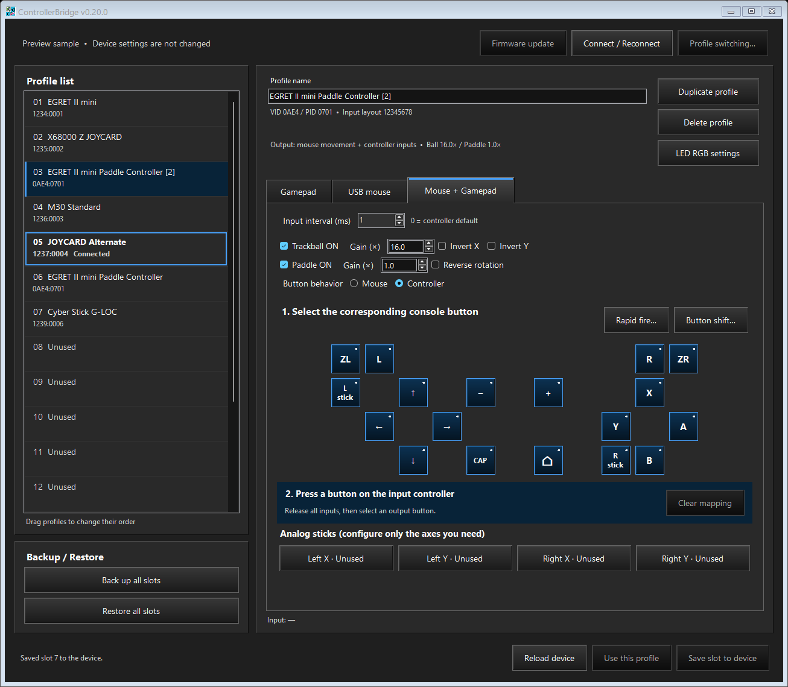
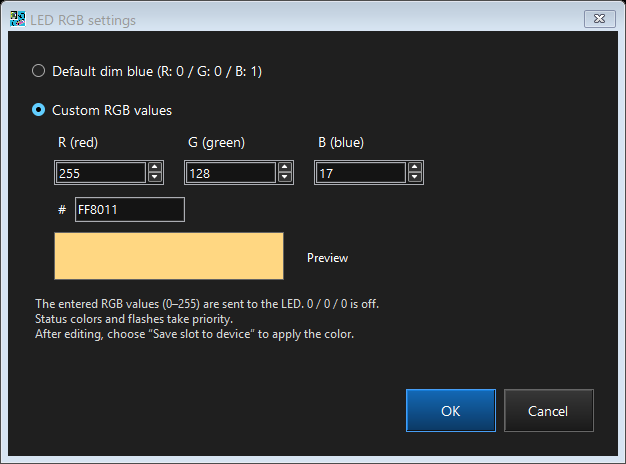

# Current verification

Applies to ControllerBridge Windows configurator and normal firmware 0.20.11. Mouse UDLR settings defaults to movement threshold 64 pt, pressed hold time 30 ms and released wait time 20 ms. The editing ranges remain 1–256 pt and 1–512 ms for each duration. These defaults initialize missing settings; valid saved values are retained. The dialog keeps adjacent units and omits redundant range/hold-wait labels. LED RGB uses a square eyedropper icon. Storage formats and allocations remain unchanged. Dated entries below describe their own builds. Current allocation figures are in [Current normal-build memory](#current-normal-build-memory).

## 2026-11-01 — 30 ms hold / 20 ms wait defaults (0.20.11)

Changed the firmware defaults and GUI preview/initial values from 16/16 ms to **30 ms hold / 20 ms wait**. Existing valid settings are not overwritten, including previously saved 16/16 ms values. A missing/invalid wait record still inherits a valid saved legacy hold value; when the hold record is also missing/invalid, wait retains its independent 20 ms default instead of inheriting the new 30 ms hold default. Threshold 64 pt, hidden gains, editing ranges, profile/bank/JSON formats and the 128-byte common-settings footprint remain unchanged.

- **46,727 deterministic C checks pass**, including 536 direction checks and 145 storage checks. Existing timing tests now include the exact 30/20 ms deadlines, delayed completion and clock wrap. Storage coverage checks an uninitialized configuration, a valid legacy configuration with no timing records, independently missing/damaged records, saved 16/16 ms retention, older shared-hold migration and subsequent save/reload.
- **1,244 GUI checks pass**: 614 normal and 630 UDLR checks in Japanese and English. The current defaults appear as 64 pt / 30 ms / 20 ms, saved values remain unchanged, and the existing save/cancel/readback/retry and embedded-firmware checks pass. Native DPI transitions 96→144→192→96 verify the settings dialog at 100–200%. Representative default-value captures were visually inspected.
- Normal and optional UDLR firmware/GUI builds pass with the existing .NET 9.0.319 and pinned Pico tools. ELF measurements confirm unchanged normal and test allocation totals. All profile and storage layouts are unchanged.
- No physical board was opened, reset or programmed for this default-only change. Existing stored settings therefore remain as they were. Prior 0.20.10 persistence and gameplay observations are historical evidence, not a new 30/20 ms physical timing measurement.

Reports and built-file hashes are in `build/mouse-udlr-defaults/`. The earlier 0.20.10 release ZIP is retained unchanged.

## 2026-11-01 — simpler UDLR dialog and eyedropper icon (GUI 0.20.10)

Removed the explanatory sentence below the Mouse UDLR fields in both languages and reduced the dialog height by 30 logical pixels. Its two-line introduction and all three settings remain. Replaced the LED RGB text button with a 40×40 logical-pixel button containing a vector eyedropper. The tooltip and accessible name are localized as Color picker / カラーピッカー. It opens the same Windows color chooser, using the same confirmation/cancellation path and RGB values. Keyboard activation and focus cues use the existing button behavior.

The existing Japanese/English settings, LED RGB and firmware-package suites pass **1,904 checks**: **944 normal** and **960 UDLR**. Simulated native DPI transitions 96→144→192→96 verify square button bounds, accessible names/tooltips and layout at 100–200% scaling. Japanese 100% settings/LED and English 200% LED captures were visually inspected. Both GUI builds use the installed .NET 9 SDK, with no compiler warnings.

This is a GUI-only change. The four existing build/distribution UF2 files match their prior hashes; the embedded firmware and manifests pass their package checks. Firmware remains normal 0.20.10 / optional 0.20.10-udlr. The board and its profiles were not accessed or written. The previous firmware verification below and current memory figures remain applicable. App icons and older release archives are preserved. Reports, binary hashes and the prior EXEs are under `build/mouse-udlr-icon/`.

## 2026-11-01 — independent wait time and dialog layout (0.20.10)

Mouse UDLR settings now explains pointer-to-direction operation in two lines, with the requested Japanese text: 「ポインタ移動量を上下左右キー操作として送信します。」 and 「すべてのプロファイルで共通です。」. Spinner and unit control bounds adjoin; range labels are removed while validation remains. **Hold time** controls the pressed phase, and the new **Wait time** independently controls the released interval. Each defaults to 16 ms and accepts 1–512 ms in the UI. The LED RGB color-picker button now fits its complete localized label.

- **46,713 deterministic C checks pass**, including 526 direction checks and 141 storage checks. Asymmetric hold/wait values (1/512, 512/1, 7/37 and 37/7 ms), exact deadline boundaries, delayed acknowledgements and clock wrap verify phase independence. Storage checks cover upgrading the old 112-byte common prefix, inheriting hold only when wait is absent/invalid, retaining independent saved values, CRC/range failures, failed Flash pause and unchanged profiles/measurements.
- **31 CLI checks and 1,640 GUI checks pass**: 960 normal and 680 UDLR checks in Japanese and English. Settings checks cover the three-field schema, read/cancel/save/readback, failed-save retry, drafts and close protection, adjoining spinner/unit bounds and absent range labels. LED checks cover the full picker label and existing RGB behavior. Native DPI transitions 96→144→192→96 verify 100–200% scaling without changing system settings. Representative captures were visually inspected. Both builds use the existing .NET 9.0.319 and pinned Pico toolchain.
- **146 physical settings checks pass** on normal 0.20.10. Invalid wait values and old UDS1/schema-1 writes are rejected. Stale expected wait values cannot overwrite settings; duplicate retries remain safe. Independent 1/512 and 512/1 ms timings save correctly. A wait-only change retains hold, 512/37 ms survives reboot, and a hold-only change retains wait. The test restores **64 pt / 16 ms hold / 16 ms wait**, reboots, and confirms the runtime threshold and both limits. Each stage preserves the complete profile bank and hidden gains.
- **11 final preservation checks pass**: firmware identity, all 16 profiles, generation 28, active slot 0, full prior common response and rejection of keyboard-test commands in normal firmware. A verified **2 MiB Flash backup** precedes programming. All **65,536 storage bytes** match before first boot. The final comparison matches the backup except for the new **16-byte DWT1 record** at `0x1FE070`; the original 112-byte common prefix and all other 65,520 compared bytes are identical. Its saved wait value is 16 ms with a valid CRC. The first immediate verification after the final reboot ran before USB enumeration finished; the subsequent read-only verification passed.
- No new physical movement-timing capture or Switch gameplay trial was performed for 0.20.10. Earlier user confirmation established working 16 ms shared timing; this update verifies separate control, persistence and layout. There are no new profile/bank/JSON formats. Commands 52/53 explicitly use UDS2/schema 2; old messages are rejected.

Reports and delivered hashes are in `build/mouse-udlr-wait/`. Full-Flash and storage images are in `test/mouse-udlr-wait/before-20261101-200132/`. The board is running normal 0.20.10; optional 0.20.10-udlr binaries are built separately.

## 2026-11-01 — Mouse UDLR settings dialog (0.20.9)

After confirming successful operation at 16 ms, the user requested a **Mouse UDLR settings** button immediately right of **Profile switching...**. The dialog edits shared integer movement threshold 1–256 pt (default 64) and hold time 1–512 ms (default 16). Hold time still applies to both press and release. Save validates, persists and independently reads back the result. Cancel does not save. The UI preserves unsaved profile drafts and hidden cursor gains; opening it does not rewrite existing settings. Commands 52/53 and capability bit 18 expose the feature in both normal and optional test builds.

- **46,624 deterministic C checks pass**, including 470 direction checks and 108 storage checks. The additions exercise edit boundaries, invalid values, retained hidden gains and atomic candidate editing. Existing timing, storage-migration, retry, wraparound, held-key and unassigned-direction checks remain.
- **31 CLI checks and 1,568 GUI checks pass**: 804 normal and 764 UDLR checks in Japanese and English. Coverage includes the new button position, device/capability gating, dialog read/cancel/save, separate readback, failed save and retry, close protection during a save, old values outside the editing range, and firmware-package identity. Simulated native DPI transitions 96→144→192→96 verify the header and dialog at 100–200% without changing system display settings. Captures were also visually inspected. Both builds use the existing .NET 9.0.319 and pinned Pico toolchain.
- **119 physical settings checks pass** on normal 0.20.9: invalid ranges/magic/schema are rejected, stale expected values cannot overwrite settings, equal values and duplicate retries are accepted, 1 pt / 1 ms and 256 pt / 512 ms save correctly, and 256 pt / 512 ms survives reboot. The test restores **64 pt / 16 ms**, reboots, and confirms the actual runtime threshold and both timing limits. Every successful stage preserves the complete profile bank, active slot/generation and hidden gains.
- **11 final preservation checks pass**: normal firmware identity, all 16 profiles, generation 28, active slot 0, full common-configuration response and normal rejection of keyboard-test commands. A verified **2 MiB Flash backup** precedes programming. The final **65,536-byte storage region exactly matches** the pre-update backup after the temporary parameter edits are restored; the pre-first-boot comparison also matches. There is no new storage record or format in this release.
- The user has accepted the 16 ms behavior. This update validates the settings UI, command handling and persistence; it does not add a new physical motion-timing capture or claim that all games/hosts have been tested.

Reports and delivered hashes are in `build/mouse-udlr-settings/`. The full-Flash backup and storage images are in `test/mouse-udlr-settings/before-20261101-193156/`. The board is running normal 0.20.9; optional 0.20.9-udlr binaries are built separately.

## 2026-11-01 — persistent hidden 16 ms hold duration (0.20.8)

The user confirmed direction operation after the 0.20.7 timing fix and requested reducing the 30 ms hold to 16 ms. A shared device-wide `hold_ms` now controls both press and release minima. It is stored with its own version and CRC as DHT1 at common-sector offset 96, initialized to 16 only if missing or invalid. Valid saved values are preserved. There is no editing UI or external setter; read-only command 51 reports the actual limits. The existing threshold, gains, pointer output and four-click waiting capacity remain in effect. At 16+16 ms the ideal upper bound is 31.25 clicks/s before polling overhead, and four queued clicks represent about 128 ms of additional work.

- **46,606 C checks pass**, including 452 direction checks and 108 storage checks. New coverage includes default 16 and custom 1/7/37/1,000 ms deadlines, invalid durations, upgrade from the actual 0.20.7 record layout, preserved threshold/gains, independently invalid CRC/range handling, saved custom values across reload, no writes on a valid load, and host-pause failure without storage damage. Earlier boundary, retry, stale-completion and wraparound checks remain.
- **31 CLI checks and 532 GUI checks pass**: 248 normal firmware-update checks and 284 UDLR/firmware-update checks across Japanese and English. Both firmware variants and bundled EXEs build with the existing .NET SDK 9.0.319, Pico SDK 2.1.1 and GCC 14.2.1. There is no GUI layout change. The normal/test keyboard separation is retained.
- **11 physical update/reboot checks pass** on normal 0.20.8. All 16 profiles, generation 28, active slot 0, complete 56-byte common-configuration response, threshold and gains match the pre-update baseline. Both actual timing limits report 16,000 us after a second boot. Normal firmware still rejects test-start commands.
- **Physical Flash migration is byte-verified.** A verified 2 MiB backup precedes programming. The last 64 KiB is identical before the first boot. After initial migration, the only change in those 65,536 bytes is the new 16-byte DHT1 record (schema 1, hold 16, valid CRC). The old 96-byte common prefix and every other byte remain unchanged. The record reloads after reboot.
- This update confirms the configured duration, persistence and timer behavior. No new physical movement-timing capture was taken for the 16 ms build. The 31.000–31.001 ms measurements below belong to 0.20.7. The user's successful operation report applies to that prior version.

Build, delivery and hardware reports are in `build/direction-hold/`. The full-Flash backup and before/after storage images are in `test/direction-hold/before-20261101-185354/`. The normal firmware is installed; the separate 0.20.8-udlr binaries are available for optional keyboard testing.

## 2026-11-01 — acknowledged press/release timing (0.20.7)

The user still saw no direction response on Switch HOME with 0.20.6, and reproduced missed extremely short taps using an ordinary controller. The prior scheduler could transmit release at the next poll after press ACK, making an approximately 1 ms press possible. Version 0.20.7 holds press for at least 30 ms from its first successful ACK, then holds release for at least 30 ms from its successful ACK. These intervals are engineering defaults, not an established Nintendo minimum. At that point Switch adoption still needed a post-update trial; the user subsequently confirmed direction operation before requesting the 0.20.8 duration change above.

- **46,507 C checks pass**, including 388 direction checks. Coverage includes exact deadline boundaries, clock wrap, failed ACK/retry, reset/stale-cookie rejection, held U/D/L/R keyboard codes, one-time edge accounting, physical-hat priority, independent buttons/axes and the bounded pending queue. The existing all-unassigned relative-input runtime checks now use the actual timed overlay. An initial test-only compiler warning about constant runtime checks was corrected to compile-time assertions before the successful build.
- **31 CLI checks, 456 normal GUI checks and 492 UDLR GUI checks pass**. Existing .NET SDK 9.0.319, Pico SDK 2.1.1 and GCC 14.2.1 are unchanged. Normal/test firmware packages remain separate, and normal firmware excludes the keyboard descriptor/test command. English normal/test previews were inspected; no layout change was required.
- **11 physical update/reboot checks pass** on normal 0.20.7. All 16 profiles, generation 28, active slot 0, the complete common-configuration response and hidden gains match the fresh baseline. A verified 2 MiB Flash backup precedes programming, and the last 64 KiB matches before first boot. The first backup request preceded BOOTSEL enumeration and found no device; no data was written. The retry found the selected board and completed full readback verification.
- **Physical PC timing:** actual EGRET movement produced pressed durations **31.000–31.001 ms** and consecutive released gaps **31.000–31.001 ms**, measured between matching USB completion callbacks. The later settled snapshot contains 862 completed press/release pairs, zero pending edges, neutral output, 862 measured press intervals and 702 measured consecutive released gaps. Thus no generated key remained held after movement ended. Normal gamepad `GET_REPORT` samples contained hats **0, 2, 4, 6 and 15**, matching up/right/down/left/neutral. This is PC-host evidence, not a Switch response claim.
- The bounded 30-second capture includes **385 generated events, 355 newly accepted clicks, 357 completed presses and 357 completed releases**, plus 30 capacity discards and zero physical conflicts. The two extra completions came from work queued before the baseline. Mouse counters increase by **2,549 movement inputs and 2,549 successful movement transfers**, with zero drops or flushes and matching signed displacement (X +24, Y -628). Across the longer operation the settled lifetime counters show 961 generated, 862 accepted/completed and 99 capacity discards; mouse inputs and ACKs both equal 5,679. Direction overload does not block the mouse queue. The four waiting clicks bound extra queued work to about 240 ms at the ideal 30+30 ms schedule, plus host polling; the maximum consecutive rate is below about 16.7 clicks/s.
- `GET_REPORT` samples read the last armed report. Their apparent phase lengths have polling uncertainty (some approximately 26.5 ms), so they are not substituted for the completion-timestamp measurements. Original raw data is preserved under `test/direction-timing/live-20261101-183522/`; an earlier 120-second capture before the user began moving is retained separately. Configuration and profile generation are unchanged across the capture. No source inputs were synthesized on the board.

Build, delivery and hardware reports are in `build/direction-timing/`. The full-Flash backup is `test/direction-timing/before-20261101-183032/flash-before.bin`. Holding intervals, queue capacity and timing statistics are runtime firmware state; no profile or Flash format was changed.

## 2026-11-01 — simultaneous pointer movement and D-pad clicks (0.20.6)

The previous conversion path suppressed mouse movement for converted sources. That contradicted the intended simultaneous-output behavior. `um_mix` now retains both enabled pointer sources regardless of conversion bits; the same relative report independently updates cursor accumulators. Pointer/cursor gains, inversion, X/Y selection, threshold 64 and discard-excess behavior are unchanged.

- **46,243 C checks pass**, including 203 relative-input runtime checks. New cases use the EGRET-format HID layout with all 18 digital bindings empty, verify that the mapper returns a neutral report despite no assigned input being touched, and carry the same report through pointer output and generated D-pad press/release queues. Trackball right/up and paddle Y down/up are covered in both combined button behaviors. No physical D-pad assignment is required.
- **456 normal GUI checks and 492 UDLR GUI checks pass**, in Japanese and English, on the first run. Both firmware variants and both GUI builds use existing Pico SDK 2.1.1 / GCC 14.2.1 and .NET SDK 9.0.319. Normal UF2 remains 200,192 bytes; optional UDLR UF2 is 199,168 bytes.
- **12 physical configuration checks pass** after updating the board to normal 0.20.6 and rebooting. All 16 profiles and legacy configuration match the fresh pre-update backup; generation 28, active slot 0, both conversions ON, paddle Y and pointer gains 6.0/1.5 are retained. Common threshold 64 and hidden gains 60/15 tenths reload with schema 2 and persisted status. A verified 2 MiB Flash backup precedes programming; the last 64 KiB matches it before first boot.
- **The Switch HOME D-pad symptom is not yet resolved by physical evidence.** On the prior normal 0.20.5 board, the diagnostic showed all four direction assignments empty, conversion enabled, and zero generated/enqueued/ACKed clicks. However, the input history contained only initial zero fields, and the subsequent 120-second observation received five-byte source reports that remained all zero. Thus zero generated clicks in that interval do not prove a conversion failure or an assignment dependency. No input was simulated on the physical board. The later physical observation below supersedes the lack of nonzero PC input; Switch reception remains to be checked.
- **Subsequent physical movement observation (normal 0.20.6, Windows PC host):** the user operated the EGRET trackball and paddle for an approximately 35-second capture. All four D-pad assignments remained empty; both conversions were ON, combined full-gamepad output remained selected and profile generation stayed 28. Direction counters increased by **770 generated, 770 enqueued, 770 successfully ACKed presses and 770 successfully ACKed releases**, with zero drops/conflicts. Mouse counters increased by **3,415 movement inputs and 3,415 successful movement transfers**, with zero drops/flushes; signed input/output displacement increments matched at X +132, Y +272. Sampled source reports contained nonzero X, Y and wheel. The source log is latest-report sampling, not a complete USB trace; the cumulative counters supply the transfer totals. The mouse snapshot boundaries slightly enclose the direction polling boundaries. This confirms simultaneous PC transfer with empty D-pad assignments, but does not prove Switch HOME adoption or press duration. Original logs, hashes and interpretation are preserved under `test/simultaneous-direction/live-20261101/`.
- Press/release timing was not changed speculatively. The 0.20.6 queue sends release after the press is acknowledged, without a minimum hold duration. Its effect on Switch reception remains a separate unresolved question.

Reports, hashes and read-only input captures are in `build/simultaneous-direction/`; the full-Flash backup is `test/udlr/before-20261101-175228/flash-before.bin`. Historical 0.20.5 pointer-suppression descriptions below apply only to their dated builds.

## 2026-11-01 — unassigned shifted-input registration display (GUI 0.20.5)

An explicit shifted no-output setting was incorrectly marked as a registered mapping because the GUI looked only at the override bit. Registration display now requires an assigned input as well: unassigned outputs have no `*`, and Japanese/English tooltips report no registered shifted mapping. The no-output override is retained to prevent main-page inheritance from becoming active. Clearing a main mapping preserves independently registered shifted inputs.

- **600 GUI checks pass** across Japanese and English: normal build 147 self-tests, 65 shift checks and 23 rapid-fire checks per language; UDLR build 65 shift checks per language. Ten new workflow checks cover inherited versus registered mappings, No output, clearing the main mapping, serialized reload, reassigning the main mapping, restoring inheritance and registering/clearing a real shifted input. Both language previews were visually inspected.
- The first English normal self-test failed in the existing `ProfileFile.Save` / `File.Replace` operation. Its error log is retained under `build/shift-unassigned/checks/normal/en/self-test/`. The same EXE passes in a fresh output directory under `checks-en-retry/`; no file-save code was changed and the cause was not established. The shift and rapid-fire suites pass on their first run in both languages; both UDLR shift suites also pass on their first run.
- Both final EXEs build with installed .NET SDK 9.0.319 without compiler warnings. An initial nullable warning in the new check code was corrected before the final build. Firmware, embedded UF2 inputs, profile layout, icons, and older release archives are unchanged. No board or profile was written. Firmware remains normal 0.20.5 / optional 0.20.5-udlr and the memory figures below remain current: normal Flash 99,920 + storage 49,152 (remaining 1,948,080), SRAM 152,664 + stacks 8,192 (remaining 371,624); common settings 96 of 4,096 bytes.

Final checks, hashes and preserved inputs are recorded in `build/shift-unassigned/verification.json`.

## 2026-11-01 — separate pointer and hidden cursor gains (0.20.5)

- **46,171 C checks pass**, including 124 direction, 73 storage and 131 relative-input runtime checks. Cases vary actual cursor gains independently of pointer gains, retain original pointer defaults/ranges, preserve a valid older threshold while adding the gain record, check gain-record CRC/ranges, and retain both profile banks, legacy configuration and measurement storage.
- **842 normal GUI checks and 492 UDLR GUI checks pass**, covering Japanese and English. Pointer controls remain editable and save their own values during conversion. Neither profile nor test screens show hidden cursor gain values. A synthetic test uses cursor gains 8.3/2.7 to verify that logs read actual device parameters rather than initial constants. The physical defaults remain 6.0/1.5. Both language previews were visually inspected and all 18 suites passed on the first run.
- **12 physical checks pass after normal 0.20.5 update and reboot**. Threshold 64 and hidden gains 60/15 tenths reload with schema 2 and persisted status. All 16 profiles, bank generation 21, active slot 0, and legacy configuration match the fresh backup byte for byte. The active pointer values remain 6.0/1.5 as previously saved by the user; no profile save was performed. Normal firmware rejects both UDL1 and UDL2 test commands.
- A verified 2 MiB Flash backup precedes programming. The last 64 KiB matches the backup before first boot; first boot adds only the cursor-gain record through the existing common-settings save path. Evidence is under `build/hidden-gains/` and `test/udlr/before-20261101-164922/`. Physical rotation and gameplay responsiveness remain user trials. This turn leaves the board running **normal 0.20.5**; the optional test binary was built and checked but not installed.
- Pico SDK 2.1.1 / GCC 14.2.1 and installed .NET SDK 9.0.319 build both variants. No toolchain changes or icon regeneration. Normal UF2 is 200,192 bytes; test UF2 is 199,168 bytes. The normal image omits the test keyboard descriptor, UDL2/UTS2 markers and test identity.

An initial staging-script assertion expected ten configuration-save sites; inspection found eight and the assertion was corrected before applying source changes. The final C build and all firmware/GUI builds pass. No product behavior or check was weakened to obtain the passing results.

## 2026-11-01 — fixed conversion gains and device-wide threshold (0.20.4)

- **46,146 C checks pass**, including 116 direction/queue checks, 60 storage checks and 127 relative-input runtime checks. They verify 6.0× / 1.5× independent of profile gain, signed cancellation and fractional carry, X/Y plus reversal, retained ordinary mouse sensitivity, and one-erase extension storage preserving the old prefix, both profile banks and the measurement sector.
- **836 normal GUI checks and 484 UDLR GUI checks pass**, with Japanese and English. Tests exercise X/Y arrow labels, enabled axis selection, disabled sensitivity controls while converting, retained profile values, fixed-gain summaries, read-only threshold display, trial logs, update identity, and the absence/presence of the test dialog type/button in the actual build. Both self-tests passed on the first run. Sample images use synthetic input.
- **13 physical-board checks pass after update and reboot**. The common threshold reloads as 64 with its persisted flag set; reported gains are 60/15 tenths. All 16 profiles and legacy common config match the fresh pre-update backup byte for byte (bank generation 21). Old UDL1 requests and UDL2 requests carrying a threshold are rejected. Output is left stopped; no physical rotation or game response was asserted.
- A verified 2 MiB Flash backup was saved before programming; the last 64 KiB matched exactly before the first new boot. First boot adds the common-setting extension. Existing profiles and measurement formats are unchanged. Paths and hashes are in `build/fixed-direction/verification.json` and `test/udlr/before-20261101-142315/`.
- Normal and test firmware build with the pinned Pico SDK 2.1.1 / GCC 14.2.1; both GUIs use installed .NET SDK 9.0.319. No toolchain changes or icon generation. Normal UF2 is 198,656 bytes; test UF2 is 197,632 bytes. The normal binary omits the UDLR keyboard descriptor and protocol markers.

Early local test compilation found a constant-condition warning, a test-fixture narrowing conversion, and a missing staged board header. Those test harness issues were corrected before the passing run; product behavior was not relaxed. BOOTSEL enumeration was polled once again after the documented delayed reboot. Final product builds and GUI checks pass.

## 2026-11-01: 256× gain and pointing-to-direction conversion

Normal firmware and GUI 0.20.3 implement trackball gain 1.0–256.0 and mouse flag bits 6/7 for ball D-pad and paddle left/right. Profile/bank/JSON sizes and versions remain unchanged. Separate signed sums retain fractional tenths after gain and inversion. Reaching ±64 emits one click, clears only that source axis, and discards excess. Source Off retains preferences; converted sources stop producing mouse movement. Physical D-pad input wins over a generated click. A queue without space for both edges drops the whole new click.

- **46,105 C checks pass**, including 101 direction-accumulator/queue checks, 148 mouse checks, 122 relative-input runtime checks, and 236 profile checks. Cases include ±64 boundaries, opposite-sign cancellation, tenths carry, 256×, extreme signed inputs, independent X/Y/paddle sums, excess discard, input report IDs/interfaces, profile reset, preserved physical controls and atomic pair rejection at queue capacity.
- **31 CLI checks pass**. Gain/flag edits, automatic combined output, preservation and pre-upload capability rejection are covered.
- **843 GUI checks per language, 1,686 total**, pass in `build/direction-keys/checks/summary.json`. These include 55 new direction checks and 39 paddle checks per language, old JSON defaults, binary/JSON/bank round trips, staged edits, profile selection, output mode constraints, firmware compatibility and existing GUI suites.
- **29,762 DPI checks** pass in `build/direction-keys/dpi/summary.json`. They simulate 96 → 120 → 144 → 192 → 96 → 192 → 96 in both languages and inspect bounded layouts. OS display settings were unchanged. Both language screenshots were visually checked.
- The pinned Pico SDK/GCC build and installed .NET 9 publish pass. UF2 197,120 bytes, SHA-256 `A64BB0856DB2B11DE69C1642A82052AF7C7EB5EA02BB65ED8D1F148709CB8A5F`. No toolchain installation, framework change or icon regeneration was used.

The first new GUI fixture lacked a required VID; correcting that fixture made both language runs pass. Early test expectations for the old 64× maximum were updated to the requested 256×. These are deterministic checks, not gameplay measurements. The useful threshold and normal-console response to short direction clicks remain to be assessed. Memory allocations below reflect the final normal ELF.

## 2026-11-01: paddle X/Y output selection

The paddle row now contains an **Output axis** list in both mouse output modes. X is horizontal; Y is vertical. Gain and paddle reversal follow the selected axis, trackball inversion stays independent, and disabling the paddle retains the choice. Editing stages the value until **Save profile to device**. The firmware mixer, profile codecs, GUI, CLI and capability negotiation implement the same behavior.

Mouse flag bit 5 stores Y; zero retains X. Existing binary profiles and JSON without the property remain X. Profile v6/848 bytes, bank v6/13,908 bytes and JSON v3 are unchanged. Capability bit 15 prevents uploading Y to an older firmware through the GUI or CLI. Firmware/GUI 0.20.2 must be used together for Y.

- Normal firmware builds with the existing pinned RP2350 toolchain. UF2: 192,512 bytes; SHA-256 `BF89BA1931002DA2B00322C3B25FA6E3F30887B5DDEEB8351617826B65F2A059`.
- **45,975 C checks pass**, including 146 mouse mixer/queue/encoding checks and 105 mouse runtime checks. Added cases cover X/Y with both input enables, opposite signs, paddle and independent trackball inversion, fractional carry, saturation, actual report-ID/interface extraction, carry reset and persisted Y settings. Existing rapid fire, shifted pages, flash storage and profile output cases remain.
- **26 CLI checks pass**, including axis selection/readback, preservation across unrelated edits and rejection before save on unsupported firmware.
- **777 GUI checks per language, 1,554 total**, pass in `build/paddle-axis/checks-retry/summary.json`. The 37 paddle checks per language exercise the actual combo and draft/save/reload, profile isolation, disabled/busy state, duplication, old binary/JSON defaults, individual export and bank backup/reorder/restore. Existing self-test, rapid, shift, LED, updater, connection, profile menu, arrival, axis, input-log and output-tab suites pass. The EXE was built with installed .NET 9, with zero warnings after correcting a nullable annotation in the new check code.
- **29,634 DPI layout checks** pass across Japanese and English, including simulated transitions 96 → 120 → 144 → 192 → 96 → 192 → 96 and bounded-window checks. The new selector and all controls on its row are checked for reachability, with selection text width checked at each DPI. Results: `build/paddle-axis/dpi/summary.json`. Windows display settings were unchanged. Japanese and English mouse/combined captures were visually inspected.

The first Japanese general self-test stopped at the existing `File.Replace` operation while replacing a test JSON file (`build/paddle-axis/checks/ja/self/error.txt`). The same EXE passed the full suite in a fresh output directory. Production file-save behavior was not changed; the intermittent OS file-operation cause remains undetermined.

These tests use synthetic input, storage and GUI preview data. No physical USB device was opened or programmed for this feature, so the run does not establish paddle Y behavior in a game. Flash code/initial values increase by 16 bytes from 0.20.1; static SRAM and persistent storage are unchanged. Test-only G502 logging firmware and captured investigations are separate from this normal build.

## 2026-11-01: LED RGB slider rows and color picker

The LED dialog now uses one horizontal row per RGB channel, with a 0–255 slider and numeric readout. A **Color picker…** button on the right opens the Windows color chooser initialized from the current raw channel values. Accepting a color updates the three sliders, readouts, hexadecimal code and existing preview; cancellation preserves the draft. Standard-color mode disables custom entry but keeps the numeric readouts legible. The shared profile-save reminder and draft-only OK behavior remain in place.

The final self-contained EXE passed **158 existing LED checks per language, 316 total**. These cover exact RGB bytes, default/custom/off behavior, hexadecimal input and paste, invalid input, preview conversion, cancellation, profile serialization, duplicate and backup/restore behavior, and control bounds. Japanese and English captures were visually inspected. Reports are in `build/led-sliders/checks-final/summary.json`.

The existing DPI runner passed **13,185 checks per language, 26,370 total**, including simulated transitions 96 → 120 → 144 → 192 → 96 → 192 → 96 and bounded-window checks. The slider rows, picker button, readouts, reminder and actions were also inspected in the generated captures. Reports are in `build/led-sliders/dpi/summary.json`; Windows display settings were not changed.

The native Windows picker was also exercised through the preview UI: it opened with RGB 0/0/1; accepting red produced 255/0/0 and `FF0000`; selecting blue and cancelling retained red. Dragging the red slider from 255 to 127 updated the readout and code to `7F0000`. The containing LED dialog was then cancelled, leaving the preview profile unchanged. This UI run used synthetic preview data, without opening a physical USB device.

The GUI remains 0.20.1 and uses the installed .NET 9 SDK. Firmware and its UF2 are unchanged (`3E7BCE463636A2F4EA0F622420D6F98917669CB6440D8BB13F3077434FD1985C`). Board allocation remains Flash code/initial values 96,100 bytes plus 49,152 reserved, leaving 1,951,900; static SRAM 151,588 plus 8,192 for stacks, leaving 372,700. Profile and bank payload sizes remain 848 and 13,908 bytes.

## 2026-11-01: profile save wording and shared settings reminder

The profile action is now **Save profile to device** (Japanese: **プロファイルをデバイスに保存**). Unsaved-edit, duplicate, import and mouse-mapping guidance uses the same action name. The rapid-fire dialog title and heading are now **Rapid fire settings**. Its Japanese range and unavailable-button guidance follows the requested wording, and the former held-button explanatory line has been removed from that dialog.

Rapid fire, LED RGB, button shift and axis settings all use one shared localized reminder: changes are not written until **Save profile to device** is chosen on the profile screen. Immediate-write dialogs such as profile switching and firmware updates retain guidance matching their own save behavior. The axis window reserves the measured height of the new reminder when arranging its input list and calibration controls.

The final self-contained EXE passed **361 checks per language, 722 total**: rapid fire 23, shift 55, LED 162, axis 82, profile menu 23 and output tabs 16. Japanese and English captures were visually inspected. Results are in `build/save-wording/checks-final/summary.json`. The first axis run exposed a one-pixel vertical overflow after adding the reminder; the layout now reserves its wrapped height and both final axis suites pass. The original diagnostic remains in `build/save-wording/checks/ja/axis`.

The existing DPI runner also passed **13,157 checks per language, 26,314 total**, including simulated transitions 96 → 120 → 144 → 192 → 96 → 192 → 96 and bounded-window checks. Results are in `build/save-wording/dpi/summary.json`. Windows display settings were not changed; this is a controlled layout check, not a physical monitor-move test.

This is a GUI wording/layout update using the existing .NET 9 SDK. No physical device was opened or programmed. Firmware 0.20.1 and its UF2 remain byte-identical (`3E7BCE463636A2F4EA0F622420D6F98917669CB6440D8BB13F3077434FD1985C`). Board allocation is unchanged: Flash code/initial values 96,100 bytes plus 49,152 reserved, leaving 1,951,900; static SRAM 151,588 plus 8,192 for stacks, leaving 372,700. Profile and bank payload sizes remain 848 and 13,908 bytes.

## 2026-11-01: rapid-fire range 1–60 and new default 20

GUI controls, profile validation and firmware capabilities now agree on **1–60 complete press/release cycles per second**, in steps of one. Zero still means Off. The GUI shows 20 when enabling a currently Off output; saved nonzero values such as 2, 7, 10 and 30 remain unchanged. Opening or applying the dialog without enabling an Off output preserves zero. The same rules apply to main and shifted button pages. Wire fields, version-6 profiles, 16-slot banks and JSON version 3 are unchanged. The version is 0.20.1 so the bundled updater can distinguish firmware that accepts the wider range.

- Normal RP2350 firmware builds with the existing pinned toolchain. UF2: 192,512 bytes; SHA-256 `3E7BCE463636A2F4EA0F622420D6F98917669CB6440D8BB13F3077434FD1985C`.
- **45,930 C checks passed**, including **44,164 rapid-fire checks**. Every integer rate from 1 through 60 is checked immediately before and at each mathematical half-cycle boundary over three seconds. Existing independent-button, release/repress, output-pause, timer-wrap, axis and C# wire-fixture cases remain. Runtime capabilities advertise minimum 1 and maximum 60.
- **17 CLI checks passed** against the unchanged profile and snapshot formats.
- The self-contained Windows GUI passes **744 checks per language, 1,488 total**: general self-test 138, rapid fire 23, shift 55, LED 162, updater 124, connection 46, profile menu 23, arrival 42, axis 82, input log 33 and output tabs 16. The rapid dialog checks verify range/default, preservation of stored values, Off/Cancel/Apply behavior, disabled unmapped outputs, main/shifted binary round trips, profile JSON and whole-bank backup at 1, 20 and 60. Japanese and English rapid-setting captures were visually inspected.

The first English self-test stopped at the existing `File.Replace` operation while replacing a test JSON file (`build/rapid-range/checks/en/self/error.txt`). The same EXE passed in a fresh output directory; no production file-save behavior was changed. The underlying intermittent file-operation cause remains undetermined. Final reports retain the Japanese run and English retry in `build/rapid-range/verification.json`.

These are deterministic software checks with simulated inputs/storage. No board was opened or programmed, and this run does not establish physical USB delivery or game acceptance at 60 cycles per second. Flash code/initial values decrease by 48 bytes from 0.20.0; SRAM and persistent allocation sizes are unchanged.

## 2026-11-01: shift key numbers and simultaneous registration

The shift key list, learning feedback and registration review now use the same `InputField.Label` button numbers as the input log and live status. Saved USB source details remain visible to distinguish identical button numbers across interfaces or report IDs. Labels are resolved only with this profile's matching controller descriptor; offline or unrelated descriptors do not supply guessed button numbers.

Choosing **Learn shift keys** captures a gesture from its first new press until all captured inputs are released. Multiple fields, interfaces and report IDs can join the gesture. Existing held-input protection remains active. Already registered keys do not consume capacity twice, and an addition exceeding four total keys is rejected as a whole. Selecting an output, removing a modifier, closing, or losing the connection cancels the pending gesture. Applying the draft while captured keys remain held asks for their release first. See [the updated workflow](button-shift.md).

The final self-contained .NET 9 EXE passed **310 checks per language, 620 total**: shift 55, general self-test 134, input log 33, controller arrival 42 and connection UI 46. The expanded shift cases cover actual modal input delivery from both the main window and registration wizard, multiple changes in one poll and across polls, four-key capacity, duplicate sources, held inputs, single-key additions, cancellation of delayed preparation, hat/trigger ranges, button-number resolution and the registration review. Japanese and English captures of learning, registered keys and the review were visually inspected. Results are in `build/shift-learning/checks/summary.json`.

Two initial runs stopped because new synthetic profiles omitted required VID/name values (`build/shift-learning/initial/ja/error.txt` and `build/shift-learning/gesture-checks/ja/error.txt`). The test fixtures were corrected; production profile validation was not relaxed. No physical USB device was opened or programmed. Real controller timing remains unverified by this GUI test run.

This was a GUI change with no profile/bank format or firmware change. The 0.20.0 UF2 remained byte-identical (`3588776F42A03FCD91E895E3A07C98205E89F8F0ACD439554B485E1B4DC7E30D`). At that point board allocation was Flash 96,148 bytes plus 49,152 reserved (1,951,852 remaining), and static SRAM 151,588 bytes plus 8,192 for stacks (372,700 remaining). The current table below reflects the subsequent firmware build.

## 2026-11-01: DPI layout correction

The reported half-width controls and clipped LED dialog were reproduced with a synthetic 192-DPI startup baseline followed by display on a 96-DPI window. The form was consuming its DPI baseline before its control tree was complete. Forms now defer the initial scaling pass until construction ends. Hidden mapping/wizard pages retain their parents, single-column tables follow the window width during repeated scaling, and owner-drawn secondary fonts use the scaled control font. Windows fit the monitor's working area and provide scrolling when their content minimum is larger than the screen. The English square Capture button displays **CAP**, retaining its full tooltip and accessible name.

The final .NET 9 build passed these checks:

| Verification | Result |
|---|---|
| Japanese/English × initial DPI 96, 120, 144, 192 | All 8 cases passed |
| Native DPI notifications, each language | 96 → 120 → 144 → 192 → 96 → 192 → 96 passed |
| Main output tabs and combined-mode radio changes | Button text fit, mapping-cell dimensions and reachable controls passed at every step |
| LED, shift, rapid fire, axis, profile switching, registration, input log and simulated updater | Visible buttons fit and remain reachable; registration pages keep their mapping size when opened |
| Working areas 1920×1040 and 1280×680 | Window bounds fit; selecting the shift dialog's Apply button scrolls it fully into view |
| DPI assertions across the above cases | 43,912 passed; includes repeated text/bounds checks through control ancestors |
| Published EXE functional suites | 692 per language, 1,384 total passed: self 134, shift 30, LED 162, updater 124, connection 46, profile 23, arrival 42, axis 82, input log 33 and output tabs 16 |

The first English self-test encountered an `IOException` in `File.Replace` while replacing a test JSON file. Its log remains at `build/dpi/function-checks/en/self/error.txt`. The same published EXE passed the self-test and remaining English suites in a fresh output directory without a production-code change. The underlying cause of that file-operation failure has not been established.

The DPI runner uses the .NET 9 startup-DPI cache and native DPI-change notifications for controlled layout checks; it does not change Windows display settings. Both connected monitors were actually at 96 DPI during verification. Synthetic startup screenshots do not reproduce all native font-rasterization behavior at another system DPI. These checks are not a physical 4K-at-200% / FHD-at-100% monitor-move test. Native 96-DPI captures and captures after simulated DPI transitions were also visually inspected. The images below come from the published EXE at native 96 DPI using synthetic profiles.





Run the regression matrix after preparing the normal firmware package and restoring the existing GUI dependencies:

```powershell
.\tools\check-gui-dpi.ps1 -OutputDirectory build/dpi-new-run
```

Use a fresh output directory. The runner opens only preview forms and a fake updater device. It records results and captures per case, and leaves OS settings, physical USB devices and saved profiles untouched. The project and runner continue to use the installed .NET 9 SDK. The 0.20.0 firmware UF2 used for that DPI correction remained byte-identical (`3588776F42A03FCD91E895E3A07C98205E89F8F0ACD439554B485E1B4DC7E30D`), so that GUI-only correction did not change board allocation.

## 2026-11-01: button shift and format migration

The RP2350 Release firmware built successfully with the pinned Pico toolchain. The self-contained Windows x64 configurator was published with the existing .NET 9 SDK. The UF2 is 192,512 bytes, SHA-256 `3588776F42A03FCD91E895E3A07C98205E89F8F0ACD439554B485E1B4DC7E30D`.

- C tests: **13,051 checks passed**, including 78 dedicated shift checks using the real mapper, runtime, and Flash store implementation with simulated hardware. Coverage includes AND detection, inherited/remapped/muted outputs, modifier consumption and full-release guard, held inputs, split report IDs, common axes, rapid phases, shortcut conflicts, detach/seed, and no Flash write during page changes. Version-5 migration preserves all 16 slots and metadata; simulated first/second commit interruptions retain a valid bank and preserve common settings/measurements. C also executes the C#-generated version-6 shift fixture.
- CLI: **17 checks passed**, including the 848-byte/version-6 encoding. Existing stateless live-validation scripts accept current profiles only when shift is disabled and explicitly reject shifted profiles; they are not used as a shift oracle.
- GUI: Japanese and English each pass shift 30, general self-test 134, firmware update 124, connection 46, profile menu 23, controller arrival 42, axes 82, input log 33, and LED 162: **676 per language, 1,352 total**. Shift checks open the actual modal dialog from the main window, deliver input through the normal path, apply only to an unsaved draft, and cover cancellation of delayed learning after selecting No output or Inherit from main. The full suites passed before the final learning-cancellation/text polish; affected shift/self/axis/input-log suites were rerun on the final EXE.
- Japanese and English shift captures were inspected for complete controls, readable instructions, override marks, and absence of independent axis controls. The new English [shift screenshot](gui-shift-en.png) uses synthetic settings, not a read from a user's board.

An earlier English connection-suite run failed an existing state assertion. The assertion was extended to record the actual state; a diagnostic rerun and the complete final bilingual run passed. The original failure log is retained under `build/shift/checks/en/connection/error.txt`; its cause remains undetermined. No production connection behavior was changed to make it pass.

No physical USB device was opened or programmed by the shift tests. Real controller/gameplay response, hardware Flash interruption, and timing under hardware load remain unverified. Host tests establish state transitions and simulated recovery, not physical power-loss performance. Direction correction is deferred and unchanged.


## 2026-10-31 cancellable BOOT connection wait

First installation now starts monitoring for a valid BOOT connection as soon as the guide appears. The waiting dialog shows numbered reconnection steps and only **Cancel**, with no preliminary Yes/No question and no manual-wait timeout. Valid BOOT detection advances to the final overwrite confirmation; only Yes starts writing. A readable version mismatch keeps the existing automatic-update flow.

The published executable passed 124 firmware workflow/dialog checks, 46 connection checks, and 134 GUI self-tests in each of Japanese and English. The added deterministic cases cover BOOT detection before final confirmation, an already connected BOOT device, waiting cancellation, cancellation at the detection boundary, closing the wait with the window close button, declining the final confirmation, and BOOT failure preventing confirmation and writing. Cancelling via the close button is completed after the closing event, preventing the dialog from remaining open. Both languages' waiting and final-confirmation captures were visually inspected at 96 DPI.

The attached factory-state board also passed 16 read-only checks per language. Startup and background discovery after a simulated prior absence each opened the real wait with only Cancel. Cancelling both waits left its factory firmware intact, with no additional guides or editor changes through three retries after each cancellation. These results total 320 checks per language, 640 across both languages. The real board was not physically reconnected in BOOT mode or programmed; the detection-to-confirmation transition was exercised with a simulated device. The firmware UF2, supplied icons, and board memory allocations below are unchanged.

## 2026-10-31 factory-state board discovery

The supplied factory-state Waveshare RP2350-USB-A was connected to USB-C during verification. Windows reported product `Pico`, USB parent `2E8A:0009`, a CDC serial interface, and a reset interface. It did not expose the ControllerBridge HID transport or a firmware version. The corrected discovery classifies it as `UnknownFirmware` and shows **Device unsupported**, rather than `NotDetected` / **Device not connected**. Metadata enumeration does not open the serial port or issue reset commands.

Before the BOOT-wait revision above, the executable passed 96 firmware workflow/discovery checks, 46 connection UI checks, and 134 GUI self-tests in each of Japanese and English. The added deterministic cases cover factory/BOOT candidates, unrelated peripherals, composite child rejection, RP2040 BOOT exclusion, stable keys, multiple-candidate rejection, same-port BOOT matching, distinct unsupported status, repeated-prompt suppression, and rearming after an observed disconnect.

Read-only checks against the attached factory board passed 16 checks in each language. The real startup discovery opened the real installation guide, which the check declined. A second scenario simulated only the prior disconnected state, then used the normal background timer and actual USB discovery to find the same attached board and open guidance again. This verifies the connection-time code path; it is not a physical unplug/replug test. After each decline, three discovery retries over 6.8 seconds produced zero extra guides, enabled/text changes, invalidations, layouts, or editor rebindings. Both language captures of the guide and unsupported main-window status were visually inspected.

The factory board remained connected with its original USB identity. No reboot, serial reset, firmware programming, or profile write was performed. Actual first programming and the BOOT-to-application transition remain unverified by this check. The updater now binds a detected factory target to its USB port and still requires RP2350 USB/INFO_UF2 validation and the overwrite confirmation. Shared Pico SDK IDs identify candidates, not a carrier-board model.

Only the PC configurator and documentation changed. The supplied PNG/ICO and the embedded/distributed firmware are unchanged; the UF2 SHA-256 remains `E2004081E0562335C3F91A4B25345690967FD213D2BB65835FE34C109414DEF7`. Board memory allocations and remaining capacity in the table below remain current.

## 2026-10-30 input-log repainting

The flicker came from unconditional whole-list invalidation on every 100 ms refresh, a native ListView without double buffering, and a two-step status-label assignment when a notice was retained. The latter temporarily removed the second line and resized the grid twice per update. Updating `VirtualListSize` also requested a whole native count refresh; append notifications now preserve the viewport and limit invalidation to affected rows.

Native-window probes measured the original and corrected code using 12 deterministic updates per scenario at 96 DPI:

| Scenario | Original | Corrected |
|---|---|---|
| Visible append: full-client paint regions | 12 | 0 |
| Offscreen append, following off: list paints | 12 | 0 |
| Retained notice: grid size changes | 24 | 0 |
| Retained notice: status text assignments | 24 | 12 |
| Full 2,000-row ring: full-client paint regions | 12 | 0 |
| Native ListView double-buffer style | Disabled | Enabled |

The repaint suite passes 44 checks in both Japanese and English, covering visible/offscreen/following appends, a retained notice, ring rotation, idle ticks, same-count snapshot replacement after clear, scroll position, newest row contents, and actual native buffering. The existing 33 input-log checks also pass in both languages. These are native paint/layout measurements with synthetic input, not USB timing or frame-by-frame compositor measurements. Necessary changed-row painting and background handling still occur inside the buffered native control. The 100 ms display cadence and input event retention are unchanged. This PC-only change leaves the firmware and board memory figures below unchanged.

## 2026-10-30 registration input log and stable analog readout

The input-log suite passed 33 checks in Japanese and English using synthetic parsed fields and the normal GUI input-delivery path. It covers duplicate button Usage names with distinct indexes/report locations, snapshots and missing values, press/release events, signed hexadecimal values, device-timestamp wrap, baseline draining, mapping while logging or paused, resume-gap notices, clear/reopen, bounded retention, export contents, and overrun handling. Actual modal `ShowDialog` checks verify that both the wizard and sibling log remain enabled while the main editor is disabled, and that cancelling retains the finished log. The checks invoke no profile saves and perform no hardware writes.

The analog-dialog suite passed 82 checks in each language. Nine values from zero through signed 32-bit extremes verify that the live label, **Record center**, and **Use descriptor range** retain identical bounds and that the full numeric text fits. Existing calibration, source detection, waiting/offline states, and six-/32-axis layouts also pass. Japanese and English log/wizard captures and short-/long-value analog captures were visually inspected at 96 DPI. These checks do not establish physical controller sampling timing or lossless recording under sustained event-ring overload.

This is a PC GUI change using the existing firmware 0.19.0 event stream. The firmware, supplied icon, saved profile formats, and board memory figures below are unchanged. The log's 2,000-row limit applies to PC memory, not board storage.

The final self-contained executable passed those 33 input-log and 82 analog-dialog checks in both languages. It also passed the existing 134 GUI self-tests, 42 controller-arrival checks, and 44 connection UI checks in Japanese. It was published with the installed .NET 9 SDK; the embedded UF2 remains the 0.19.0 image with the SHA-256 listed below.

## 2026-10-30 connected-profile appearance

The connected controller's active profile uses bold text, a blue outline, and a Connected label in the list. Selection highlighting remains independent, and the editor's fonts are unchanged. The displayed-row cache follows the connected active slot, so a disconnect invalidates the former highlighted row. Japanese and English previews were inspected with the connected row both selected and unselected; the existing 44 connection UI checks passed in each language. The firmware, supplied icon, and board memory allocation are unchanged.

## 2026-10-30 unused-slot name appearance

The profile-name text box is disabled and uses the gray surface background when the selected slot is unused. A registered slot restores its normal editable input appearance. Japanese and English captures of both states were visually inspected. The updated executable passed the existing 42 input-arrival and 44 connection UI checks in each language. This is a GUI-only change: the supplied PNG/ICO and embedded firmware 0.19.0 are unchanged, so the board memory figures below remain current.

## 2026-10-30 input arrival and guarded registration

The Japanese and English executable each passed 42 input-arrival checks. They exercise first-slot ordering, saved and unsaved profile matches, dirty/deleted-slot protection, initialization/unsupported input, stale bank/input snapshots, deferred modal/foreground operations, one-time selection, manual browsing, reconnection, full-bank text, recovery when a slot becomes available, and the serialized registration identity. The arrival path only changes the PC list selection. Both languages' empty-slot and full-bank captures were visually inspected.

Forty deterministic checks run the real C runtime against simulated storage and parsed input descriptors. They cover successful registration, duplicate commit rejection, occupied slots, stale bank/attachment data, same-model reconnect, different input, loss during transfer and after its final chunk, every guarded identity component, mismatched staged profile/mapping data, storage failure/retry, and ordinary offline profile editing. These checks verify the firmware transaction logic, not physical USB/Flash timing. No physical board was programmed for this update.

The supplied PNG/ICO are preserved. The published EXE icon was compared against the supplied ICO. The embedded and distributed 0.19.0 UF2 has SHA-256 `E2004081E0562335C3F91A4B25345690967FD213D2BB65835FE34C109414DEF7`. Existing profile/bank version 5, JSON version 2, and current Flash records remain compatible. The new GUI requires its bundled 0.19.0 firmware for guarded registration.

## 2026-10-30 disconnected startup (before factory-state detection)


With no recognized board, disconnected startup remains a normal waiting state without a startup error or firmware confirmation. The results in this subsection predate the factory-state detection added above: factory/BOOT USB identities now count as detected unsupported boards and open guidance automatically.

The published EXE passed 44 connection UI checks and 82 firmware workflow/dialog checks in each language. Real USB discovery returned `NotDetected` in Japanese and English, with zero guides at startup and through three retries over 6.8 seconds. Those retries caused no enabled/text changes, invalidations, layouts, or editor rebindings. The supplied PNG and ICO were preserved byte for byte without regeneration; the icon extracted from the published EXE matches the supplied ICO pixel for pixel. No hardware was written; current 0.19.0 memory figures are listed below.

## 2026-10-29 window and icon update

The supplied PNG icon was updated and the ICO/EXE rebuilt. Its 64-pixel frame matches the source pixel for pixel; the icon extracted from the published EXE matches the generated ICO. Both language captures show the new icon.

The initial client height increased from 1000 to 1100 (width remains 1290), and the minimum window size now matches the initial size. At 96 DPI, the complete window is 1306 × 1139. Before the change, the combined controller editor had 408 pixels available for 459 pixels of content and required vertical scrolling. It now has 508 pixels, leaving 49 pixels below the complete content. Japanese and English renders cover gamepad, USB mouse, both combined button modes, an unused slot and button learning; all have no horizontal or vertical editor scrollbar. The minimum-size captures also have no editor scrollbar. The English Clear mapping button's column now sizes to its label to avoid clipping its second line.

The LED/settings suite was rerun on the final executable: 162 checks passed in each language. The screenshots and measurements use the current 96-DPI desktop; they do not establish fit on every smaller working area or display scaling. No hardware was written; current 0.19.0 memory figures are listed below.

## Build and software checks

The current 0.19.0 executable and firmware were rebuilt using the installed toolchains. The LED preview remains fixed at gamma 4.0, with synchronized six-digit RGB entry accepting an optional leading `#`.

| Check | Result |
|---|---|
| Normal firmware Release build | Passed with the existing Pico SDK 2.1.1 and Arm GCC 14.2.1 |
| Windows self-contained publish | Passed with the existing .NET 9 SDK; output `ControllerBridge.exe` |
| LED setting UI and persistence | 162 checks passed in Japanese and English; fixed preview curve, native hex paste with an optional # prefix, bidirectional synchronization, invalid-code rejection, exact RGB, default/off, draft/save/cancel, duplicate, reorder, JSON, and layout |
| LED output driver | 45 checks passed using the real driver with simulated PIO/time |
| GUI self-test | 134 checks passed in Japanese and English |
| Firmware workflow, discovery and dialogs | 124 checks passed in Japanese and English, using simulated identities/devices, including cancellable BOOT waiting and final confirmation after detection |
| Connection UI and automatic guidance | 46 checks passed in Japanese and English, including silent disconnected startup, unsupported status and guidance after an observed disconnect |
| Factory-state board with real USB discovery | 16 read-only checks passed in each language; `UnknownFirmware`, startup BOOT wait and background arrival after simulated absence, with only Cancel and stable retries after each cancellation |
| Previous disconnected startup with real USB discovery | 3 read-only checks passed in each language; `NotDetected`, zero guides, and three background retries over 6.8 seconds |
| Previous 0.17.1 attached older bridge startup | 7 read-only checks passed; `UnknownFirmware` detected, one guide, three retries over 6.8 seconds after declining |
| Previous 0.17.1 output tabs and profile menu | 16 and 23 checks respectively passed in each language |
| Previous 0.17.1 read-only device inspection | Connected HID bridge and its USB location identified; old firmware did not support command 47 |
| Previous 0.16.0 axis-dialog verification | 64 English checks passed; implementation unchanged |
| Controller arrival UI | 42 checks passed in each language |
| Guarded registration runtime | 40 deterministic C checks passed |
| Current C storage/runtime/LED verification | 12,959 deterministic checks passed, including the new registration checks, 74 profile-output/color checks and 45 LED-driver checks |
| Previous 0.16.0 diagnostic CLI verification | 16 checks passed; implementation unchanged |

LED checks verify exact RGB888 wire offsets and unchanged profile/bank sizes, default versus explicit black, full 255 values, canonical default reset, draft isolation, save, duplication, reorder, individual JSON and whole-bank backups. The real C driver is run against simulated PIO writes and time: checks cover the RGB wire order inferred from the user's physical observation, MSB-first 24-bit PIO setup, separate red/green/blue at both full and low levels, unequal channel values, diagnostic primary colors and logical RGB telemetry, unchanged-color suppression, changing one custom color to another, full FIFO retry, default/white/off, save success/failure, profile-number flashes, error recovery, host waiting, disconnect, and diagnostic override. Profile runtime tests exercise persisted colors through selection, BOOT/shortcut cycling, reload, reorder and default reset. These checks establish software values and state transitions; the user reported the physical red/green reversal in 0.18.0. The corrected 0.18.1 emission and Flash writes have not been physically verified by the agent. See the [wire-order evidence](status-led.md#wire-order-and-physical-observation).

The preview update checks known gamma-4.0 reference points, monotonicity over the 8-bit domain, exact black, native paste of `000004`, `#000004` and mixed-case codes, prefix removal with caret preservation, spinner/code synchronization, malformed/incomplete/duplicate-prefix/embedded-prefix/overlong strings, recovery by editing a spinner, default mode, OK/cancel/reopen behavior, and unchanged profile bytes and dirty state. No per-PC preview preference is accessed. These checks validate the software mapping, not physical LED-to-monitor brightness agreement.

The input-arrival, connection UI, firmware workflow, LED/settings and general GUI self-tests were run on the 0.19.0 executable in both languages. The attached-device observations below are retained from 0.17.1; the disconnected real USB discovery check was repeated with 0.19.0. The earlier LED dialog visual inspection remains applicable to its unchanged layout.

The earlier icon generation check decoded all nine generated ICO sizes and compared its 64-pixel frame to the PNG. For this release, the separately supplied PNG and ICO are preserved byte for byte, and the icon extracted from the EXE matches the supplied ICO pixel for pixel. The main window and LED dialog captures show the icon in their title bars. Taskbar and Explorer cache refresh were not separately exercised.

The updater checks exercise exact same-version exit, lower/higher/prerelease mismatches, immediate manual BOOT waiting, final confirmation only after detection, cancellation during waiting or at the detection boundary, declining confirmation, failure at probe/BOOT/write/verification, and post-write version mismatch. They validate the actual embedded package checksum, UF2 family/address/block limits, identity decoding, RP2350 disk markers, and ambiguity rejection. Dialog checks cover text fit, Cancel-only waiting, closing the wait, default No at final confirmation, closing confirmations, blocking closure while writing, and final results. Japanese and English screenshots were visually inspected.

Connection checks cover no supported interface, missing version support, lower/higher versions, and transport errors. Across three repeated attempts in each settled state, enabled changes, text changes, invalidations, layout events, and editor rebindings were all zero, with no repeated guide. They also exercise preserving edits made during discovery, overlapping attempt suppression, foreground-operation priority, modal-editor deferral, stable empty-input host retries, and one final live-label update per input batch. Known-version mismatch and factory/other-software states are simulated; they have not been physically flashed for this verification.

The attached physical HID bridge was independently identified as `UnknownFirmware`, rather than treating failure to discover any device as a hardware test. Its version-query response is unavailable. The real automatic BOOT guide was captured and declined; over the following 6.8 seconds, three background retries caused zero enabled/text changes, invalidations, layouts, editor rebindings, or additional guides. These counters establish that the application did not request periodic UI changes in this scenario; they are not a video/frame-timing measurement of the display compositor.

Read-only inspection successfully located the connected bridge's USB parent and location path and received an unsupported-command response for firmware version query. It did not reboot the board or change any firmware, profile or setting. BOOT drive mapping, actual UF2 transfer, physical disconnection timing, and the full automatic return to the HID application have not yet been exercised on hardware. Success in simulated tests is not presented as a hardware flash test.

Backup checks cover current-format round trips, rejection of previous JSON versions and unrelated product identifiers, checksums, exact bank bytes, identity, and atomic replacement. Binary and JSON profiles from versions 1-4 are rejected without conversion.

The C checks include 39 checks of the actual storage implementation with a simulated Flash array: old header rejection, current writes and reloads, CRC failures, unused slots, and host-pause failures. Runtime checks confirm 16 unused slots at startup, with no automatically registered controller. Profile and bank tests cover new saves, reloads, selection persistence, and failed writes. These are host-side checks; physical Flash persistence and registration after installation have not been exercised on a board.

Profile checks cover stored numbered names, copying a copy, ordering, UTF-8 truncation, name width, the row-specific context menu, JSON round trips, duplicate names and IDs, unsaved import, untouched other slots, and invalid/oversized files. These checks use preview data and do not write a physical device.

The firmware dialog screenshots are generated from the current executable and visually inspected. The analog-dialog image and its checks are retained from 0.16.0; axis input was synthetic through the normal notification path and does not establish physical stick calibration. The standard file dialogs were not manually exercised in this verification.

The GUI contains its own diagnostic entry points, so the following checks run from a fresh build. Each writes its results to the given output directory.

```powershell
.\tools\build-diagnostic.ps1 -Target ControllerBridge
.\tools\build-configurator.ps1 -Restore
.\dist\ControllerBridge.exe --self-test captures/gui-check --language en
.\dist\ControllerBridge.exe --check-led-rgb captures/led-check --language en
.\dist\ControllerBridge.exe --check-controller-arrival captures/arrival-check --language en
.\dist\ControllerBridge.exe --check-profile-menu captures/profile-check --language en
.\dist\ControllerBridge.exe --check-axis-dialog captures/axis-check --language en
.\dist\ControllerBridge.exe --check-firmware-update captures/firmware-check --language en
.\dist\ControllerBridge.exe --check-connection-ui captures/connection-check --language en
.\dist\ControllerBridge.exe --check-startup-readonly captures/startup-check --language ja
.\dist\ControllerBridge.exe --inspect-firmware captures/firmware-readonly.json
.\dist\ControllerBridge.exe --check-input-log captures/input-log --language ja
.\dist\ControllerBridge.exe --check-input-log-paint captures/input-log-paint --language ja
.\dist\ControllerBridge.exe --check-axis-dialog captures/axis-dialog --language ja
.\dist\ControllerBridge.exe --check-button-shift captures/shift --language ja
```

No SDK/runtime is installed or updated by these scripts. The target framework remains `net9.0-windows`. The board has not been flashed by this change. Use the new **Firmware update** workflow to install the embedded firmware. Settings written by 0.16.0 remain supported; older Flash records are ignored.

## Current normal-build memory

| Resource | Used or reserved | Remaining |
|---|---:|---:|
| Flash, 2,097,152 bytes | Code/initial values 101,352; persistent storage 49,152 | 1,946,648 |
| SRAM, 532,480 bytes | Static data 153,140; two stacks 8,192 | 371,148 |
| One bank copy, 16,384 bytes | Payload 13,908 + header 16 | 2,460 |
| Saved measurement, 4,096 bytes | Payload 3,784 + header 16 | 296 |
| Common settings, 4,096 bytes | Legacy header/payload 56 + alignment 8 + direction records 64 | 3,968 |

Static SRAM consists of vector table 272, initialized data 35,456, and BSS 117,412 bytes. The linker minimum heap of 2,048 bytes is part of the remaining SRAM, not an additional subtraction. These are allocation figures, not measured peak stack or free-heap values.

These figures were read from the final 0.20.11 ELF section tables and are unchanged from 0.20.10. Reserved Flash remains 49,152 bytes. Common settings use 128 bytes, leaving 3,968; profile/bank/measurement sizes remain 848/13,908/3,784 bytes. Normal UF2 is 202,752 bytes. The optional UDLR build uses Flash 100,888 + reserved 49,152 (remaining 1,947,112), and SRAM 153,240 + stacks 8,192 (remaining 371,048); its UF2 is 202,240 bytes.

Button-page transitions use runtime state only; they do not write Flash. Both pages share all four axis settings. The GUI editor and test image buffers allocate PC memory, outside the board figures above.
