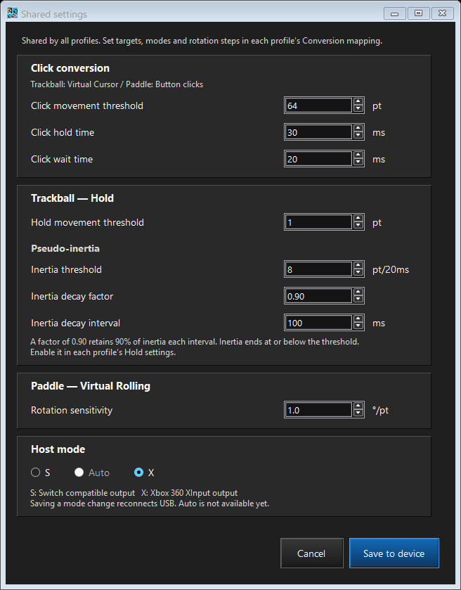
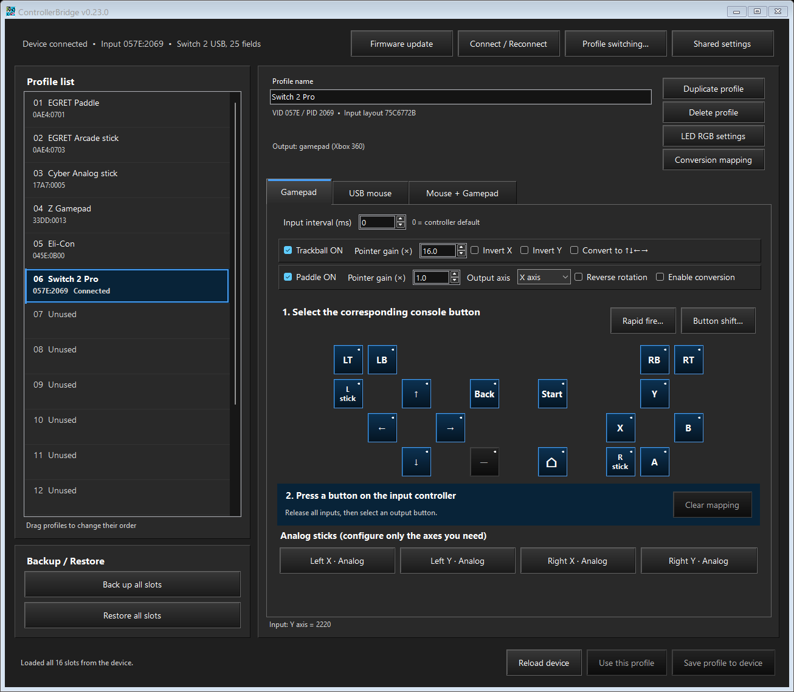

# S/X host output and Switch 2 Pro input

ControllerBridge 0.23.0 introduced a device-wide host selector at the bottom of **Shared settings**. The current version is 0.25.0. Install the matching configurator and firmware. Japanese UI calls this selector **出力モード** and describes X as **X : Xbox360互換**; English labels are unchanged.

| Choice | Behavior |
|---|---|
| **S** | Default. Retains the existing Switch-compatible gamepad output. |
| **Auto** | Tries X first; if acceptance is not observed within five seconds, reconnects as S once. No further mode retries. |
| **X** | Uses the wired Xbox 360 XInput gamepad protocol for Gamepad and Mouse + Gamepad. |

Choose **Save to device**. The configurator verifies the saved value, asks the board to reconnect USB, and reconnects through the configuration interface. All profile mappings and unsaved drafts retain their physical positions. The selected mode persists after restart. USB mouse-only output remains a mouse while retaining the S/Auto/X preference for the gamepad modes.

## Auto selection

S and X remain fixed modes, with S the default. Auto is a bounded connection attempt, not identification of a console model. It initially presents the same X descriptors and input protocol as fixed X. The five-second window starts at the first observed USB host activity (reset, setup or frame traffic). Ordinary descriptor reads, Microsoft OS descriptor reads and SET_CONFIGURATION alone do not confirm X.

After configuration, either a valid XInput capability request (`C1/01`, interface 0, value `0100` or `0000`), a recognized three-byte player-LED/eight-byte rumble packet, or a completed gamepad IN transfer confirms X. Once confirmed, that selection remains X. Otherwise the device disconnects, waits 250 ms, and presents the normal S interface. S is the final choice even if it also fails: there is no S retry, return to X, or alternating loop.

The result survives bus reset, suspend/resume, profile changes and reapplying the same selected mode. A new attempt starts only at firmware startup or when the user changes away from Auto and selects it again. Removing USB-C power normally starts a new session; a bus reset alone does not. Mouse-only output remains a mouse and does not run automatic gamepad selection. A gamepad layout change retains an existing Auto result.

The five-second interval is an implementation policy, not a measured universal host timeout. A host that postpones X-specific traffic and input reads until an application opens the controller may fall back to S; use fixed X in that case. Likewise, these signals prove protocol use, not that a particular game accepts the controller. Fixed S is appropriate when the user wants immediate Switch-compatible presentation without the Auto wait. Switch/POLYMEGA Auto recognition has not been established by a console-side trace.

Shared settings stores **Auto**, separately from the currently active S/X result. The configurator reads that result and displays **Auto (X)** or **Auto (S)**, with the corresponding button names; existing profile bytes are unchanged. The fallback changes only runtime USB state and does not write Flash.

## Button layout

The internal profile IDs retain their established physical positions. In X, the screen shows **Y at the top, X at the left, B at the right and A at the bottom**. Saving a host-mode change does not rewrite any profile bytes.

| Physical position or function | S label | X label/function | XUSB encoding |
|---|---|---|---|
| Bottom face button | B | A | 0x1000 |
| Right face button | A | B | 0x2000 |
| Left face button | Y | X | 0x4000 |
| Top face button | X | Y | 0x8000 |
| Left / right shoulder | L / R | LB / RB | 0x0100 / 0x0200 |
| Left / right trigger | ZL / ZR | LT / RT | Separate bytes, released 0 / pressed 255 |
| Minus / plus | − / + | Back / Start | 0x0020 / 0x0010 |
| Left / right stick click | L / R stick | L / R stick | 0x0040 / 0x0080 |
| HOME | HOME | Guide | 0x0400 |
| Capture | CAPTURE | No Xbox 360 counterpart | No bit sent; primary mapping button disabled |
| D-pad up / down / left / right | Same directions | Same directions | 0x0001 / 0x0002 / 0x0004 / 0x0008 |

Guide is sent using the established Xbox 360 wire bit. Windows' ordinary documented `XInputGetState` button list omits Guide; the operating system and Guide-aware consumers handle it separately. The physical test observed HOME through the system's extended XInput state export. Opening a particular overlay depends on that program and the Windows/Game Bar settings.

## USB and report format

The gamepad interface uses class/subclass/protocol **FF/5D/01**, the published 17-byte Xbox gamepad descriptor, interrupt IN **0x81**, interrupt OUT **0x01**, and 32-byte endpoint reservations. These match the connected 8BitDo Arcade Stick in X mode. EP0 uses 8-byte packets and OUT01 declares 8 ms. With profile Input interval 0, IN81 requests the reference 4 ms period; with values 1–255, it requests that value instead. Actual polling remains host-controlled. The first oversized device-descriptor read at address zero completes after its first 8-byte packet; addressed reads return the complete descriptor. Configuration Feature reports are assembled across eight 8-byte packets.

With profile Input interval 0, input reports retain the 11 ms producer clock independently of host ACK time. A 4 ms polling host consequently observes the measured 8/12 ms spacing. This is the cadence inferred from the reference’s timestamps, not a claim of cycle-exact electrical equivalence. Since 0.24.1, an explicit value 1–255 removes that software wait and arms changes immediately through the existing ordered queue, while requesting that interval in IN81's descriptor. Only the gamepad IN interval changes; the combined mouse retains its own interval. Applying a changed active X interval reconnects USB after profile verification, and retains Auto's current result. See [latency and polling policy](latency-scheduling.md). Each input packet is exactly 20 bytes:

| Offset | Bytes | Value |
|---:|---:|---|
| 0 / 1 | 1 each | Report identifier 0x00 / length 0x14 |
| 2 | 2 | Button bits, little endian |
| 4 / 5 | 1 each | LT / RT |
| 6 / 8 / 10 / 12 | 2 each | Signed LX / LY / RX / RY, little endian |
| 14 | 6 | Zero |

Stick center is 0, with endpoints −32768 and +32767; positive Y is up. The existing mapper produces 8-bit axis positions, which this encoder scales into the signed XInput range. This release retains that conversion resolution. Trigger outputs are digital because the established profile targets ZL/ZR are digital bindings. Bit 0x0800 stays zero.

Since 0.23.1, X output uses VID **045E** with separate PIDs **4005/4006** and a separate HID Feature configuration interface. The configurator also recognizes the earlier CAFE:4005/4006 identities for updates. It advertises the Microsoft OS 1.0 compatible ID **XUSB10** for interface 0, allowing the installed Windows Xbox driver to bind to that function without hiding configuration access. The real test required no driver installation.

| Output layout | Device identity | Interfaces / endpoints |
|---|---|---|
| X gamepad | 045E:4005 | XUSB IF0 IN81/OUT01; reference accessory IF1–3; configuration IF4 IN85 |
| X gamepad + mouse | 045E:4006 | XUSB IF0 IN81/OUT01; reference accessory IF1–3; mouse IF4 IN85; configuration IF5 IN86 |
| Mouse only | CAFE:4004 | Existing mouse layout; host preference retained |

At profile Input interval 0, the first four interface descriptors, including the advertised accessory/security functions, match the reference byte for byte. An explicit nonzero interval changes only gamepad IN81's bInterval in those interfaces. Device revision is **0114**. The measured strings are **8BitDo** (including its terminal UTF-16 NUL), **Controller**, and **157F8F8**. Exact-length string reads succeed. Over-reading manufacturer or serial returns 16 bytes followed by STALL, reproducing the observed reference behavior; string index 4 is unsupported. Device GET_STATUS returns `02 00`, as observed.

The reference’s five accessory endpoints produced transfer errors, rather than useful data. The corresponding endpoints remain inactive in this firmware. Their precise electrical behavior has not been established as identical. GET_INTERFACE on accessory interfaces and GET_STATUS for their endpoints are rejected. No headset audio or Xbox-console authentication is implemented. Rumble and player-LED output packets are acknowledged and the gamepad OUT endpoint is rearmed, but forwarding them to the input controller is not implemented.

### Retained differences and optional PID build

To retain the Windows configurator, the default device class remains **00/00/00**, PIDs remain **4005/4006**, a configuration HID is appended, and the Microsoft **XUSB10** compatible-ID response is retained. The reference uses device class **FF/FF/FF**, PID **028E**, and four interfaces. Configuration length/interface count therefore differ; combined mouse mode also appends a mouse. The mapper still uses the existing 8-bit axis resolution and digital trigger bindings. Nonzero profile Input interval additionally opts into a different gamepad polling/production cadence. These are explicit differences, so this build is not presented as an identical clone of every reference behavior.

The CMake cache settings `CONTROLLER_XINPUT_PID` and `CONTROLLER_XINPUT_COMBINED_PID` allow a dedicated build to change either PID; defaults are `0x4005` and `0x4006`. For example, `-DCONTROLLER_XINPUT_PID=0x028e` selects the reference gamepad PID. This is a last-resort build option, not a change made by the normal configurator. Windows may bind its whole-device retail driver to 028E and hide the configuration HID. The normal release keeps the existing configuration-accessible PIDs. A PID change alone does not remove the other differences above or establish POLYMEGA compatibility.

## Linux xpad selection and initialization

Linux xpad v4.14 and v6.6 select wired Xbox 360 interfaces using **VID 045E + class/subclass/protocol FF/5D/01**. Their Microsoft-vendor entry does not require PID 028E. Both ControllerBridge X layouts match this entry; the configuration HID interface does not. The gamepad interface provides the two interrupt endpoints required by the probe path. The former CAFE VID did not match that entry.

The v6.6 wired startup path issues a 20-byte vendor interface read: `bmRequestType=C1`, `bRequest=01`, `wValue=0100`, `wIndex=0000`. Version 0.23.2 returns the connected reference’s **single zero byte**, rather than the 20-byte capabilities supplied by 0.23.1. The motor-capability request with `wValue=0000`, normally requesting 8 bytes, likewise returns one zero byte. Both short responses were observed on the working reference. Unknown vendor requests remain unsupported.

In upstream xpad v6.6, the USB helper treats the short response as an error and the startup code logs a warning, **but continues successfully**. The local verification preserves this behavior; it does not suppress the warning or replace the measured response with a fabricated longer packet. The older v4.14 startup path does not issue this query. Both versions’ matching and input-decoding logic accept the emitted report format.

POLYMEGA’s exact driver, version and identity restrictions remain unknown, and its operation with this build has not been physically verified. A successful Windows connection or extracted xpad test is not a substitute for that host test. See the dated [verification record](verification.md).

## Wired 8BitDo Arcade Stick input

The connected reference identifies as **045E:028E**, revision **0114**, with wired Xbox 360 reports. The earlier single LED command left this unit flashing and eventually timing out. The host now sends `01 03 02`, `02 08 03`, `01 03 02`, then `01 03 06` on one open interrupt OUT pipe, retaining the USB data toggle across all four packets. The ordinary descriptor enumeration and preceding capability query are unchanged. A failed transfer stops the sequence.

This four-packet startup was validated by reconnecting the controller after the firmware was running. It established input and steady LEDs where the former startup did not. Windows tracing independently showed four successful 3-byte OUT requests, but did not expose their payload bytes; the exact byte sequence comes from a published working implementation and the successful direct test. It is not claimed to have been recovered from that trace. A firmware reboot does not remove USB-A power, so a timed-out controller may need a USB cable reconnect and HOME to re-enter connection standby. For a new controller, use **Add controller** to create its mappings; this firmware does not silently add a profile.

## Switch 2 Pro input

The connected controller identified itself as Nintendo **057E:2069**, revision **0201**. Its protocol differs from the original 057E:2009 Switch Pro protocol. The supported path uses the HID input endpoint on interface 0 and the bulk command/reply endpoints OUT02/IN82 on interface 1. Audio interfaces remain unused.

Initialization follows the ten published SDL commands, retaining open bulk endpoints and USB data toggles throughout the sequence. The controller then sends report **0x05**. The internal schema preserves its raw bit offsets: face buttons at bits 40–43, the remaining button/D-pad fields at their published positions, and four packed 12-bit stick axes at bits 88/100/112/124. The schema exposes 25 fields, including C/GL/GR as optional assignable inputs. A distinct SWP2 fingerprint separates these profiles from original Switch Pro profiles.

For a new controller, choose **Add controller**, assign its physical buttons, and use the normal analog-axis calibration. Unit-specific neutral/range values should be measured from that controller. For the physical trial, the first unused slot was registered as **Switch 2 Pro**, with its axes calibrated from the user's movement. This is a saved configuration on the tested board; firmware does not silently create profiles on other boards.

## Saved data and verification

Host mode adds an independent 16-byte HSM1 record at common-sector offset 228, leaving all preceding settings records intact. Missing/invalid HSM1 defaults to S. Shared settings use UDSA/schema 10 and guard the old host value together with the other editable values before saving. Profile v8 remains 848 bytes; bank v8 remains 13,908 bytes; runtime common settings remain 40 bytes because host mode uses existing padding. Common Flash usage is 244/4,096 bytes.

The original 0.23.0 physical validation covered Windows recognition, configuration access, real buttons/Guide and axes, combined output enumeration and S/X return. The dated 0.23.2 entry records the current reference-matching checks separately. Existing profile registrations and common numeric settings are preserved. See the dated [verification record and current memory budget](verification.md).

## Protocol references and attribution

- [Microsoft XINPUT_GAMEPAD](https://learn.microsoft.com/en-us/windows/win32/api/xinput/ns-xinput-xinput_gamepad): documented digital masks, trigger range and signed stick conventions.
- [GP2040-CE wired XInput descriptors](https://github.com/OpenStickCommunity/GP2040-CE/blob/main/headers/drivers/xinput/XInputDescriptors.h): original gamepad descriptor, 20-byte report and Guide bit.
- [Linux xpad v4.14](https://github.com/torvalds/linux/blob/v4.14/drivers/input/joystick/xpad.c) and [v6.6](https://github.com/torvalds/linux/blob/v6.6/drivers/input/joystick/xpad.c): device matching, endpoint checks, wired startup and report decoding. No GPL implementation code is included in product sources.
- [SDL Xbox 360 driver](https://github.com/libsdl-org/SDL/blob/main/src/joystick/hidapi/SDL_hidapi_xbox360.c): input and motor capability packet layout.
- [Published wired startup sequence](https://github.com/MiSTle-Dev/C64Nano/discussions/150): the four OUT packets validated on the connected Arcade Stick.
- [TinyUSB device enumeration](https://github.com/hathach/tinyusb/blob/master/src/device/usbd.c): initial descriptor discovery with an 8-byte EP0 before SET_ADDRESS.
- [Microsoft XINPUT_CAPABILITIES](https://learn.microsoft.com/en-us/windows/win32/api/xinput/ns-xinput-xinput_capabilities): capability masks and significant-bit resolution.
- [Microsoft OS 1.0 descriptors](https://learn.microsoft.com/en-us/windows-hardware/drivers/usbcon/microsoft-defined-usb-descriptors): compatible-ID mechanism. The actual installed Windows `xusb22.inf` matches MS_COMP_XUSB10.
- [espp USB XInput function](https://github.com/esp-cpp/espp/blob/main/components/usb_device/src/usb_device.cpp): existing composite XUSB10 implementation reference.
- [SDL Switch 2 driver, pinned revision f3be7b901e5c5ed5b4860bd89c99fc386be28b9d](https://github.com/libsdl-org/SDL/blob/f3be7b901e5c5ed5b4860bd89c99fc386be28b9d/src/joystick/hidapi/SDL_hidapi_switch2.c): Switch 2 initialization and input layout. The command sequence was adapted, with the [SDL zlib license](../licenses/SDL-zlib.txt) retained; the local host implementation is marked as altered.
